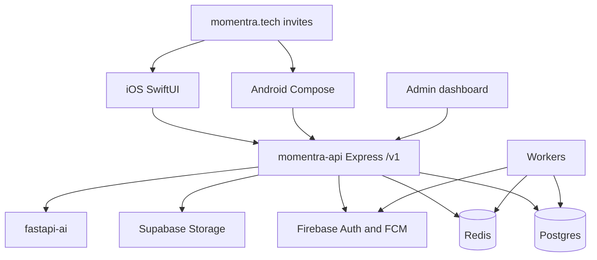
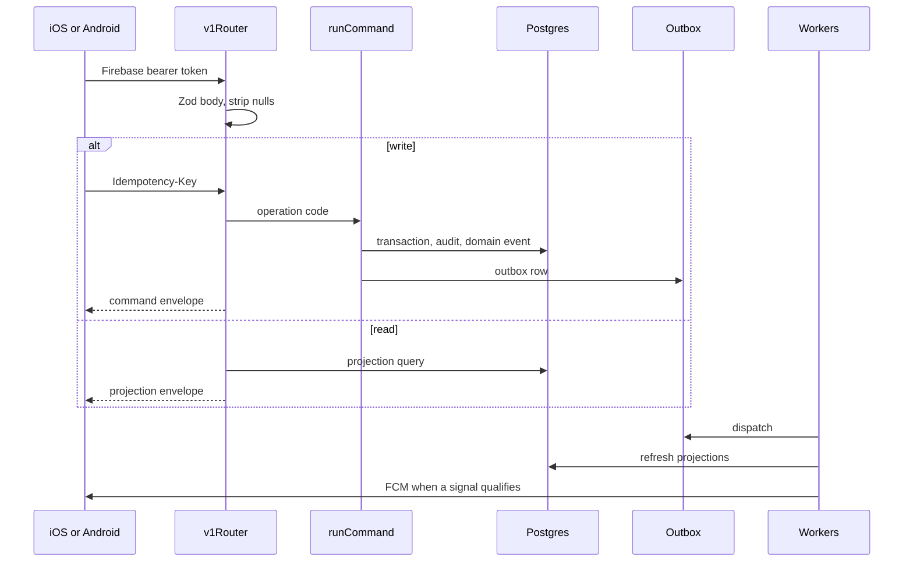

# Momentra architecture

Momentra is a three-context life and work product. A person uses one account across **Personal**, **Group**, and **Business**. Each context is a set of **moments**. Every moment is read through the same four surfaces: **Pulse**, **Moments**, **Life**, and **Memory**.

The phone apps are native. The server is one TypeScript API over Postgres. Writes are commands. Reads are projections. Stories are composed from the same posted facts.

Deeper business rules live in [BUSINESS_BACKEND.md](./BUSINESS_BACKEND.md). The surface contract lives in [MOMENTRA_SURFACE_DOCTRINE.md](../implementation/MOMENTRA_SURFACE_DOCTRINE.md).

## System map

| Piece | Where it lives | Role |
|---|---|---|
| iOS app | `momentra/` | SwiftUI shell, Firebase sign-in, `APIClient` |
| Android app | `apk/` | Compose shell, same API |
| API | `backend/typescript/` | Live HTTP, commands, projections |
| Migrations | `frds/migrations/` | Postgres schema, ordered `V001` upward |
| Invite site | `web/invite/` | `https://momentra.tech/j/{code}` and `/c/{code}` on Vercel |
| Admin | `admin-dashboard/` | Telemetry and lean KPIs, `X-Admin-Key` |
| Compose | `docker-compose.yml` | API, workers, Redis, FastAPI on the VPS |

Public API host is `https://api.momentra.tech`. The invite site stays on Vercel. The API is the Dokploy Compose service `momentra-api`, container port 3000.

## The product model

A **user** is a Firebase identity mapped to `core.user`. `GET /v1/me` is the bootstrap: profile, devices, consents, and the moments the person can open.

A **moment** is `core.moment`. It has a domain and a type.

| Domain | Meaning | Context row |
|---|---|---|
| `PERSONAL` | One person's life systems | `personal.personal_moment_context` |
| `GROUP` | People sharing an experience or a ledger | `collaboration` participants |
| `BUSINESS` | A company operating surface, or a creator-owned moment before a company exists | `business.business_moment_context` |

Personal families, derived from the moment type:

| Family | Label |
|---|---|
| `LIFE_OPERATIONS` | Everyday |
| `FUTURE_BUILDING` | Future |
| `LIFESTYLE` | Lifestyle |
| `RELATIONSHIPS` | People |

Group moments cover shared experiences, house parties, trips, weddings, shared purchases, and shared living. Group money is a ledger. Pulse reads finance positions and coordination counters from that ledger.

Business has two generations on the same context table. Legacy families (`TEAM_OPERATIONS`, `BUSINESS_RUNWAY`, `BUSINESS_OPERATIONS`) still load. The current create path is the operating catalog:

| Family | Subtypes |
|---|---|
| `MARKETING_CAMPAIGNS` | Client campaign, own-business campaign |
| `TRADING_DISTRIBUTION` | Trading / wholesale, distribution / dealership |
| `RETAIL_CONSUMER` | Retail store, restaurant / food, consumer service |
| `MANUFACTURING_PRODUCTION` | Standard production, made-to-order |

A **company** (`business.company`) is the business tenant. Company membership (`OWNER`, `ADMIN`, `MEMBER`, `CONTRACTOR`, `OBSERVER`) is separate from the operating role on a setup (`OWNER_ADMIN`, `OPERATIONS_LEAD`, `FINANCE`, `APPROVER`, `CONTRIBUTOR`, `TEAM_MEMBER`, `OBSERVER`). Operating roles decide who can post, approve, and see money.

## Four surfaces

The shell tabs ask different questions of the same moment. They are separate projections, assembled from current events, patterns, and curated history.

| Surface | Question | Time |
|---|---|---|
| Pulse | What needs attention now? | Now |
| Moments | What am I managing? | Active |
| Life | What pattern is emerging? | Medium and long |
| Memory | What is worth remembering? | History |

Personal Pulse blends family health. Group Pulse reads the ledger. Business Pulse reads the operating projection: budget, target, attention, and finance the role is allowed to see. A missing fact stays unrecorded. The UI shows coverage instead of a fake zero.

Quick Add is the write path into a moment. The server catalog decides which event codes a subtype may post. Clients send the draft. The server validates it.

## Request path

`backend/typescript/src/app.ts` mounts `v1Router` from `api/v1/router.ts`. `router-product.ts` is not mounted.

Authenticated routes use Firebase. Writes that change money or membership require an idempotency key. `runCommand` stores the key, runs the transaction, writes audit and a domain event, and enqueues the outbox. A repeated key returns the first result.

Responses are envelopes: `commandEnvelope` for writes, `projectionEnvelope` for reads, with the request correlation id. Postgres sessions for a signed-in user run through `withUserConnection` so row security sees that user.

Optimistic concurrency uses `expectedVersion` where the client sends it. A mismatch is 409.

## Data

Postgres is the system of record. Schemas:

| Schema | Holds |
|---|---|
| `core` | Users, moments, moment types |
| `personal` | Personal context and life-system setup |
| `collaboration` | Group participants, invites, group commands |
| `business` | Companies, setups, `operating_event`, khata |
| `finance` | Expenses, income, contributions, invoices, accounts |
| `memory` | Curated memory and attachments |
| `projection` | Read models for Pulse, Moments, Life, Memory |
| `events` | Domain events and the outbox |
| `governance` | Capability checks per moment type |
| `work` | Work items |
| `media` | Media metadata; bytes live in Supabase Storage |
| `analytics`, `analytics_raw`, `analytics_core`, `analytics_mart` | Product telemetry and lean KPIs |
| `ai` | Action proposals |
| `audit`, `platform`, `security`, `shared` | Audit, platform tables, RLS, shared poll kernel |

Business operating facts are rows in `business.operating_event`. One ledger serves marketing, trading, retail, and manufacturing. Family modules validate the write. The catalog projects Pulse, boards, finance, and target coverage from those rows. Story composers read the same rows and never invent a missing quantity, sale, or tax amount.

Personal and group money stay in `finance`. Group settlements and contributions are ledger movements. Business company finance (khata, invoices) requires a company-bound moment.

Redis holds rate limits, idempotency support, and worker coordination. The API fails open on rate limit when Redis is down.

## Story

Moment Story is a read model with a profile per family.

| Profile | Moments |
|---|---|
| `MARKETING_CAMPAIGN` | Both campaign subtypes |
| `RETAIL_FOOD_CONSUMER` | Retail, food, consumer service |
| `MANUFACTURING_MADE_TO_ORDER` | Standard production and made-to-order |
| Group profiles | Shared experience, house party, trip, wedding, shared purchase, shared living |

`snapshot.ts` loads events. A pure composer (`marketing-story.ts`, `retail-story.ts`, `manufacturing-story.ts`) returns eight chapter ids. `render.ts` turns chapters into pages. iOS `MomentStoryViewerView` and Android `MomentStoryViewerScreen` branch on `mc-`, `rf-`, and `mf-`. Memory on the active screen sets `previewStoryId` to open that viewer.

## Workers and side effects

Compose runs these beside the API:

| Process | Job |
|---|---|
| `outbox-dispatcher` | Deliver domain events |
| `projection-worker` | Rebuild projection rows |
| `notification-worker` | Decide and send FCM |
| `scheduler` | Recurring schedules and reminders |
| `memory-worker` | Memory upkeep |
| `analytics-worker` | Lean analytics rollups |
| `fastapi-ai` | Internal AI calls, keyed by `MOMENTRA_AI_INTERNAL_KEY` |

Notification policy lives in `platform/notifications`: signal evaluators per domain, recipient preferences, lock-screen copy, and a decision audit. A signal that does not qualify does not send.

Media uploads go through the API to the `momentra-media` bucket. Attachment rows point at stored objects for expenses, contributions, and memory.

## Clients

iOS and Android share the shell: auth, context switch, then the active moment's four tabs plus Quick Add. Each business subtype has its own active view and hub. The hubs post into one capture sheet. The sheet builds an `OperatingCaptureDraft`. The API client strips nulls before POST and PATCH so optional Zod fields stay absent.

Setup screens collect the moment before activation. Personal setup chooses a life system. Business setup chooses a family and subtype, then budget, target, channels, and people as that family's catalog requires. Activation writes `business.business_system_setup` or the personal life-system setup and creates the moment.

Invite links open the app through universal links and app links. Group codes use `/j/{code}`. Company codes use `/c/{code}`.

## Admin and analytics

`/admin/api/*` is a separate router with `X-Admin-Key`. The Vite dashboard on port 5180 is for operators. It shows lean KPIs from `analytics_mart`, client telemetry, setup reports, and shared-experience lists. It is separate from the mobile session.

Client telemetry posts through `/v1/telemetry` before the user middleware attaches, then the rest of `/v1` requires a bearer token.

## Deploy

Dokploy on the Hostinger VPS runs `docker-compose.yml` from `main`. Secrets are environment variables on the Compose app, including `DATABASE_URL`, Firebase service account JSON, Supabase keys, `ADMIN_API_KEY`, and `SCHEMA_RELEASE`.

`GET /health/live` and `GET /health/ready` are the probes. The domain must target container port 3000. Host port 3001 is only a debug publish, because host port 3000 is the Dokploy UI.

Schema changes ship as SQL in `frds/migrations/` and are applied in version order. Application code assumes the release named by `SCHEMA_RELEASE`.
