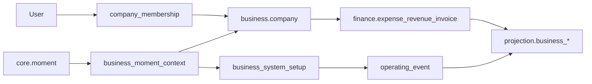
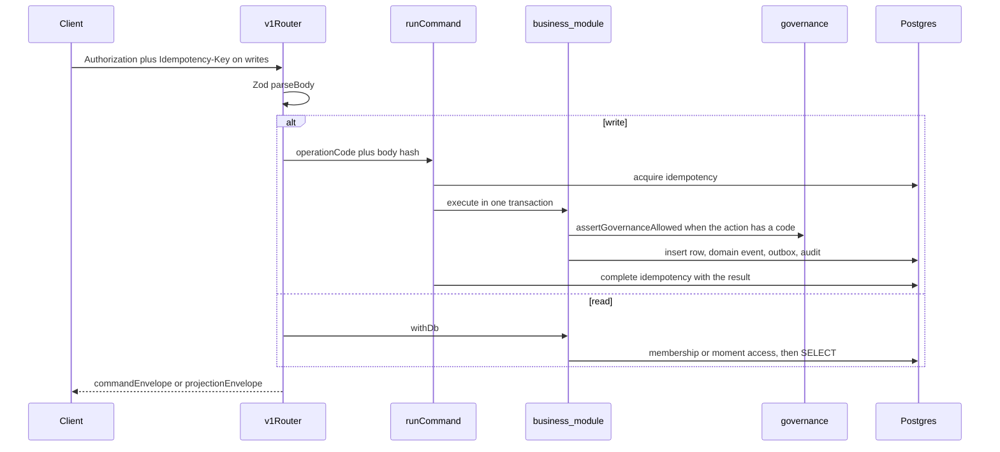

# Business backend architecture

Current-state map of how the Business domain works on the server. Screen-by-screen status lives in [BUSINESS_CURRENT_IMPLEMENTATION_AUDIT.md](../implementation/BUSINESS_CURRENT_IMPLEMENTATION_AUDIT.md). This file explains the model, the request path, and where logic sits.

Live HTTP surface: [`backend/typescript/src/api/v1/router.ts`](../../backend/typescript/src/api/v1/router.ts), mounted from [`backend/typescript/src/app.ts`](../../backend/typescript/src/app.ts). [`router-product.ts`](../../backend/typescript/src/api/v1/router-product.ts) is not mounted. Do not treat it as a second API.

## What a business is

A **company** is the tenant. It owns members, locations, teams, vendors, contracts, SLA definitions, and khata parties. Creating a company inserts `business.company` and an `OWNER` row in `business.company_membership`.

A **business moment** is a `core.moment` with `domain_code = 'BUSINESS'`, plus one `business.business_moment_context` row (family, optional company, optional team) and, when activated through setup, an `ACTIVE` `business.business_system_setup` row (preferences JSON).

`company_id` on the moment context, the setup, and `business.operating_event` is nullable ([V095](../../frds/migrations/business/V095__business_moment_without_company.sql)). A moment with no company is reachable by its creator or an active `collaboration.moment_participant`. Finance, khata, and company records refuse that case: `requireCompanyBoundMoment` in [`membership.ts`](../../backend/typescript/src/modules/business/membership.ts) returns 409, "This record stays with a company."

## Two moment generations

Both generations share `business.business_moment_context.business_family`. The check constraint is in [V094](../../frds/migrations/business/V094__operating_moments.sql).

| Generation | Family codes | Role |
|---|---|---|
| Legacy, still loadable | `TEAM_OPERATIONS`, `BUSINESS_RUNWAY`, `BUSINESS_OPERATIONS` | Older Money / Daily Business / Team surfaces. Family contexts: `team_operations_context`, `business_runway_context`, `business_operations_context`. |
| Also still valid on the context row | `EVENTS_OPERATIONS`, `VENDOR_OPERATIONS` | Allowed by the family check. Not in the operating catalog. |
| Operating, current create path | `MARKETING_CAMPAIGNS`, `TRADING_DISTRIBUTION`, `RETAIL_CONSUMER`, `MANUFACTURING_PRODUCTION` | Defined in [`operating-catalog.ts`](../../backend/typescript/src/modules/business/operating-catalog.ts). |

Operating subtypes, stored as `core.moment_type` and as `preferences.subtype`:

| Family | Subtypes |
|---|---|
| Marketing & Campaigns | `CLIENT_CAMPAIGN`, `OWN_BUSINESS_CAMPAIGN` |
| Trading & Distribution | `TRADING_WHOLESALE`, `DISTRIBUTION_DEALERSHIP` |
| Retail & Consumer | `RETAIL_STORE`, `RESTAURANT_FOOD`, `CONSUMER_SERVICE` |
| Manufacturing & Production | `STANDARD_PRODUCTION`, `MADE_TO_ORDER` |

The catalog, not the client, decides which Quick Add codes a subtype may post, which target metrics exist, and whether a channel is required. Marketing campaigns use ten Quick Adds: `ACTIVITY`, `PROGRESS`, `SPEND`, `PAYMENT`, `REVISION`, `APPROVAL`, `UPDATE`, `ISSUE`, and `RESULT` for both subtypes, plus `INVOICE` and `COLLECTION` for `CLIENT_CAMPAIGN` only. A client `SALE` write is stored as `INVOICE`. Own-business campaigns never book attributed sales as revenue. Campaign channels are optional. Start date, end date, objective metric, unit, budget, and target are required. Progress is incremental (sum) or cumulative (latest snapshot per series) and is not mixed across units. Payload fields on `operating_event.payload` include `reportingMode`, `metricCode`, `budgetCategory`, `paymentState`, `activityStatus`, `attributedSales`, `revisionKind`, and `effectiveAt`. Attention cards follow the v3 rule numbers: `ATT-01` overdue activity, `ATT-02` activity due within three days, `ATT-03` spend or payment awaiting approval, `ATT-04` overdue payable, `ATT-05` overdue client collection, `ATT-06` over budget, `ATT-07` budget at least 90 percent used, `ATT-08` campaign behind a comparable target, `ATT-09` a due activity with no owner. Channel names and budget categories come from the v3 lists. Marketing Moment Story uses profile `MARKETING_CAMPAIGN` and eight chapters built from the same operating ledger. Incurred spend and cash paid stay separate. Attributed sales are not booked revenue.

Retail Store, Restaurant & Food, and Consumer Services share the same ledger. Each subtype posts ten Quick Adds: sale or finalized charge, purchase, collection, payment, spend, stock, order or booking, a status revision of that source, a budget or target revision, and an issue, approval, or update. A channel is required. Budget and target stay optional, and an empty target is not shown as zero percent. Orders, bookings, and completed work are commitments until a sale or a finalized service charge is posted. A collection is not a second sale and a payment is not a second expense. Stock moves on an explicit stock event or a received purchase, not on a quick amount and not on an itemized sale. Credits reduce net revenue and do not restock unless a separate stock event says so. Undated balances stay open and are never overdue. Retail Moment Story uses profile `RETAIL_FOOD_CONSUMER` and the same eight-page order for all three subtypes: Business Moment, In Motion, Revenue, Money, Operations, People, Attention, Story So Far. Missing facts stay “not recorded”.

Standard Production and Made-to-Order share that ledger and the same ten Quick Adds: customer order, purchase, production, sale, delivery, collection, payment, spend, stock, and one update, issue, approval, budget, or target sheet. Budget and target are required. Channels stay optional. A customer order is not revenue, cash, stock, or a receivable. A purchase counts once toward budget and payables, and stock increases only on an explicit receipt. Quick production is recorded output and does not create a finished SKU. Finished stock increases only when an accepted quantity and a product are both explicit. A sale is not a delivery. A status-only delivery changes status and does not post a quantity. Target progress uses one basis: recognized sales, accepted units, delivered units, or order intake. Unlike units are not added, and a missing fact is coverage rather than zero. Manufacturing Moment Story uses profile `MANUFACTURING_MADE_TO_ORDER` for both subtypes and eight pages: The Manufacturing Moment, The Period in Motion, The Production and Order Story, The Money Story, The Materials and Fulfilment Story, People Behind Production, What Still Needs Attention, The Story So Far.

`BUSINESS_SETUP_DEMO_AMOUNTS` in [`setup-service.ts`](../../backend/typescript/src/modules/business/setup-service.ts) is seed and QA copy only. It is not merged into activate or create.

Company membership types (`OWNER`, `ADMIN`, `MEMBER`, `CONTRACTOR`, `OBSERVER`) are separate from operating roles (`OWNER_ADMIN`, `OPERATIONS_LEAD`, `FINANCE`, `APPROVER`, `CONTRIBUTOR`, `TEAM_MEMBER`, `OBSERVER`). Operating roles live on setup participants and gate Quick Add inside `canSubmit`, `canApprove`, `financeVisibleFor`, and `needsMakerChecker`.

## Request path

`runCommand` ([`run-command.ts`](../../backend/typescript/src/platform/transaction/run-command.ts)) hashes the body, replays a completed idempotency row, and otherwise runs the handler inside one transaction. A failed command marks the key failed and rethrows the original error.

Writes that change business state also call `insertDomainEventAndOutbox` and `insertAudit`. Projection refresh, when the writer calls it, happens in that same transaction via `refreshBusinessProjectionsAfterWrite`.

## Access

`assertCompanyMomentAccess` loads the context only when all of the following hold:

- `core.moment.domain_code = 'BUSINESS'`
- context status is `ACTIVE`
- the caller is an active company member of `company_id`, or the moment has no company and the caller is the creator or an active participant

Company routes use `assertActiveCompanyMember`, which also requires governance action `COMPANY_ACCESS`.

Observers are not one switch.

- `assertNotCompanyObserver` blocks company observers from posting expenses, revenue, and invoices.
- `OBSERVER_DENIED_ACTIONS` in [`resolver.ts`](../../backend/typescript/src/modules/governance/resolver.ts) blocks a fixed set (`EXPENSE_CREATE`, `MEMORY_CREATE`, `POLL_CREATE`, and several group codes). It does not include `COMPANY_UPDATE`, `LOCATION_CREATE`, `ISSUE_CREATE`, `VENDOR_MANAGE`, `SLA_MANAGE`, `REVIEW_CREATE`, `DECISION_RECORD`, `MEETING_CREATE`, `RECOGNITION_CREATE`, or `MILESTONE_CREATE`.
- `POST /v1/moments/:momentId/business-updates` does not call governance. It only checks moment access and that the moment is company-bound (`createBusinessUpdate`).

Finance approval uses `assertCanApproveCompanyFinance`: active membership plus `COMPANY_UPDATE`.

Row-level security on `business.*` lets an active company member select, and lets the backend app role write. Policies are in [V027](../../frds/migrations/business/V027__rls_business.sql), with a later policy on `operating_event` in V094. The API still checks membership in SQL. RLS is not a substitute for those checks.

## Modules

All under [`backend/typescript/src/modules/business`](../../backend/typescript/src/modules/business) unless noted.

| File | Responsibility |
|---|---|
| `service.ts` | Company, location, and team create, read, and update. Company create emits `CompanyCreated`. Status changes on company patch are owner-only. |
| `membership.ts` | Moment access, company membership, add member, leave (owner or admin must name a successor), transfer ownership. |
| `company-invite-service.ts` | Mint, preview, and redeem `business.company_invite`. Routes: `POST/GET /v1/company/invites` and `POST /v1/company/invites/:code/redeem`. |
| `setup-service.ts` | In-memory catalog from `OPERATING_FAMILIES`. `GET /v1/business/setups` lists catalog plus the caller's setups. `POST /v1/business/setups/:familyCode/activate` creates the moment through `createMoment`. Both apps create moments with `POST /v1/moments` and `domainCode=BUSINESS`; activate is the server path, not the client path. |
| `operating-catalog.ts` | Families, subtypes, Quick Add definitions, role rules, preference normalization, and `projectOperatingMoment` (pure projection from prefs plus event rows). |
| `operating-service.ts` | `GET .../operating`, `POST .../operating-events`, `POST .../operating-events/:eventId/decision`. Refuses Quick Add unless the family is one of the four operating codes and an active setup exists. |
| `khata.ts` | Parties are `business.vendor` rows with a party kind. Entries are `business.khata_entry`, posted on a moment. The party company must match the moment company. |
| `operations-precision.ts` | Vendor patch, vendor contract, SLA definition and check, issue, risk, improvement, business update, approval request, and ops pulse extras (SLA compliance, monthly spend). |
| `business-closure-writers.ts` | Tax obligation, forecast scenario, investor update, budget alert, budget review, decision, meeting record, recognition, retrospective, activity log entry. |
| `business-closure-reads.ts` | Capacity, workload, month-over-month deltas, progress snapshot, roster, weekly report, issue evidence, share link. Capacity is a heuristic: open issues over members times five. Workload buckets are issue severities, not departments. |
| `business-reads.ts` | Lists: expenses, revenues, invoices, vendors, issues, improvements, updates, pending approvals, memories, and the moments timeline (`GET .../moments`). |
| `business-projection.ts` | Writers for `projection.business_pulse`, `business_life`, `business_memory`, `business_moments`, and pulse history. Health, team, and ops scores are computed here from setup prefs and finance totals. No demo KPI is inserted. |
| `business-life-enrichment.ts` | Company Life scores, typed signals, and trend series for the three legacy families (`BUSINESS_RUNWAY`, `BUSINESS_OPERATIONS`, `TEAM_OPERATIONS`). |
| `business-memory-commands.ts` | `POST /v1/business/moments/:momentId/memories` writes `memory.memory` and refreshes the business memory projection. |
| [`finance/business-finance.ts`](../../backend/typescript/src/modules/finance/business-finance.ts) | Expense, revenue, invoice create, vendor create, and approval decide. Expenses land in `finance.expense` plus `finance.business_expense_context` and may open `governance.approval_*`. |
| [`projection/service.ts`](../../backend/typescript/src/modules/projection/service.ts) | Facet reads: `getBusinessMomentProjection`, `getBusinessPulseOrFinance`, `getBusinessMomentActivity`. |
| [`notifications/signals/evaluate-business.ts`](../../backend/typescript/src/platform/notifications/signals/evaluate-business.ts) | Derived notification signals from existing governance and finance projections. It does not recalculate those numbers. |

## API

Mounted at `/v1` and, for clients that prefix it, `/api/v1`. Every route below sits behind `authMiddleware`. Paths are the router paths. Writes marked **yes** require an `Idempotency-Key` header and go through `runCommand`. Reads do not. Successful writes return `commandEnvelope` with status 201. Reads return `projectionEnvelope`.

`POST /v1/moments` with `domainCode=BUSINESS` is the create path both apps use. It writes `core.moment` and `business.business_moment_context`. When `companyId` is sent, the caller must already be an active member of that company.

### Company

| Method | Path | Idempotency | Handler |
|---|---|---|---|
| GET | `/v1/companies` | no | `listCompanies` |
| POST | `/v1/companies` | yes | `createCompany` |
| GET | `/v1/companies/:companyId` | no | `getCompany` |
| PATCH | `/v1/companies/:companyId` | yes | `updateCompany`. Status change is owner-only. |
| GET | `/v1/companies/:companyId/locations` | no | `listLocations` |
| POST | `/v1/companies/:companyId/locations` | yes | `createLocation` |
| PATCH | `/v1/companies/:companyId/locations/:locationId` | yes | `updateLocation` |
| GET | `/v1/companies/:companyId/teams` | no | `listTeams` |
| POST | `/v1/companies/:companyId/teams` | yes | `createTeam` |
| GET | `/v1/companies/:companyId/members` | no | `listCompanyMembers` |
| POST | `/v1/companies/:companyId/members` | yes | `addCompanyMember` |
| POST | `/v1/companies/:companyId/leave` | yes | `leaveCompany` |
| POST | `/v1/companies/:companyId/transfer-ownership` | yes | `transferCompanyOwnership` |
| POST | `/v1/company/invites` | yes | `mintCompanyInvite` |
| GET | `/v1/company/invites/:code` | no | `getCompanyInviteByCode` |
| POST | `/v1/company/invites/:code/redeem` | yes | `redeemCompanyInvite` |

### Vendors, SLA, khata

| Method | Path | Idempotency | Handler |
|---|---|---|---|
| GET | `/v1/companies/:companyId/vendors` | no | `listCompanyVendors` |
| POST | `/v1/companies/:companyId/vendors` | yes | `createVendor` |
| PATCH | `/v1/companies/:companyId/vendors/:vendorId` | yes | `updateVendor` |
| POST | `/v1/companies/:companyId/vendors/:vendorId/contracts` | yes | `createVendorContract`. No list route. |
| POST | `/v1/companies/:companyId/vendors/:vendorId/sla-definitions` | yes | `createSlaDefinition`. No list route. |
| POST | `/v1/companies/:companyId/sla-definitions/:slaDefinitionId/checks` | yes | `recordSlaCheck` |
| GET | `/v1/companies/:companyId/khata/parties` | no | `listKhataParties` |
| POST | `/v1/companies/:companyId/khata/parties` | yes | `createKhataParty` |
| GET | `/v1/companies/:companyId/khata/parties/:partyId/entries` | no | `listKhataPartyEntries` |
| POST | `/v1/moments/:momentId/khata/entries` | yes | `createKhataEntry` |

### Setup and moment inventory

| Method | Path | Idempotency | Handler |
|---|---|---|---|
| GET | `/v1/business/setups` | no | `getSetupCatalog` plus `listUserSetups` |
| POST | `/v1/business/setups/:familyCode/activate` | yes | `activateBusinessSetup` |
| GET | `/v1/business/moments` | no | `listBusinessMoments`. Drafts only for the creator. |
| POST | `/v1/business/moments/:momentId/company` | yes | Attach a company to a moment that does not have one. |
| POST | `/v1/business/moments/:momentId/duplicate` | yes | Duplicate the business moment. |
| POST | `/v1/moments` | yes | `createMoment` when `domainCode` is `BUSINESS`. |

Shared moment lifecycle routes also apply once the moment exists: `GET /v1/moments/:momentId`, `GET /v1/moments/:momentId/setup`, `PATCH /v1/moments/:momentId`, and `POST` activate, discard-draft, archive, completion-review, complete, reopen, cancel, and delete. Those handlers are the moment module, not the business module.

### Operating Quick Add

| Method | Path | Idempotency | Handler |
|---|---|---|---|
| GET | `/v1/business/moments/:momentId/operating` | no | `getOperatingProjection` |
| POST | `/v1/business/moments/:momentId/operating-events` | yes | `recordOperatingEvent` |
| POST | `/v1/business/moments/:momentId/operating-events/:eventId/decision` | yes | `decideOperatingEvent` |

`recordOperatingEvent` body: `eventType`, `title`, optional `note`, `amount` (decimal string, up to four places), `counterpartyName`, `channelName`, `paymentStatus` (`NONE`, `PENDING`, `READY`, `PAID`, `COLLECTED`), `occurredAt`, and for marketing campaigns optional `reportingMode` (`INCREMENTAL` or `CUMULATIVE`), `metricCode`, `budgetCategory`, `paymentState` (`PAID`, `PART_PAID`, `PAY_LATER`), `activityStatus` (`OPEN` or `DONE`), `attributedSales`, `revisionKind` (`BUDGET`, `TARGET`, or `CATEGORY`), and `effectiveAt`. Decision body: `decision` (`APPROVED` or `REJECTED`) and optional `reason`. Marketing stories are generated with `POST /v1/moments/:momentId/stories` and read with the existing story routes. A marketing moment is authorized by company membership instead of group access.

### Facets and lists

| Method | Path | Handler |
|---|---|---|
| GET | `/v1/business/moments/:momentId/pulse` | `getBusinessMomentProjection` facet `pulse` |
| GET | `/v1/business/moments/:momentId/finance` | facet `finance` |
| GET | `/v1/business/moments/:momentId/life` | facet `life` |
| GET | `/v1/business/moments/:momentId/memory` | facet `memory` |
| GET | `/v1/business/moments/:momentId/actions` | facet `actions` |
| GET | `/v1/business/moments/:momentId/activity` | `getBusinessMomentActivity`. Query: `cursor`, `limit` (default 20, max 50). |
| GET | `/v1/business/moments/:momentId/moments` | `listBusinessMomentTimeline`. Query: `limit` (default 50). |
| GET | `/v1/business/moments/:momentId/expenses` | `listBusinessExpenses` |
| GET | `/v1/business/moments/:momentId/revenues` | `listBusinessRevenues` |
| GET | `/v1/business/moments/:momentId/invoices` | `listBusinessInvoices` |
| GET | `/v1/business/moments/:momentId/issues` | `listBusinessIssues` |
| GET | `/v1/business/moments/:momentId/improvements` | `listBusinessImprovements` |
| GET | `/v1/business/moments/:momentId/updates` | `listBusinessUpdates` |
| GET | `/v1/business/moments/:momentId/approvals` | `listPendingApprovals` |
| GET | `/v1/business/moments/:momentId/memories` | `listBusinessMemories` |
| GET | `/v1/business/moments/:momentId/capacity` | `getCapacity` |
| GET | `/v1/business/moments/:momentId/workload` | `getWorkload` |
| GET | `/v1/business/moments/:momentId/mom-deltas` | `getMomDeltas` |
| GET | `/v1/business/moments/:momentId/progress-snapshot` | `getProgressSnapshot` |
| GET | `/v1/business/moments/:momentId/roster` | `getRoster` |
| GET | `/v1/business/moments/:momentId/weekly-report` | `getWeeklyReport` |

### Money, memory, and closure writes

| Method | Path | Idempotency | Handler |
|---|---|---|---|
| POST | `/v1/moments/:momentId/business-expenses` | yes | `createBusinessExpense` |
| POST | `/v1/moments/:momentId/revenues` | yes | `createBusinessRevenue` |
| POST | `/v1/moments/:momentId/invoices` | yes | `createBusinessInvoice` |
| POST | `/v1/moments/:momentId/approval-requests` | yes | `createApprovalRequest` |
| POST | `/v1/approvals/:approvalRequestId/decide` | yes | `decideBusinessApproval` |
| POST | `/v1/business/moments/:momentId/memories` | yes | `createBusinessMemory` |
| POST | `/v1/business/moments/:momentId/share-link` | yes | `createShareLink` |
| POST | `/v1/moments/:momentId/issues` | yes | `createIssue` |
| POST | `/v1/moments/:momentId/issues/:issueId/evidence` | yes | `addIssueEvidence` |
| POST | `/v1/moments/:momentId/risks` | yes | `createRisk` |
| POST | `/v1/moments/:momentId/improvements` | yes | `createImprovement` |
| POST | `/v1/moments/:momentId/business-updates` | yes | `createBusinessUpdate`. No governance action check. |
| POST | `/v1/moments/:momentId/tax-obligations` | yes | `createTaxObligation` |
| POST | `/v1/moments/:momentId/forecast-scenarios` | yes | `createForecastScenario` |
| POST | `/v1/moments/:momentId/investor-updates` | yes | `createInvestorUpdate` |
| POST | `/v1/moments/:momentId/budget-alerts` | yes | `createBudgetAlert` |
| POST | `/v1/moments/:momentId/business-reviews` | yes | `createBudgetReview` |
| POST | `/v1/moments/:momentId/decisions` | yes | `createDecision` |
| POST | `/v1/moments/:momentId/meeting-records` | yes | `createMeetingRecord` |
| POST | `/v1/moments/:momentId/recognitions` | yes | `createRecognition` |
| POST | `/v1/moments/:momentId/retrospectives` | yes | `createRetrospective` |
| POST | `/v1/moments/:momentId/activity-log-entries` | yes | `createActivityLogEntry` |
| POST | `/v1/moments/:momentId/milestones` | yes | `workService.createMilestone` |
| POST | `/v1/moments/:momentId/polls` | yes | `createPoll` |

`GET /v1/group/moments/:momentId/polls` lists polls, but it authorizes a group member. A company member who is not a group member is denied.

### Operating Quick Add

`recordOperatingEvent`:

1. `assertCompanyMomentAccess`. Family must be an operating family. Active setup must exist.
2. `eventType` must be a catalog Quick Add on that subtype.
3. `viewerRole` plus `canSubmit`. Observers cannot submit. Team members cannot submit budget-consuming or payment actions. Finance-only actions need a finance-visible role or operations lead.
4. Insert `business.operating_event`. Amounts are decimal strings with up to four places. Currency comes from setup preferences.
5. If `needsMakerChecker` (budget, target, payment, collection, and some contributor money actions, unless the role auto-posts), `approval_status` is `PENDING`. Owner/admin, finance, and operations lead auto-post those codes.
6. Emit `OperatingEventRecorded`, audit, and return a fresh `projectOperatingMoment`.

`decideOperatingEvent` sets `APPROVED` or `REJECTED`. The decider must `canApprove` (owner/admin, finance, or approver) and must not be the submitter.

The operating projection is computed in process from preferences and event rows. It is not a `projection.business_*` table.

## Reads

Facet GETs on `/v1/business/moments/:momentId/{pulse,life,memory,finance,actions}` go through `getBusinessMomentProjection`.

| Facet | Source | Notes |
|---|---|---|
| `pulse` | `projection.business_pulse` joined on **company_id**, plus finance snapshot and the latest five moment activities | One pulse row per company. Membership is required in the SQL join. |
| `finance` | `projection.business_finance_snapshot` for that company | Same query as pulse. Empty when no snapshot exists. |
| `life` | `projection.business_life` for the company, plus issues, activity, and setup | Company-scoped payload. Life enrichment adds module scores for the three legacy families. |
| `memory` | `projection.business_memory`, with a fallback read of `memory.memory` | Items belong to the moment that last refreshed the row. |
| `actions` | `getAvailableActions` | Every returned action is forced to `enabled: true`. This facet is not a permission decision. |
| `activity` | `projection.recent_activity` where `scope_type = MOMENT`, `domain_code = BUSINESS`, and the context company matches | Cursor is `occurredAt\|recentActivityId`. Not limited to the caller. |
| `operating` | In-memory `projectOperatingMoment` | Separate route, not one of the five facets. |
| `moments` | `listBusinessMomentTimeline` over `projection.business_moments` | Timeline and KPI cards. |
| lists | `business-reads.ts` | `expenses`, `revenues`, `invoices`, `issues`, `improvements`, `updates`, `approvals`, `memories`. |

Other moment reads: `capacity`, `workload`, `mom-deltas`, `progress-snapshot`, `roster`, `weekly-report`. Company reads: members, locations, teams, vendors, khata parties and entries. `GET /v1/business/moments` lists moments the caller can see. Drafts are visible to the creator.

`refreshBusinessProjectionsAfterWrite` rewrites pulse, life, and memory for the company and moment after a business write. Pulse history stores the score that matches the family: runway uses health, team uses team score, daily operations uses ops score.

## Data

Migrations: [`frds/migrations/business`](../../frds/migrations/business).

| Schema | What Business uses it for |
|---|---|
| `business` | Company, membership, team, moment context, family contexts, setup, operating events, vendor, contract, SLA, issue, risk, decision, review, update, khata, invite. |
| `core` | Moment, moment type, moment category, user profile, capability. |
| `finance` | Expense, `business_expense_context`, revenue, invoice, invoice line. |
| `governance` | Approval request and decision. |
| `projection` | `business_pulse`, `business_pulse_history`, `business_finance_snapshot`, `business_life`, `business_memory`, `business_moments`, `recent_activity`. |
| `memory` | Memory rows created by the business memory command. |
| `work` | Milestone and goal when a milestone is created. |
| `collaboration` | Moment participant, used when a business moment has no company. |

Idempotency keys live in the platform store, not in `business.*`. Domain events go to the outbox in the same transaction as the write.

## Boundaries

- Personal and group moments are different domains. A business handler that needs a moment calls `assertCompanyMomentAccess`, which requires `domain_code = BUSINESS`.
- Poll list `GET /v1/group/moments/:momentId/polls` authorizes a group member. Company membership alone does not pass that check.
- Operating Quick Add does not write `finance.expense`. Legacy expense, revenue, and invoice routes do. A pending operating payment is an `operating_event` row until a decision lands.
- Notification evaluation reads projections. It does not own business totals.
