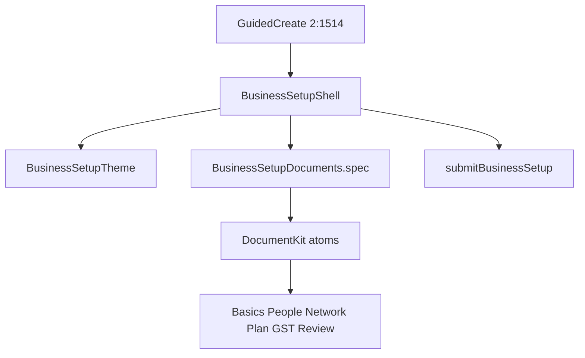

# Nine Business Setup Figma Parity

I'm using the writing-plans skill to create the implementation plan.

> **For agentic workers:** REQUIRED SUB-SKILL: Use superpowers:subagent-driven-development (recommended) or superpowers:executing-plans to implement this plan task-by-task. Steps use checkbox (`- [ ]`) syntax for tracking.

**Goal:** Make all nine Business subtype setup screens match Figma file `rknfN9EikSCdqmqXogR29o` setup-v6 frames on iOS and Android.

**Architecture:** Keep one shared `BusinessSetupShell` + theme-driven `BusinessSetupDocumentKit`. Expand the field/section model so each of the nine `BusinessSetupDocuments` specs can express the Figma v6 structure. Rewrite each subtype’s document from its Figma node (not from the current shortened specs). Lockstep Swift ↔ Kotlin.

**Tech Stack:** SwiftUI (`momentra/.../BusinessSetup/`), Jetpack Compose (`apk/.../business/setup/`), Figma SoT `rknfN9EikSCdqmqXogR29o`, existing `BusinessSetupTheme` / tokens.

**Spec:** Figma nodes in [`docs/qa/BUSINESS_V4_APPSTATE_SMOKE.md`](docs/qa/BUSINESS_V4_APPSTATE_SMOKE.md); families in [`docs/superpowers/plans/2026-11-19-business-v4-contract-freeze.md`](docs/superpowers/plans/2026-11-19-business-v4-contract-freeze.md).

## Global Constraints

- SoT file: `rknfN9EikSCdqmqXogR29o` — do not use legacy TzLvw setup flows.
- Nine subtypes only: `CLIENT_CAMPAIGN`, `OWN_BUSINESS_CAMPAIGN`, `TRADING_WHOLESALE`, `DISTRIBUTION_DEALERSHIP`, `RETAIL_STORE`, `RESTAURANT_FOOD`, `CONSUMER_SERVICE`, `STANDARD_PRODUCTION`, `MADE_TO_ORDER`.
- Platforms: native iOS + Android lockstep; no web.
- Shared shell stays; no nine separate screen files.
- Activate still calls existing `submitBusinessSetup` — extra Figma fields store in setup preferences / values map; do not invent a new backend API in this plan.
- Personal / Group create unchanged.
- After approval, also save this plan to `docs/superpowers/plans/2026-11-21-business-setup-figma-v6-parity.md`.

## Review Focus

- Empty required title still blocks activate (disabled CTA).
- Chip swap within a family reseeds fields and theme without losing a typed title when keys match.
- GST “No” hides registration fields.
- Review section reflects current values, not stale seed placeholders.
- Long scroll + sticky activate bar does not clip CTA glow.

## Drift (confirmed)

| Layer | App today | Figma v6 (e.g. `5:33148`, `5:18833`) |
|-------|-----------|--------------------------------------|
| Depth | ~3 sections (basics / channels / people), text + single-choice | ~6–7 sections: Basics, People & Roles, Network/Catalogue, Channels & Plan, GST, Review |
| CTA | `Activate campaign` / `Activate trading` | `Start this business` / `Start the business!` (per frame) |
| People | Plain text leads | Owner card, role chips, member list, + Add member |
| Network | Missing | Expandable module rows |
| GST | Missing | Toggle + registration type + state |
| Review | Missing | Summary card before CTA |
| Field types | `text` \| `choice` only | Also multi-select chips, dates, toggles, rows with trailing actions |

User screenshot matches the **current shortened app**, not Figma v6 — that is the sync gap.

## File map

| Responsibility | iOS | Android |
|----------------|-----|---------|
| Shell | [`BusinessSetupShell.swift`](momentra/momentra/Shell/BusinessSetup/BusinessSetupShell.swift) | [`BusinessSetupShell.kt`](apk/app/src/main/java/com/example/momentra/ui/shell/business/setup/BusinessSetupShell.kt) |
| Specs (9) | [`BusinessSetupDocuments.swift`](momentra/momentra/Shell/BusinessSetup/BusinessSetupDocuments.swift) | [`BusinessSetupDocuments.kt`](apk/app/src/main/java/com/example/momentra/ui/shell/business/setup/BusinessSetupDocuments.kt) |
| Kit atoms | [`BusinessSetupDocumentKit.swift`](momentra/momentra/Shell/BusinessSetup/BusinessSetupDocumentKit.swift) | [`BusinessSetupDocumentKit.kt`](apk/app/src/main/java/com/example/momentra/ui/shell/business/setup/BusinessSetupDocumentKit.kt) |
| Invite / people | [`BusinessSetupInviteSection.swift`](momentra/momentra/Shell/BusinessSetup/BusinessSetupInviteSection.swift) | [`BusinessSetupInviteSection.kt`](apk/app/src/main/java/com/example/momentra/ui/shell/business/setup/BusinessSetupInviteSection.kt) |
| Theme | [`BusinessSetupTheme.swift`](momentra/momentra/Shell/BusinessSetup/BusinessSetupTheme.swift) | [`BusinessSetupTheme.kt`](apk/app/src/main/java/com/example/momentra/ui/shell/business/setup/BusinessSetupTheme.kt) |
| Tests | `momentraTests/BusinessSetup*` | `apk/.../setup/*Test.kt` |
| Smoke | [`docs/qa/BUSINESS_V4_APPSTATE_SMOKE.md`](docs/qa/BUSINESS_V4_APPSTATE_SMOKE.md) | same |

## Figma node map

| Type code | Node |
|-----------|------|
| `CLIENT_CAMPAIGN` | `5:33148` |
| `OWN_BUSINESS_CAMPAIGN` | `5:38325` |
| `TRADING_WHOLESALE` | `5:18833` |
| `DISTRIBUTION_DEALERSHIP` | `5:8637` |
| `RETAIL_STORE` | `5:80797` |
| `RESTAURANT_FOOD` | `5:90612` |
| `CONSUMER_SERVICE` | `5:71162` |
| `STANDARD_PRODUCTION` | `5:50728` |
| `MADE_TO_ORDER` | `5:55863` |

---

### Task 1: Expand setup field model + kit atoms

**Files:**
- Modify: `BusinessSetupDocuments.swift` / `.kt` (`BusinessSetupFieldSpec` kind enum)
- Modify: `BusinessSetupDocumentKit.swift` / `.kt`, `BusinessSetupShell.swift` / `.kt` `fieldView`
- Test: new `BusinessSetupFieldModelTests` (iOS) + `BusinessSetupFieldModelTest` (Android)

**Interfaces:**
- Produces: field kinds `text`, `choice`, `multiChoice`, `toggle`, `date`, `rowAction`, `memberList`, `moduleList`, `reviewSummary` (exact names locked in this task’s tests)
- Consumes: existing `BusinessSetupTheme`

- [ ] **Step 1: Write failing tests** asserting each new kind round-trips in a minimal spec builder and that shell mapping does not crash on an empty values map.
- [ ] **Step 2: Run tests — expect FAIL**
- [ ] **Step 3: Implement kinds + DocumentKit renderers** (toggle, multi-select chips, date row, member row, expandable module row, review summary card). Reuse theme accents; Marketing indigo / Trading emerald already in `BusinessSetupTheme`.
- [ ] **Step 4: Run tests — expect PASS**
- [ ] **Step 5: Commit** `feat(business): expand setup document field kinds for Figma v6`

---

### Task 2: Marketing pair (`CLIENT_CAMPAIGN`, `OWN_BUSINESS_CAMPAIGN`)

**Files:**
- Modify: `BusinessSetupDocuments` clientMarketing + ownMarketing
- Pull structure via Figma `get_design_context` / screenshot for `5:33148`, `5:38325`
- Test: section titles + activateLabel + required keys

- [ ] **Step 1: Failing tests** for CLIENT: sections include Basics, People & Roles, Network, Channels & Plan, GST, Review; `activateLabel` matches Figma CTA string from frame; hero/eyebrow match Figma.
- [ ] **Step 2: Run — FAIL**
- [ ] **Step 3: Rewrite both marketing specs** from Figma; wire People section to invite/member atoms; sticky CTA uses new label.
- [ ] **Step 4: Run — PASS**; device smoke top+scroll vs `5:33148`
- [ ] **Step 5: Commit** `feat(business): Figma v6 marketing setup documents`

---

### Task 3: Trading pair (`TRADING_WHOLESALE`, `DISTRIBUTION_DEALERSHIP`)

**Files:** Documents + shell if module list needs trading-specific labels  
**Nodes:** `5:18833`, `5:8637`

- [ ] **Step 1: Failing tests** for trading section order + `Start the business!` (or exact Figma string) + emerald theme unchanged
- [ ] **Step 2: FAIL → implement → PASS**
- [ ] **Step 3: Commit** `feat(business): Figma v6 trading/distribution setup documents`

---

### Task 4: Retail trio (`RETAIL_STORE`, `RESTAURANT_FOOD`, `CONSUMER_SERVICE`)

**Nodes:** `5:80797`, `5:90612`, `5:71162`

- [ ] **Step 1: Failing tests** per subtype for section titles + activate labels from Figma
- [ ] **Step 2: FAIL → implement → PASS**
- [ ] **Step 3: Commit** `feat(business): Figma v6 retail/restaurant/service setup documents`

---

### Task 5: Manufacturing pair (`STANDARD_PRODUCTION`, `MADE_TO_ORDER`)

**Nodes:** `5:50728`, `5:55863`

- [ ] **Step 1: Failing tests** for both specs vs Figma
- [ ] **Step 2: FAIL → implement → PASS**
- [ ] **Step 3: Commit** `feat(business): Figma v6 manufacturing/MTO setup documents`

---

### Task 6: Smoke + cross-platform gate

**Files:** [`docs/qa/BUSINESS_V4_APPSTATE_SMOKE.md`](docs/qa/BUSINESS_V4_APPSTATE_SMOKE.md)

- [ ] **Step 1: Update smoke table** — require scroll through Review + GST for each of 9; chip-swap retheme; CTA copy check
- [ ] **Step 2: Run** Android `BusinessSetupThemeTest` + new field/document tests; iOS `BusinessSetup*` tests
- [ ] **Step 3: Commit** `test(business): setup v6 smoke and parity gates`

## Out of scope

- Backend GST/network APIs beyond storing values locally in the setup map
- Redesigning guided create `2:1514`
- Personal/Group setups
- Publishing Code Connect for setup atoms
