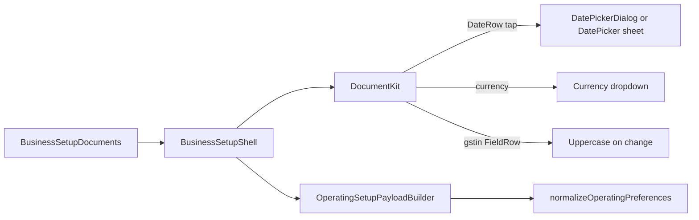

# Business Setup Date / Currency / GSTIN Controls

> **For agentic workers:** REQUIRED SUB-SKILL: Use superpowers:subagent-driven-development (recommended) or superpowers:executing-plans to implement this plan task-by-task. Steps use checkbox (`- [ ]`) syntax for tracking.

**Goal:** On all 9 Business Setup flows, dates use a real calendar picker, currency is a dropdown (not free text), and GSTIN capitalizes as the user types.

**Architecture:** Fix once in DocumentKit + Shell wiring so every subtype inherits the behavior. Documents only change `currency` from `text` → shared choice/dropdown options. Reuse the existing `SetupDateField` picker pattern, restyled with `BusinessSetupTheme`. GSTIN uppercase is a FieldRow option keyed off `gstin` (keyboard + onChange filter).

**Tech Stack:** Jetpack Compose Material3 `DatePickerDialog` / `ExposedDropdownMenuBox`; SwiftUI `DatePicker` sheet / `Menu` or `Picker`; existing `OperatingSetupPayloadBuilder` + backend `normalizeCurrencyCode` / gstin uppercasing stay as submit-time safety net.

**Spec:** User request — date pickers, currency dropdowns, GSTIN capital letters by default across all 9 setups. Patterns: [`apk/.../SetupDateTimeField.kt`](apk/app/src/main/java/com/example/momentra/ui/setup/SetupDateTimeField.kt), [`momentra/.../SetupDateTimeField.swift`](momentra/momentra/Shell/Setup/SetupDateTimeField.swift), DocumentKit `DateRow`/`FieldRow`/`ChoiceChips`.

**Also save a copy to:** `docs/superpowers/plans/2026-11-22-business-setup-date-currency-gstin.md` when execution starts.

## Global Constraints

- Apply to all 9 subtype codes: `CLIENT_CAMPAIGN`, `OWN_BUSINESS_CAMPAIGN`, `TRADING_WHOLESALE`, `DISTRIBUTION_DEALERSHIP`, `RETAIL_STORE`, `RESTAURANT_FOOD`, `CONSUMER_SERVICE`, `STANDARD_PRODUCTION`, `MADE_TO_ORDER`.
- Android + iOS lockstep; no backend schema change required.
- Currency options (exact labels, INR default): `INR · Indian Rupee (₹)`, `USD · US Dollar ($)`, `EUR · Euro (€)`, `GBP · British Pound (£)`, `AED · UAE Dirham (د.إ)`.
- Date fields that use `Kind.Date` must open a picker; stored value after confirm is `YYYY-MM-DD` (except `planMonth` → `YYYY-MM`). Empty / cleared `endDate` means “Still open”.
- GSTIN: every keystroke and paste becomes uppercase; keyboard prefers characters capitalization.
- Do not rewrite STANDARD_PRODUCTION section structure or MTO quote policy in this plan.

## Review Focus

- Paste lowercase GSTIN → field shows uppercase immediately (not only after Save).
- `endDate` clear / “Still open” still coerces correctly on activate (empty end allowed).
- `planMonth` picker writes `YYYY-MM` and dual-write/startDate fallback in payload still works.
- Currency chip/menu label still normalizes to ISO-3 (`INR`) via existing `normalizeCurrencyCode`.
- Field error chrome on DateRow / currency row still shows when activate fails.

---

## File map

| File | Responsibility |
|------|----------------|
| [`BusinessSetupDocumentKit.kt`](apk/app/src/main/java/com/example/momentra/ui/shell/business/setup/BusinessSetupDocumentKit.kt) / [`.swift`](momentra/momentra/Shell/BusinessSetup/BusinessSetupDocumentKit.swift) | Real `DateRow` picker; `CurrencyDropdown`; `FieldRow` uppercase mode |
| [`BusinessSetupShell.kt`](apk/app/src/main/java/com/example/momentra/ui/shell/business/setup/BusinessSetupShell.kt) / [`.swift`](momentra/momentra/Shell/BusinessSetup/BusinessSetupShell.swift) | Wire Date/Currency/gstin FieldRow flags |
| [`BusinessSetupDocuments.kt`](apk/app/src/main/java/com/example/momentra/ui/shell/business/setup/BusinessSetupDocuments.kt) / [`.swift`](momentra/momentra/Shell/BusinessSetup/BusinessSetupDocuments.swift) | Shared `CURRENCY_OPTIONS`; all 9 `currency` → choice; MTO `endDate` → date |
| Field model + DocumentKit tests (Android/iOS) | Pin kinds, options, uppercase behavior |
| Smoke [`docs/qa/BUSINESS_V4_APPSTATE_SMOKE.md`](docs/qa/BUSINESS_V4_APPSTATE_SMOKE.md) | One checklist line for picker/dropdown/GSTIN caps |



---

### Task 1: DocumentKit DateRow = real date picker

**Files:**
- Modify: `apk/.../BusinessSetupDocumentKit.kt` (`DateRow`)
- Modify: `momentra/.../BusinessSetupDocumentKit.swift` (`DateRow`)
- Test: extend field-model / a small DocumentKit-facing unit if present; otherwise Shell-level assertions via stored value format in payload tests

**Interfaces:**
- Consumes: `Kind.Date` fields; theme; current string value
- Produces: `DateRow(..., mode: Day | Month)` writing `YYYY-MM-DD` or `YYYY-MM`; optional clear for open-ended end dates

- [ ] **Step 1: Write failing Android test** `OperatingSetupPayloadBuilderTest` (or new DocumentKit test) asserting that when prefs already hold picker output `2026-10-12`, `coerceSetupDate` / build leaves ISO startDate; and document that DateRow contract is ISO (pin in comment + field-model later). Prefer adding `BusinessSetupDateFormattingTest` if no UI test harness: pure Kotlin helpers `formatSetupDateDisplay` / `parseSetupDateValue`.

- [ ] **Step 2: Implement Android `DateRow` as tappable row** (same chrome as FieldRow) opening Material3 `DatePickerDialog` (mirror `SetupDateField`). On OK: write `YYYY-MM-DD`. Show formatted display (`d MMMM yyyy`). If `allowClear=true` (endDate), show Clear → `""`. For `planMonth` keys, use month-oriented confirm writing `YYYY-MM` and display `MMMM yyyy`.

- [ ] **Step 3: Implement iOS `DateRow` the same way** using graphical `DatePicker` in a sheet (mirror `SetupDateField`).

- [ ] **Step 4: Shell — pass `field.key` into DateRow** so `planMonth` vs day mode and `endDate` clear are selected without document changes beyond kind.

- [ ] **Step 5: Run Android unit tests for date helpers / payload coerce; fix until green**

- [ ] **Step 6: Commit** `feat(setup): real date pickers in BusinessSetup DateRow`

---

### Task 2: Currency dropdown on all 9 documents

**Files:**
- Modify: both `BusinessSetupDocuments.*` — shared options constant + every `currency` field
- Modify: both DocumentKits — `CurrencyDropdown` (ExposedDropdownMenu / Menu) styled like FieldRow, not chip cloud
- Modify: both Shells — when `field.key == "currency"` and kind is Choice, render `CurrencyDropdown` instead of `ChoiceChips` (or always for currency key)

**Interfaces:**
- Consumes: `Kind.Choice` options list from docs
- Produces: selected label string (e.g. `INR · Indian Rupee (₹)`); default first option / INR when empty

- [ ] **Step 1: Failing field-model tests** — for each of the 9 type codes, `currency` field kind is Choice (or Dropdown) and options equal `CURRENCY_OPTIONS`; default seed selects INR.

```kotlin
// Android BusinessSetupFieldModelTest
@Test
fun allNineSetupsUseCurrencyDropdownOptions() {
    val expected = listOf(
        "INR · Indian Rupee (₹)",
        "USD · US Dollar ($)",
        "EUR · Euro (€)",
        "GBP · British Pound (£)",
        "AED · UAE Dirham (د.إ)",
    )
    listOf(
        "CLIENT_CAMPAIGN", "OWN_BUSINESS_CAMPAIGN", "TRADING_WHOLESALE",
        "DISTRIBUTION_DEALERSHIP", "RETAIL_STORE", "RESTAURANT_FOOD",
        "CONSUMER_SERVICE", "STANDARD_PRODUCTION", "MADE_TO_ORDER",
    ).forEach { code ->
        val field = BusinessSetupDocuments.spec(code).sections
            .flatMap { it.fields }.first { it.key == "currency" }
        assertTrue(field.kind is BusinessSetupFieldSpec.Kind.Choice)
        assertEquals(expected, (field.kind as BusinessSetupFieldSpec.Kind.Choice).options)
    }
}
```

Mirror on iOS with `#expect`.

- [ ] **Step 2: Run tests — expect FAIL** (8 subtypes still `text`; MTO only one option)

- [ ] **Step 3: Add `CURRENCY_OPTIONS` constant** in both Documents files; replace every `text("currency", ...)` / single-option choice with `choice("currency", "Currency", CURRENCY_OPTIONS)`. Fix MTO `endDate` to `date(...)` for picker parity.

- [ ] **Step 4: Implement `CurrencyDropdown` in DocumentKit** — tap FieldRow-like control → menu of options; selected label shown. Shell routes `key == "currency"` to it.

- [ ] **Step 5: Run field-model tests — PASS**; spot-check payload still maps label → `INR` via existing builders

- [ ] **Step 6: Commit** `feat(setup): currency dropdown on all nine business setups`

---

### Task 3: GSTIN uppercase while typing

**Files:**
- Modify: DocumentKit `FieldRow` (+ Shell Text branch for `gstin`)
- Test: unit test of uppercase filter helper; optional payload test already uppercases on submit

**Interfaces:**
- Consumes: `forceUppercase: Boolean` on FieldRow
- Produces: `onValueChange(newValue.uppercase())`; Android `KeyboardOptions(capitalization = Characters)`; iOS `.textInputAutocapitalization(.characters)`

- [ ] **Step 1: Failing test** for helper `fun forceUppercaseInput(raw: String) = raw.uppercase()` used by FieldRow — assert `"27aafcf…"` → `"27AAFCF…"`.

- [ ] **Step 2: Wire Shell Text branch** — `forceUppercase = (field.key == "gstin")` on both platforms for all documents (no per-doc change).

- [ ] **Step 3: Update FieldRow** to apply keyboard + filter when flag set.

- [ ] **Step 4: Run unit tests — PASS**

- [ ] **Step 5: Commit** `feat(setup): capitalize GSTIN as user types`

---

### Task 4: Smoke note + verify

**Files:**
- Modify: [`docs/qa/BUSINESS_V4_APPSTATE_SMOKE.md`](docs/qa/BUSINESS_V4_APPSTATE_SMOKE.md) — under global setup smoke add:
  - Date fields open calendar / month picker (not free-text only)
  - Currency is a dropdown with INR default
  - GSTIN types in capitals

- [ ] **Step 1: Add smoke bullets**

- [ ] **Step 2: Re-run** Android `BusinessSetupFieldModelTest` + `OperatingSetupPayloadBuilderTest`; backend `business-setup-draft.test.ts` (no regressions)

- [ ] **Step 3: Commit** `docs(qa): setup date currency GSTIN smoke checks`

---

## Self-review (coverage)

| Requirement | Task |
|-------------|------|
| Date pickers (start/end/gstEffectiveFrom/planMonth) | Task 1 |
| Currency dropdowns all 9 | Task 2 |
| GSTIN capital by default | Task 3 |
| Smoke / regression | Task 4 |

No backend API change; payload/backend uppercase remains defense in depth.
