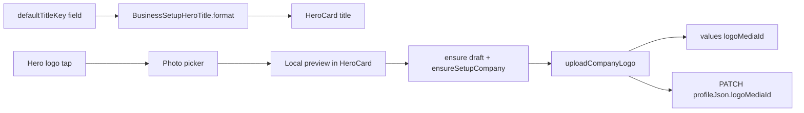

# Business Setup Logo Upload + Live Hero Title Implementation Plan

> **For agentic workers:** REQUIRED SUB-SKILL: Use superpowers:subagent-driven-development (recommended) or superpowers:executing-plans to implement this plan task-by-task. Steps use checkbox (`- [ ]`) syntax for tracking.

**Goal:** On all 9 Business Setup flows (Android + iOS), the hero card icon becomes an upload-logo control that shows the chosen logo after a successful upload, and the hero title (e.g. “Brightline Setup”) updates live from the Business Basics primary name field.

**Architecture:** One shared `BusinessSetupShell` + `HeroCard` already drives all nine subtype docs. Add a pure `BusinessSetupHeroTitle.format` helper and wire Shell to pass a live title into `HeroCard`. Extend `HeroCard` with a tappable logo slot (local preview → upload via existing `uploadCompanyLogo` → persist `logoMediaId` in setup preferences + company `profileJson`). No per-subtype screen files.

**Tech Stack:** Jetpack Compose (`PickVisualMedia`, `ImageBitmap`); SwiftUI (`PhotosPicker`, `UIImage`); existing `BusinessSliceRepository.uploadCompanyLogo` / `APIClient.uploadCompanyLogo`; `MomentCreateViewModel.ensureSetupCompany` / `MomentCreateModel.ensureSetupCompany`; `PATCH /v1/companies/{companyId}` `profileJson`; optional `downloadUrl` on media complete for reopen.

**Spec:** User request (2026-11-22) + screenshot `Screenshot_2026-11-22_at_19.29.09` (Client Campaign hero with buildings glyph + “Brightline Setup”). Prior shell parity: [`docs/superpowers/plans/2026-11-21-business-setup-figma-v6-parity.md`](2026-11-21-business-setup-figma-v6-parity.md).

## Global Constraints

- Apply to all 9 type codes: `CLIENT_CAMPAIGN`, `OWN_BUSINESS_CAMPAIGN`, `TRADING_WHOLESALE`, `DISTRIBUTION_DEALERSHIP`, `RETAIL_STORE`, `RESTAURANT_FOOD`, `CONSUMER_SERVICE`, `STANDARD_PRODUCTION`, `MADE_TO_ORDER`.
- Android (`apk/`) + iOS (`momentra/momentra/`) lockstep; change `HeroCard` / Shell once so every subtype inherits.
- Live hero title source = Business Basics primary name = `spec.defaultTitleKey` (`campaignName` | `businessName` | `storeName` | `outletName` | `serviceName`).
- Format: trimmed name + `" Setup"` when the name does not already end with `" Setup"` (case-insensitive); empty name → `spec.heroTitle` placeholder (e.g. `"Brightline Setup"`).
- Logo preference key: `"logoMediaId"` (string media id). Also write `profileJson.logoMediaId` on the linked company when upload succeeds.
- Show local image preview immediately after pick; replace the buildings/`▣` glyph only after pick succeeds (keep glyph while empty / failed).
- Reuse existing media upload helpers; do not invent a second upload pipeline.
- Do not change sticky bar CTAs, subtype chips, or document section structure in this plan.

## Review Focus

- Typing into `defaultTitleKey` updates hero title on every keystroke without waiting for Save/Activate.
- Clearing the name field restores the Figma placeholder `heroTitle` (not a blank title, not `" Setup"`).
- Name that already ends with `" Setup"` is not doubled (`"Brightline Setup"` → still one `" Setup"`).
- Logo pick with no `companyId` still shows local preview; upload retries after draft/company ensure; failed upload keeps preview and surfaces a short error banner.
- Reopening a draft that stored `logoMediaId` shows the logo again when a `downloadUrl` (or cached local preview) is available — not a permanent buildings glyph after a prior successful upload.

---

## File map

| File | Responsibility |
|------|----------------|
| Create: `apk/.../BusinessSetupHeroTitle.kt` + `momentra/.../BusinessSetupHeroTitle.swift` | Pure `format(name, placeholder) → String` |
| Modify: `BusinessSetupDocumentKit.kt` / `.swift` (`HeroCard`) | Tappable logo circle; glyph / bitmap / remote URL; uploading spinner |
| Modify: `BusinessSetupShell.kt` / `.swift` | Live title wiring; pick → preview → ensure company → upload → prefs |
| Modify: `MomentCreateViewModel.kt` / `MomentCreateModel.swift` | Thin `uploadSetupLogo(...)` wrapping ensure + upload + company patch |
| Modify: `BusinessSliceRepository.kt` / `APIClient.swift` | Keep `uploadCompanyLogo`; optionally surface `downloadUrl` from complete |
| Modify: `backend/.../media/service.ts` + router tests | `completeUpload` returns optional `downloadUrl` |
| Test: `BusinessSetupHeroTitleTest.kt` / `BusinessSetupHeroTitleTests.swift` | Title formatting |
| Test: extend field-model / smoke | `logoMediaId` round-trip note; smoke checklist lines |
| Modify: `docs/qa/BUSINESS_V4_APPSTATE_SMOKE.md` | Logo + live hero title checks for all 9 |



---

### Task 1: Live hero title from Business Basics

**Files:**
- Create: `apk/app/src/main/java/com/example/momentra/ui/shell/business/setup/BusinessSetupHeroTitle.kt`
- Create: `momentra/momentra/Shell/BusinessSetup/BusinessSetupHeroTitle.swift`
- Create: `apk/app/src/test/java/com/example/momentra/ui/shell/business/setup/BusinessSetupHeroTitleTest.kt`
- Create: `momentra/momentraTests/BusinessSetupHeroTitleTests.swift`
- Modify: `apk/.../BusinessSetupShell.kt` (~185–190) — pass live title into `HeroCard`
- Modify: `momentra/.../BusinessSetupShell.swift` (~84–89) — same
- Modify: `BusinessSetupFieldModelTest.kt` / `BusinessSetupFieldModelTests.swift` — keep asserting static `spec.heroTitle` placeholders; do **not** change those expectations to live titles

**Interfaces:**
- Consumes: `values[spec.defaultTitleKey]`, optional `initialTitle`, `spec.heroTitle`
- Produces:
  - Kotlin: `object BusinessSetupHeroTitle { fun format(name: String?, placeholder: String): String }`
  - Swift: `enum BusinessSetupHeroTitle { static func format(name: String?, placeholder: String) -> String }`

- [ ] **Step 1: Write failing Android tests**

```kotlin
@Test
fun emptyNameUsesPlaceholder() {
    assertEquals("Brightline Setup", BusinessSetupHeroTitle.format(null, "Brightline Setup"))
    assertEquals("Brightline Setup", BusinessSetupHeroTitle.format("  ", "Brightline Setup"))
}

@Test
fun typedNameAppendsSetup() {
    assertEquals("Brightline Creative Setup", BusinessSetupHeroTitle.format("Brightline Creative", "Brightline Setup"))
}

@Test
fun nameAlreadyEndingInSetupIsNotDoubled() {
    assertEquals("Brightline Setup", BusinessSetupHeroTitle.format("Brightline Setup", "Harbor & Loom Setup"))
    assertEquals("Brightline Setup", BusinessSetupHeroTitle.format("brightline setup", "Harbor & Loom Setup"))
}
```

- [ ] **Step 2: Run Android test — expect FAIL** (`BusinessSetupHeroTitle` unresolved)

Run: `./gradlew :app:testDebugUnitTest --tests com.example.momentra.ui.shell.business.setup.BusinessSetupHeroTitleTest`

- [ ] **Step 3: Implement `BusinessSetupHeroTitle.format` on Android** — trim; if blank return `placeholder`; if trimmed ends with `" setup"` (ignore case) return `trimmed`; else `"$trimmed Setup"`.

- [ ] **Step 4: Mirror Steps 1–3 on iOS** with Swift Testing `#expect`.

- [ ] **Step 5: Wire both Shells**

```kotlin
val heroTitleLive = BusinessSetupHeroTitle.format(
    name = values[spec.defaultTitleKey]?.trim().orEmpty()
        .ifEmpty { initialTitle?.trim().orEmpty() },
    placeholder = spec.heroTitle,
)
BusinessSetupDocumentKit.HeroCard(
    theme = theme,
    eyebrow = spec.eyebrow,
    title = heroTitleLive,
    subtitle = spec.heroSubtitle,
    // logo params added in Task 2 — omit until then
)
```

Do **not** pass `titleValue` into format — `titleValue` already falls back to `spec.heroTitle` and would break the empty→placeholder path.

- [ ] **Step 6: Run Android + iOS hero-title unit tests — expect PASS**

- [ ] **Step 7: Commit**

```bash
git add apk/app/src/main/java/com/example/momentra/ui/shell/business/setup/BusinessSetupHeroTitle.kt \
  apk/app/src/test/java/com/example/momentra/ui/shell/business/setup/BusinessSetupHeroTitleTest.kt \
  apk/app/src/main/java/com/example/momentra/ui/shell/business/setup/BusinessSetupShell.kt \
  momentra/momentra/Shell/BusinessSetup/BusinessSetupHeroTitle.swift \
  momentra/momentraTests/BusinessSetupHeroTitleTests.swift \
  momentra/momentra/Shell/BusinessSetup/BusinessSetupShell.swift
git commit -m "$(cat <<'EOF'
feat(setup): live hero title from Business Basics name

EOF
)"
```

---

### Task 2: HeroCard upload-logo UI + local preview

**Files:**
- Modify: `apk/.../BusinessSetupDocumentKit.kt` (`HeroCard` ~57–127)
- Modify: `momentra/.../BusinessSetupDocumentKit.swift` (`HeroCard`)
- Modify: both `BusinessSetupShell.*` — photo picker + shell state for preview / uploading / error

**Interfaces:**
- Consumes: theme; optional local image bytes / bitmap; optional remote `logoUrl`; `logoUploading: Boolean`; `onLogoClick: () -> Unit`
- Produces: updated `HeroCard` signature (Android Compose / iOS View):

```kotlin
@Composable
fun HeroCard(
    theme: BusinessSetupTheme,
    eyebrow: String,
    title: String,
    subtitle: String,
    logoBitmap: ImageBitmap? = null,
    logoUrl: String? = null,
    logoUploading: Boolean = false,
    onLogoClick: (() -> Unit)? = null,
    modifier: Modifier = Modifier,
)
```

```swift
struct HeroCard: View {
    // existing theme, eyebrow, title, subtitle
    var logoImage: UIImage? = nil
    var logoUrl: URL? = nil
    var logoUploading: Bool = false
    var onLogoClick: (() -> Void)? = nil
}
```

- [ ] **Step 1: Extend `HeroCard` on Android** — make the 72dp circle `clickable` when `onLogoClick != null`; accessibility contentDescription `"Upload logo"`. Content priority: if `logoUploading` → small `CircularProgressIndicator`; else if `logoBitmap != null` → `Image(bitmap, contentScale = Crop)` clipped to circle; else if `logoUrl` non-blank → load if a project image helper exists, otherwise glyph; else keep `▣` glyph. Do not add Coil unless already on the classpath.

- [ ] **Step 2: Extend `HeroCard` on iOS** — same priority with `PhotosPicker` **owned by Shell**, not HeroCard (HeroCard only calls `onLogoClick`). Use `Image(uiImage:)` / `AsyncImage` for URL. Accessibility label `"Upload logo"`. Replace `building.2.fill` when image present.

- [ ] **Step 3: Shell local-only wiring (both platforms)** — add state:

```kotlin
var logoPreview by remember { mutableStateOf<ImageBitmap?>(null) }
var logoBytes by remember { mutableStateOf<ByteArray?>(null) }
var logoUploading by remember { mutableStateOf(false) }
var logoUrl by remember { mutableStateOf<String?>(null) }
```

Android: `rememberLauncherForActivityResult(PickVisualMedia)` → decode JPEG/PNG bytes (mirror `PersonalExperienceHost.decodePhoto`) → set `logoBytes` + `logoPreview`. iOS: `PhotosPicker` / load `Data` → `UIImage`. Pass into `HeroCard`. **Upload network call is Task 3** — for this task, `onLogoClick` only launches the picker; after pick, preview must replace the glyph immediately.

- [ ] **Step 4: Manual smoke on one subtype (Client Campaign)** — pick an image; hero circle shows the image; title still live from Task 1.

- [ ] **Step 5: Commit**

```bash
git commit -m "$(cat <<'EOF'
feat(setup): HeroCard logo picker with local preview

EOF
)"
```

---

### Task 3: Persist logo via company upload + preferences

**Files:**
- Modify: `apk/.../MomentCreateViewModel.kt` — add `uploadSetupLogo`
- Modify: `momentra/.../MomentCreateModel.swift` — same
- Modify: both Shells — after pick, call upload; write `values["logoMediaId"]`; set `logoUrl` from complete response when present
- Modify: `BusinessSliceRepository.kt` / `APIClient.swift` only if return type must include `downloadUrl`
- Modify: `backend/typescript/src/modules/media/service.ts` `completeUpload` — return `downloadUrl: string | null` via `trySignedDownloadUrl` on the completed object’s bucket/key
- Modify: media complete DTO on both clients (`MediaUploadCompleteResultDto` / Swift equivalent) to decode optional `downloadUrl`
- Test: backend media complete test asserts `downloadUrl` key present (null allowed in test env); Android/iOS unit test for ViewModel happy-path with fakes if harness exists — otherwise document Shell integration steps in smoke

**Interfaces:**
- Consumes: `companyId: String?`, `draftMomentId: String?`, `companyName: String`, `bytes: ByteArray`/`Data`, `contentType: String`
- Produces:

```kotlin
data class SetupLogoUploadResult(
    val companyId: String,
    val mediaId: String,
    val downloadUrl: String?,
)

/** Ensures company (creating draft linkage when needed), uploads logo, patches profileJson.logoMediaId. */
suspend fun uploadSetupLogo(
    companyId: String?,
    momentId: String?,
    companyName: String,
    bytes: ByteArray,
    contentType: String = "image/jpeg",
): Result<SetupLogoUploadResult>
```

Swift: `func uploadSetupLogo(companyId: String?, momentId: String?, companyName: String, bytes: Data, contentType: String = "image/jpeg") async throws -> SetupLogoUploadResult`

Algorithm for `uploadSetupLogo` (implementer writes body; do not invent a second API):
1. Resolve `resolvedCompanyId = companyId?.takeIf { it.isNotBlank() } ?: ensureSetupCompany(momentId ?: return failure, companyName)`.
2. If still null → failure `"Could not create company for logo"`.
3. `mediaId = uploadCompanyLogo(resolvedCompanyId, bytes, contentType)`.
4. `patchCompany(resolvedCompanyId, profileJson = mapOf("logoMediaId" to mediaId), expectedVersion from getCompany if required by API)`.
5. Return `SetupLogoUploadResult(resolvedCompanyId, mediaId, downloadUrlFromComplete)`.

Shell after successful pick:
1. Set local preview (Task 2).
2. `logoUploading = true`.
3. If `draftMomentId == null`, create a DRAFT via existing `submitBusinessSetup(..., status = "DRAFT")` (same path as Save draft) and wait for `momentId` before upload — **prefer in-session DRAFT create** so upload can complete without forcing the user to tap Save draft first.
4. Call `uploadSetupLogo` with `companyName = values["companyName"]?.trim().orEmpty().ifEmpty { titleValue }`.
5. On success: `values["logoMediaId"] = mediaId`; `logoUrl = downloadUrl`; clear error.
6. On failure: keep preview; set banner `"Could not upload logo"`.
7. `logoUploading = false`.

Prefill on edit: if `values["logoMediaId"]` already set from `GET .../setup` preferences, leave glyph until `downloadUrl` can be resolved; signed URLs expire, so media id in preferences / company `profileJson` is the durable source of truth.

- [ ] **Step 1: Backend — extend `completeUpload` return** to include `downloadUrl` from `trySignedDownloadUrl` (best-effort null). Update client DTOs so Android `uploadCompanyLogo` can return media id + optional `downloadUrl`; iOS likewise.

- [ ] **Step 2: Write failing backend test** asserting complete response JSON includes `downloadUrl` key (value may be null in CI without Supabase).

- [ ] **Step 3: Implement backend + client DTO decode**

- [ ] **Step 4: Implement `uploadSetupLogo` on Android + iOS**

- [ ] **Step 5: Wire Shell post-pick upload** (both platforms) including DRAFT ensure when needed; write `logoMediaId` into `values` so Save draft / Activate `preferencesPayload` includes it.

- [ ] **Step 6: Confirm `OperatingSetupPayloadBuilder` / backend preference normalize pass unknown `logoMediaId` through** (no strip). If stripped, add an explicit allow-list entry — only if a test shows drop.

- [ ] **Step 7: Run media + setup unit tests; fix until green**

- [ ] **Step 8: Commit**

```bash
git commit -m "$(cat <<'EOF'
feat(setup): upload company logo from HeroCard and persist media id

EOF
)"
```

---

### Task 4: Smoke checklist + cross-subtype verification

**Files:**
- Modify: `docs/qa/BUSINESS_V4_APPSTATE_SMOKE.md` — add a shared “all 9” block for logo + live title
- Re-run: `BusinessSetupHeroTitleTest`, field-model tests, media complete test

**Interfaces:**
- Consumes: Tasks 1–3 deliverables
- Produces: QA checklist lines an engineer can tick on device

- [ ] **Step 1: Add smoke lines**

```markdown
### Hero logo + live title (all 9 setups)
- [ ] Changing Business Basics primary name updates hero title immediately to `{name} Setup`
- [ ] Clearing the name restores the Figma placeholder hero title
- [ ] Tapping hero logo opens image picker; after successful upload the circle shows the logo (not buildings/`▣`)
- [ ] Save draft persists `logoMediaId`; reopen still has logo when URL/preview available
```

- [ ] **Step 2: Device or emulator pass on at least Client Campaign + one Retail + one Manufacturing subtype** (three samples prove Shell inheritance for all nine)

- [ ] **Step 3: Commit**

```bash
git commit -m "$(cat <<'EOF'
docs(qa): smoke checks for setup logo and live hero title

EOF
)"
```

---

## Self-review

1. **Spec coverage:** (1) upload logo on hero for all 9 → Tasks 2–3 via shared HeroCard/Shell. (2) live “Brightline Setup” from Business Basics → Task 1. (3) APK + iOS → every task. (4) after upload success show logo → Task 2 preview + Task 3 persist.
2. **Step scan:** Signatures and assertions pinned; upload algorithm listed once under Task 3 Interfaces.
3. **Type consistency:** `logoMediaId`, `SetupLogoUploadResult`, `BusinessSetupHeroTitle.format` names match across tasks.
4. **Review Focus:** Each failure mode has a test or smoke line (title empty/doubling in Task 1 tests; upload failure banner + preview keep in Task 3; reopen in Review Focus + Task 4).
5. **Proportion:** Plan decides interfaces and wiring points; no full Compose/SwiftUI bodies transcribed.
