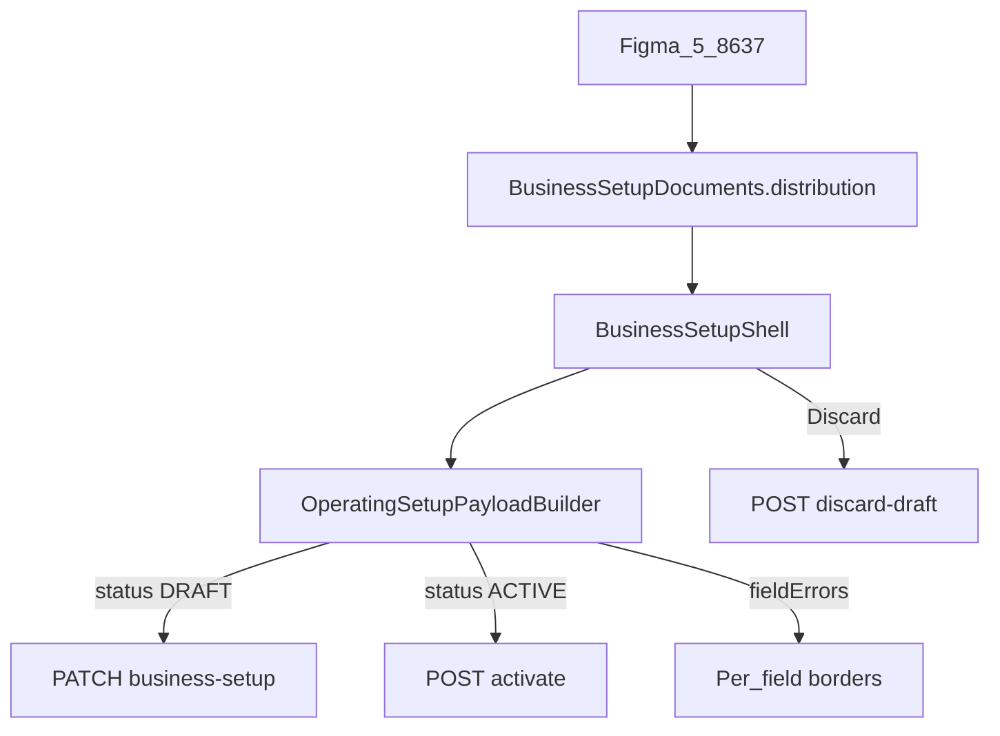

# Distribution Dealership Setup (Figma + Drafts + Field Errors)

> **For agentic workers:** REQUIRED SUB-SKILL: Use superpowers:subagent-driven-development (recommended) or superpowers:executing-plans to implement this plan task-by-task. Steps use checkbox (`- [ ]`) syntax for tracking.

**Goal:** Make `DISTRIBUTION_DEALERSHIP` setup match Figma `rknfN9EikSCdqmqXogR29o` node `5:8637` (DST-SETUP-v6 · Metro Distribution) on Android and iOS, persist every editable field through existing business draft/activate APIs, highlight invalid fields, and support Group-style drafts — **without** Section 04 Catalogue/Warehouses/Network.

**Architecture:** Keep shared `BusinessSetupShell` + document specs. Rewrite only the `distribution` document to five sections (retail pattern). Map form keys through `OperatingSetupPayloadBuilder` / backend `applyOperatingSetupAliases` into closed `OperatingPreferences`. Trading-family activate already requires positive `monthlyBudget` + `monthlyTarget` (with dual-write); keep `requiresChannel: false`. Draft CTAs already live on the shared sticky bar from retail/Group work — verify lockstep, do not fork a distribution-only shell.

**Tech Stack:** Jetpack Compose (`apk/.../business/setup`), SwiftUI (`momentra/.../BusinessSetup`), Express `/v1` business draft/activate, Postgres prefs on the moment setup row.

**Spec:** Figma [DST-SETUP-v6 · Metro Distribution](https://www.figma.com/design/rknfN9EikSCdqmqXogR29o/momentra?node-id=5-8637&m=dev); mirror pattern in [`docs/superpowers/plans/2026-11-22-retail-store-setup-figma.md`](2026-11-22-retail-store-setup-figma.md) and [`docs/superpowers/plans/2026-11-22-trading-setup-figma-draft.md`](2026-11-22-trading-setup-figma-draft.md); contracts in [`backend/typescript/src/modules/business/operating-catalog.ts`](../../backend/typescript/src/modules/business/operating-catalog.ts); smoke [`docs/qa/BUSINESS_V4_APPSTATE_SMOKE.md`](../../qa/BUSINESS_V4_APPSTATE_SMOKE.md).

## Global Constraints

- Platforms: native iOS + Android lockstep; no web.
- Type code: **`DISTRIBUTION_DEALERSHIP` only** (`TRADING_WHOLESALE` / `5:18833` is out of scope).
- **Remove Section 04** (Catalogue / Warehouses & routes / Suppliers / Team invite rows). Renumber to **5 steps**: Basics → People → Channels & Plan → GST → Review. Shell step copy: `5 steps · Distribution setup` (Figma shows `6 steps` only because §04 is present).
- Hero: `Metro Distribution Setup` / subtitle `Bring your business, people, and monthly plan together before you start.` / eyebrow `Distribution`.
- Activate CTA from Figma sticky bar: **`Start this business`** (replace current `Start the business!`).
- Identity key: `businessName` (label **Business name**); party via `companyName` → `partyName` (do not surface `principalBrand` / `territory` as primary UI keys).
- Plan fields use canonical `monthlyBudget`, `monthlyTarget`, `targetMetric` (drop UI keys `targetSales`, `routeStyle`, `dealerCount`, `collectionCycle`).
- Channels (copy says “at least one”; backend stays `requiresChannel: false`): `Retail dealers`, `Wholesale`, `Modern trade`, `HoReCa`, `Van sales`.
- Roles on invite: `Owner`, `Manager`, `Route lead`, `Warehouse`, `Salesman` — helper `Default Salesman · own beat orders & collections. Role applies when they join.` No `addPeople` row.
- GST uses retail panels: `gstTracking`, `gstRegistration`, `gstState`, `salePriceIncludesGst`, `gstEffectiveFrom` (drop UI `gstRegistered` / `gstType`).
- Accent remains Distribution / Flame (`#ea580c`); Kind chips Trading | Distribution with Distribution selected.
- Draft UX: **Save draft**, **Activate**, **Discard draft** (header when status `DRAFT`) — same lifecycle as Group/Retail via shared shell.
- Rebuild `backend/dist` after catalog changes if the repo tracks dist.

## Review Focus

- Activate with empty `monthlyBudget` and empty `monthlyTarget` (no dual-write source) → field errors on both UI keys; banner message present.
- Activate with only `monthlyTarget` filled → dual-write fills budget; activate succeeds (no false budget error).
- Missing `companyName` / party with empty identity fallbacks → field error on `companyName` (not `partyName` / `principalBrand`).
- Invalid GSTIN with `gstTracking == Yes` → field error on `gstin`; Save draft still succeeds with the same GSTIN.
- Save draft with only `businessName` → succeeds; resume prefill restores prefs including channels and plan amounts.

---

## File map

| Responsibility | iOS | Android | Backend |
|----------------|-----|---------|---------|
| Document spec | [`BusinessSetupDocuments.swift`](../../momentra/momentra/Shell/BusinessSetup/BusinessSetupDocuments.swift) `distribution` | [`BusinessSetupDocuments.kt`](../../apk/app/src/main/java/com/example/momentra/ui/shell/business/setup/BusinessSetupDocuments.kt) `distribution` | — |
| Aliases / fieldErrors | [`OperatingSetupPayloadBuilder.swift`](../../momentra/momentra/Shell/BusinessSetup/OperatingSetupPayloadBuilder.swift) | [`OperatingSetupPayloadBuilder.kt`](../../apk/app/src/main/java/com/example/momentra/ui/shell/business/setup/OperatingSetupPayloadBuilder.kt) | [`operating-catalog.ts`](../../backend/typescript/src/modules/business/operating-catalog.ts) `applyOperatingSetupAliases` / `normalizeOperatingPreferences` |
| Shell draft (verify) | [`BusinessSetupShell.swift`](../../momentra/momentra/Shell/BusinessSetup/BusinessSetupShell.swift) | [`BusinessSetupShell.kt`](../../apk/app/src/main/java/com/example/momentra/ui/shell/business/setup/BusinessSetupShell.kt) | `PATCH .../business-setup`, `POST .../activate`, `POST .../discard-draft` |
| Sticky bar | [`BusinessSetupDocumentKit.swift`](../../momentra/momentra/Shell/BusinessSetup/BusinessSetupDocumentKit.swift) | [`BusinessSetupDocumentKit.kt`](../../apk/app/src/main/java/com/example/momentra/ui/shell/business/setup/BusinessSetupDocumentKit.kt) | — |
| Tests | `BusinessSetupFieldModelTests.swift`, `OperatingSetupPayloadBuilderTests.swift` | `BusinessSetupFieldModelTest.kt`, `OperatingSetupPayloadBuilderTest.kt` | `business-setup-draft.test.ts` |
| Smoke | [`docs/qa/BUSINESS_V4_APPSTATE_SMOKE.md`](../../qa/BUSINESS_V4_APPSTATE_SMOKE.md) | same | — |

## Canonical field map (Figma `5:8637` → prefs, §04 omitted)

| Section | UI keys | Backend |
|---------|---------|---------|
| Basics | `businessName`, `companyName`, `gstin`, `currency`, `startDate`, `endDate`, `description`, `location` (+ Identity / Dates & more panels) | `identityName`, `partyName`, `gstin`, `currency`, dates, `description`, `location` |
| People | `teamMembers`, `roles` | invite only; role chips map via aliases |
| Channels | `channels`, `planMonth`, `monthlyBudget`, `monthlyTarget`, `targetMetric` | `channels[]`, `startDate` from month if empty, budget/target/metric |
| GST | `gstTracking`, `gstRegistration`, `gstState`, `salePriceIncludesGst`, `gstEffectiveFrom` | closed GST prefs; hide registration/pricing when tracking is **Not now** |
| Review | `companyName`, `gstin`, `channels`, `monthlyBudget`, `monthlyTarget`, `targetMetric` | display |
| CTA | `Start this business` | activate |

**Drop from current distribution spec:** `principalBrand`, `territory`, `routeStyle`, `dealerCount`, `collectionCycle`, `targetSales`, `modules` / network section, `gstRegistered`, `gstType`, `addPeople`.

**Aliases to keep/support:** `targetSales` / `monthlySalesTarget` → `monthlyTarget`; `principalBrand` remains party fallback only; `gstRegistered` → `gstTracking`; role labels `route lead`, `salesman`, `warehouse`.



---

### Task 1: Rewrite `DISTRIBUTION_DEALERSHIP` document (5 sections, no network)

**Files:**
- Modify: `apk/app/src/main/java/com/example/momentra/ui/shell/business/setup/BusinessSetupDocuments.kt` (`val distribution`)
- Modify: `momentra/momentra/Shell/BusinessSetup/BusinessSetupDocuments.swift` (`static let distribution`)
- Test: `apk/app/src/test/java/com/example/momentra/ui/shell/business/setup/BusinessSetupFieldModelTest.kt`
- Test: `momentra/momentraTests/BusinessSetupFieldModelTests.swift`

**Interfaces:**
- Consumes: existing `panelHeader`, `multiChoice(..., helper:)`, `date`, `choice`, `memberList`, `reviewSummary` helpers (mirror `retail` / `trading` structure without `moduleListRows`)
- Produces: `BusinessSetupDocuments.spec("DISTRIBUTION_DEALERSHIP")` with Figma keys above; `defaultTitleKey == "businessName"`; `activateLabel == "Start this business"`; no `network` section

- [ ] **Step 1: Write the failing test** `distributionMatchesFigma8637FiveSections` (Kotlin + Swift)

Assert: `heroTitle == "Metro Distribution Setup"`; `heroSubtitle` equals Figma subtitle; `activateLabel == "Start this business"`; `defaultTitleKey == "businessName"`; `sectionTitles` exactly:

```text
Business Basics
People & Roles
Channels & Monthly Plan
GST & Tax Details
Review your setup
```

`sections.none { id == "network" }`; keys include `businessName`, `companyName`, `currency`, `startDate`, `endDate`, `description`, `location`, `channels`, `planMonth`, `monthlyBudget`, `monthlyTarget`, `targetMetric`, `gstTracking`, `gstRegistration`, `gstState`, `salePriceIncludesGst`; keys do **not** include `principalBrand`, `territory`, `routeStyle`, `dealerCount`, `targetSales`, `modules`; channels options `["Retail dealers", "Wholesale", "Modern trade", "HoReCa", "Van sales"]`; roles `["Owner", "Manager", "Route lead", "Warehouse", "Salesman"]`.

Also update `tradingActivateLabelIsStartTheBusiness` (or sibling): distribution activate label assertion → `Start this business`; remove assertion that distribution still has Catalogue/Network if present.

- [ ] **Step 2: Run tests to verify they fail**

Run: `./gradlew :app:testDebugUnitTest --tests 'com.example.momentra.ui.shell.business.setup.BusinessSetupFieldModelTest.distributionMatchesFigma8637FiveSections'`

Expected: FAIL on heroTitle / activateLabel / section count / missing keys.

- [ ] **Step 3: Rewrite `distribution` specs** to the canonical field map (copy structure from `retail` five-section layout; orange-domain copy from Figma). Basics subtitle: `A home for this distribution business.`; location placeholder: `Add your DC location`; Channels helper same as trading (“places you sell…”); GST helpers match retail GST panels.

- [ ] **Step 4: Run tests to verify they pass**

Expected: PASS for new test and updated activate-label assertion.

- [ ] **Step 5: Commit**

```bash
git add apk/app/src/main/java/com/example/momentra/ui/shell/business/setup/BusinessSetupDocuments.kt \
  momentra/momentra/Shell/BusinessSetup/BusinessSetupDocuments.swift \
  apk/app/src/test/java/com/example/momentra/ui/shell/business/setup/BusinessSetupFieldModelTest.kt \
  momentra/momentraTests/BusinessSetupFieldModelTests.swift
git commit -m "$(cat <<'EOF'
feat(setup): align DISTRIBUTION_DEALERSHIP document with Figma 5:8637

EOF
)"
```

---

### Task 2: Client payload aliases + UI-keyed fieldErrors for distribution

**Files:**
- Modify: `OperatingSetupPayloadBuilder.kt` / `.swift`
- Test: `OperatingSetupPayloadBuilderTest.kt` / `OperatingSetupPayloadBuilderTests.swift`

**Interfaces:**
- Consumes: Task 1 keys (`businessName`, `companyName`, `channels`, `monthlyBudget`, `monthlyTarget`, roles)
- Produces: `build(..., activating: true).fieldErrors` keyed to those UI keys; dual-write for `DISTRIBUTION_DEALERSHIP` unchanged; `mapRole("Route lead")` → `OPERATIONS_LEAD`; `mapRole("Salesman")` → `TEAM_MEMBER` (existing `salesman` alias)

- [ ] **Step 1: Write failing tests**

`distributionFigmaAliasesRoundTrip`: prefs with `businessName`, `companyName`, `channels: "Retail dealers|Van sales"`, `monthlyBudget`, `monthlySalesTarget` (or `targetSales`) → `identityName` / `partyName` / `monthlyTarget` coerced; `activating: false` → no `validationError`.

`distributionActivateMissingBudgetAndTargetSetsFieldErrors`: activating with names only, no amounts → `fieldErrors["monthlyBudget"]` and `fieldErrors["monthlyTarget"]` set.

`distributionActivateDualWriteFromTargetOnly`: activating with names + `monthlyTarget` only → no budget/target fieldErrors (dual-write fills budget).

`mapRole("Route lead")` → `OPERATIONS_LEAD`.

- [ ] **Step 2: Run tests — expect FAIL**

- [ ] **Step 3: Implement** role alias `route lead`; ensure `validationFieldErrors` title key for distribution stays `businessName` and party error key stays `companyName`; keep distribution in `dualWriteBudgetTarget` / `tradingOrMfg`. Do not add distribution to `retailChannelsRequired`.

- [ ] **Step 4: Run tests — expect PASS**

- [ ] **Step 5: Commit**

```bash
git commit -m "$(cat <<'EOF'
feat(setup): distribution Figma aliases and activate fieldErrors

EOF
)"
```

---

### Task 3: Backend aliases + draft/activate field keys for distribution

**Files:**
- Modify: `backend/typescript/src/modules/business/operating-catalog.ts`
- Test: `backend/typescript/tests/business-setup-draft.test.ts`
- Rebuild: `backend/dist` if tracked

**Interfaces:**
- Consumes: same Figma prefs as clients
- Produces: `applyOperatingSetupAliases` already dual-writes budget↔target for `DISTRIBUTION_DEALERSHIP`; ensure activate `fieldFail` identity/party keys for this subtype are `businessName` / `companyName` (matching UI); draft normalize accepts half-filled distribution; activate still requires budget+target after aliases; `requiresChannel` stays `false`

- [ ] **Step 1: Write failing tests** in `business-setup-draft.test.ts`

`maps distribution Figma aliases and accepts a distribution draft`: `applyOperatingSetupAliases` with `subtype: 'DISTRIBUTION_DEALERSHIP'`, `businessName`, `companyName`, `channels: ['Retail dealers']`, `monthlySalesTarget` → `identityName`, `partyName`, `monthlyTarget`; `normalizeOperatingPreferences(..., { draft: true })` succeeds without budget.

`distribution activate rejects missing budget with companyName/businessName field keys`: activate without names/amounts throws; when party missing, details include `companyName` (not only `partyName`); when budget missing after aliases, details include `monthlyBudget`.

- [ ] **Step 2: Run** `node --import tsx --test tests/business-setup-draft.test.ts` from `backend/typescript` — expect FAIL on new assertions

- [ ] **Step 3: Implement** identity/party field-key mapping for `DISTRIBUTION_DEALERSHIP` (and keep wholesale consistent if already `businessName`/`companyName`); add `route lead` role alias if missing; keep dual-write list including `DISTRIBUTION_DEALERSHIP`

- [ ] **Step 4: Run draft tests — PASS**; rebuild dist if required

- [ ] **Step 5: Commit**

```bash
git commit -m "$(cat <<'EOF'
feat(backend): distribution setup Figma preference aliases and field keys

EOF
)"
```

---

### Task 4: Draft UX verify + smoke checklist

**Files:**
- Verify only: `BusinessSetupShell` / `StickyActivateBar` already expose Save draft | Discard | Activate for all subtypes including distribution
- Modify: `docs/qa/BUSINESS_V4_APPSTATE_SMOKE.md` — add Distribution (`5:8637`) five-section checklist mirroring Retail Store block

**Interfaces:**
- Consumes: Tasks 1–3
- Produces: documented smoke path draft → resume → discard → activate with field errors

- [ ] **Step 1: Confirm shell** distribution chip path uses shared `BusinessSetupShell` (no bypass). If Discard/Save draft missing on one platform for business setup, port the retail Group pattern — do not invent a distribution-only bar.

- [ ] **Step 2: Add smoke subsection** under Setup smoke:

### Distribution (`5:8637`) — five sections (no Catalogue/Network)

- [ ] Sections: Basics → People & Roles → Channels & Plan → GST → Review only
- [ ] Hero **Metro Distribution Setup**; CTA **Start this business**; accent Flame/orange
- [ ] Basics: business name, company name, GSTIN, currency, start/end, description, DC location
- [ ] Channels: Retail dealers / Wholesale / Modern trade / HoReCa / Van sales + budget + sales target + measure
- [ ] Soft plan status pill under Channels (green when budget+target parse)
- [ ] Roles: Owner / Manager / Route lead / Warehouse / Salesman
- [ ] **Save draft** creates or patches DRAFT; reopen restores prefs
- [ ] **Discard draft** in header when status is DRAFT
- [ ] Activate missing budget/target highlights those fields; invalid GSTIN with tracking Yes highlights GSTIN; Save draft still succeeds

Also update the global CTA bullet so Distribution is `Start this business` (not `Start the business!`).

- [ ] **Step 3: Commit** smoke doc

```bash
git commit -m "$(cat <<'EOF'
docs(qa): distribution setup Figma smoke checklist

EOF
)"
```

---

## Out of scope

- `TRADING_WHOLESALE` document changes (`5:18833`)
- Catalogue / Warehouses / Suppliers / masters CRUD sheets during setup
- Flipping `requiresChannel` to `true` for distribution
- Changing other business subtypes

## Self-review

1. **Spec coverage:** Figma 01 Basics, 02 People, 03 Channels, 05 GST, 06 Review → Task 1 (renumbered 5); §04 deliberately omitted per locked decision; aliases/backend → Tasks 2–3; drafts → Task 4.
2. **Steps:** Each step is one test, one implement, one verify, or one commit.
3. **Types:** Identity `businessName`; party UI `companyName`; plan `monthlyBudget` / `monthlyTarget` / `targetMetric`; CTA `Start this business`.
4. **Review Focus:** Each failure mode has a test in Tasks 2–3.
5. **Proportion:** Plan locks Figma strings and keys; implementers write bodies. CTA in Figma is `Start this business` (not the older `Start the business!` string still on the short form).
