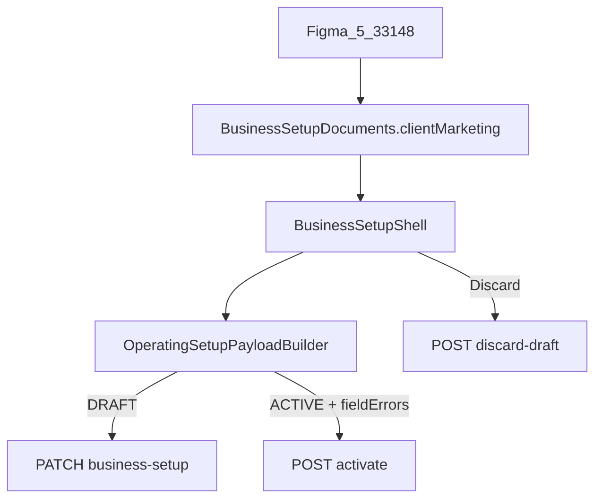

# Client Campaign Setup (Figma + Drafts + Field Errors)

> **For agentic workers:** REQUIRED SUB-SKILL: Use superpowers:subagent-driven-development (recommended) or superpowers:executing-plans to implement this plan task-by-task. Steps use checkbox (`- [ ]`) syntax for tracking.

**Goal:** Make `CLIENT_CAMPAIGN` setup match Figma `rknfN9EikSCdqmqXogR29o` node `5:33148` (MKT-SETUP-v6 · Brightline) on Android and iOS, persist every editable field through existing business draft/activate APIs, highlight invalid fields, and support Group-style drafts — **without** Section 04 Network / Catalogue.

**Architecture:** Keep shared `BusinessSetupShell` + document specs. Rewrite only the `clientMarketing` document to five sections. Map form keys through `OperatingSetupPayloadBuilder` / backend `applyOperatingSetupAliases` into closed `OperatingPreferences` (marketing economics: `clientFee`, `monthlyBudget`, optional media/agency envelopes). Activate already requires positive `monthlyBudget` + valid `startDate`; `requiresChannel` stays `false`. Draft CTAs already live on the shared sticky bar — verify lockstep, do not fork a marketing-only shell.

**Tech Stack:** Jetpack Compose (`apk/.../business/setup`), SwiftUI (`momentra/.../BusinessSetup`), Express `/v1` business draft/activate, Postgres prefs on the moment setup row.

**Spec:** Figma [MKT-SETUP-v6 · Brightline](https://www.figma.com/design/rknfN9EikSCdqmqXogR29o/momentra?node-id=5-33148&m=dev); mirror pattern in [`docs/superpowers/plans/2026-11-22-retail-store-setup-figma.md`](2026-11-22-retail-store-setup-figma.md) / [`2026-11-22-distribution-setup-figma.md`](2026-11-22-distribution-setup-figma.md); contracts in [`backend/typescript/src/modules/business/operating-catalog.ts`](../../backend/typescript/src/modules/business/operating-catalog.ts) + [`docs/architecture/BUSINESS_BACKEND.md`](../../architecture/BUSINESS_BACKEND.md); smoke [`docs/qa/BUSINESS_V4_APPSTATE_SMOKE.md`](../../qa/BUSINESS_V4_APPSTATE_SMOKE.md).

## Global Constraints

- Platforms: native iOS + Android lockstep; no web.
- Type code: **`CLIENT_CAMPAIGN` only** (`OWN_BUSINESS_CAMPAIGN` / `5:38325` is out of scope).
- **Remove Section 04** (Network / Counterparties / Catalogue rows). Renumber to **5 steps**: Basics → People → Channels & Plan → GST → Review. Shell step copy: `5 steps · Client campaign setup` (Figma shows `6 steps` only because §04 is present).
- Hero: `Brightline Setup` / subtitle `Bring your business, people, and monthly plan together before you start.` / eyebrow `Client campaign`.
- Activate CTA: **`Start this business`**.
- Identity key: `campaignName` → `identityName`; party key: **`clientName`** → `partyName` (partyLabel Client). Do **not** use `companyName` as the party error key for this subtype.
- `companyName` = agency / firm name on the Campaign panel (optional); seed as counterparty `AGENCY` when non-empty — not activate-blocking.
- Channels (encouraged in copy; backend `requiresChannel: false`): `Paid social`, `Search`, `Print`, `Influencer`, `Events`.
- Roles on invite: `Owner`, `Admin`, `Campaign Lead`, `Finance`, `Approver`. No `addPeople` row.
- Plan / commercials: `clientFee`, `billingBasis` (Retainer / Deliverable / Pass-through — UI + draft raw only unless already aliased), `monthlyBudget`, `monthlyTarget` (Primary target), `targetMetric` (unit chips), `planMonth`, plus optional `clientApprovedMediaBudget` / `agencyOperatingBudget` / `campaignBudget` aliases into closed prefs.
- Target unit chips → metrics: `Leads`→`LEADS`, `Reach`→`REACH`, `Clicks`→`ENGAGEMENT`, `Sales`→`REVENUE`.
- Campaign purpose chips → `offering` (single selected label string). Structure One-time / Ongoing → UI key `campaignStructure` (persist as optional string on marketing prefs only if already present; otherwise drop after draft — do not invent a new required gate).
- GST uses retail panels: `gstTracking`, `gstRegistration`, `gstState`, `salePriceIncludesGst`, `gstEffectiveFrom`.
- Accent: Marketing indigo `#6366F1`; Kind chips Client | Own business with Client selected.
- Draft UX: **Save draft**, **Activate**, **Discard draft** via shared shell.
- Marketing activate: budget + startDate required; target/clientFee optional on activate (unless already required elsewhere — do not newly require target).

## Review Focus

- Activate with empty `monthlyBudget` → field error on `monthlyBudget`; banner present.
- Activate with missing / invalid `startDate` → field error on `startDate`.
- Activate with empty `clientName` (and no client alias) → field error on **`clientName`**, not `companyName` / `partyName`.
- Invalid GSTIN with `gstTracking == Yes` → field error on `gstin`; Save draft still succeeds.
- Save draft with only `campaignName` → succeeds; resume prefill restores client, channels, fee, budget.

---

## File map

| Responsibility | iOS | Android | Backend |
|----------------|-----|---------|---------|
| Document spec | [`BusinessSetupDocuments.swift`](../../momentra/momentra/Shell/BusinessSetup/BusinessSetupDocuments.swift) `clientMarketing` | [`BusinessSetupDocuments.kt`](../../apk/app/src/main/java/com/example/momentra/ui/shell/business/setup/BusinessSetupDocuments.kt) `clientMarketing` | — |
| Aliases / fieldErrors | [`OperatingSetupPayloadBuilder.swift`](../../momentra/momentra/Shell/BusinessSetup/OperatingSetupPayloadBuilder.swift) | [`OperatingSetupPayloadBuilder.kt`](../../apk/app/src/main/java/com/example/momentra/ui/shell/business/setup/OperatingSetupPayloadBuilder.kt) | [`operating-catalog.ts`](../../backend/typescript/src/modules/business/operating-catalog.ts) |
| Shell draft (verify) | `BusinessSetupShell.swift` | `BusinessSetupShell.kt` | draft PATCH / activate / discard |
| Tests | `BusinessSetupFieldModelTests.swift`, `OperatingSetupPayloadBuilderTests.swift` | `BusinessSetupFieldModelTest.kt`, `OperatingSetupPayloadBuilderTest.kt` | `business-setup-draft.test.ts` |
| Smoke | [`docs/qa/BUSINESS_V4_APPSTATE_SMOKE.md`](../../qa/BUSINESS_V4_APPSTATE_SMOKE.md) | same | — |

## Canonical field map (Figma `5:33148` → prefs, §04 omitted)

| Section | UI keys | Backend |
|---------|---------|---------|
| Basics | `campaignName`, `companyName`, `clientName`, `clientContact` (optional text), `currency`, `startDate`, `endDate`, `gstin`, `campaignPurpose`→`offering`, `promotedBrand` (optional counterparty BRAND) | `identityName`, `partyName`, dates, `currency`, `gstin`, `offering` |
| People | `teamMembers`, `roles` | invite; role aliases |
| Channels | `channels`, `clientFee`, `billingBasis`, `planMonth`, `monthlyBudget`, `campaignBudget` (alias), `clientApprovedMediaBudget`, `agencyOperatingBudget`, `monthlyTarget`, `targetMetric` | closed marketing + shared plan prefs |
| GST | retail GST keys | closed GST |
| Review | `clientName`, `gstin`, `channels`, `monthlyBudget`, `clientFee`, `monthlyTarget`, `targetMetric` | display |
| CTA | `Start this business` | activate |

**Drop from current clientMarketing spec:** `billingModel` as Basics-only choice (replaced by Channels `billingBasis`), `leadGoal`, `billingFrequency`, `modules` / network, `gstRegistered` / `gstType`, `addPeople`.

**Aliases:** `clientName`→`partyName`; `campaignName`→`identityName`; `campaignBudget`→`monthlyBudget` when monthly empty; `leadGoal` remains target fallback; `gstRegistered`→`gstTracking`; roles `campaign lead`→`OPERATIONS_LEAD`, `admin`→`OWNER_ADMIN`, `approver`→`APPROVER`, `finance`→`FINANCE`.



---

### Task 1: Rewrite `CLIENT_CAMPAIGN` document (5 sections, no network)

**Files:**
- Modify: `BusinessSetupDocuments.kt` / `.swift` (`clientMarketing`)
- Test: `BusinessSetupFieldModelTest.kt` / `BusinessSetupFieldModelTests.swift`

**Interfaces:**
- Consumes: `panelHeader`, `multiChoice`, `choice`, `date`, `memberList`, `reviewSummary`
- Produces: `spec("CLIENT_CAMPAIGN")` with Figma keys; `defaultTitleKey == "campaignName"`; `activateLabel == "Start this business"`; no `network` section

- [ ] **Step 1: Write failing test** `clientCampaignMatchesFigma33148FiveSections`

Assert: `heroTitle == "Brightline Setup"`; subtitle equals Figma; `activateLabel == "Start this business"`; `defaultTitleKey == "campaignName"`; section titles exactly Basics → People & Roles → Channels & Monthly Plan → GST & Tax Details → Review your setup; no `network`; keys include `campaignName`, `companyName`, `clientName`, `currency`, `startDate`, `endDate`, `gstin`, `campaignPurpose`, `roles`, `channels`, `clientFee`, `monthlyBudget`, `monthlyTarget`, `targetMetric`, `gstTracking`, `gstRegistration`; keys exclude `modules`, `leadGoal`, `billingFrequency`, `addPeople`; channels `["Paid social", "Search", "Print", "Influencer", "Events"]`; roles `["Owner", "Admin", "Campaign Lead", "Finance", "Approver"]`.

- [ ] **Step 2: Run tests — expect FAIL**

Run: `ANDROID_HOME=… ./gradlew :app:testDebugUnitTest --tests '…BusinessSetupFieldModelTest.clientCampaignMatchesFigma33148FiveSections'`

- [ ] **Step 3: Rewrite `clientMarketing`** to the canonical map (mirror retail five-section layout; indigo marketing copy). Basics subtitle: campaign home copy from Figma (“Name the engagement…” → prefer Figma section subtitle if present). Channels subtitle: Figma “Channels, client commercials, budget and targets.” / “Where do you run it?”. GST helpers match retail.

- [ ] **Step 4: Run tests — expect PASS**

- [ ] **Step 5: Commit**

```bash
git commit -m "$(cat <<'EOF'
feat(setup): align CLIENT_CAMPAIGN document with Figma 5:33148

EOF
)"
```

---

### Task 2: Client payload aliases + UI-keyed fieldErrors

**Files:**
- Modify: `OperatingSetupPayloadBuilder.kt` / `.swift`
- Test: `OperatingSetupPayloadBuilderTest.kt` / `OperatingSetupPayloadBuilderTests.swift`

**Interfaces:**
- Consumes: Task 1 keys
- Produces: `build(..., activating: true).fieldErrors` with `campaignName`, **`clientName`** (not `companyName`), `monthlyBudget`, `startDate`; `mapRole("Campaign Lead")` → `OPERATIONS_LEAD`; `campaignBudget` / media envelopes alias into `monthlyBudget` when monthly empty; `campaignPurpose` → `offering`

- [ ] **Step 1: Write failing tests**

`clientCampaignFigmaAliasesRoundTrip`: prefs with `campaignName`, `clientName`, `channels: "Paid social|Search"`, `monthlyBudget`, `clientFee`, `campaignPurpose: "Leads"`, `monthlyTarget` / unit → `identityName`, `partyName`, `offering`, amounts coerced; `activating: false` → no validationError.

`clientCampaignActivateMissingBudgetAndStartSetsFieldErrors`: names only → `fieldErrors["monthlyBudget"]` and `fieldErrors["startDate"]`.

`clientCampaignActivateMissingClientHighlightsClientName`: `campaignName` + budget + startDate, empty client → `fieldErrors["clientName"]` (fix `companyName` must not be the party key for this subtype).

`mapRole("Campaign Lead")` → `OPERATIONS_LEAD`.

- [ ] **Step 2: Run — expect FAIL**

- [ ] **Step 3: Implement** party error key branch for `CLIENT_CAMPAIGN` → `clientName`; role alias `campaign lead`; campaignBudget→monthlyBudget alias; purpose→offering. Do not add CLIENT to `retailChannelsRequired`.

- [ ] **Step 4: Run — expect PASS**

- [ ] **Step 5: Commit**

```bash
git commit -m "$(cat <<'EOF'
feat(setup): client campaign Figma aliases and activate fieldErrors

EOF
)"
```

---

### Task 3: Backend aliases + marketing field keys + optional economics

**Files:**
- Modify: `operating-catalog.ts` (`applyOperatingSetupAliases`, `normalizeOperatingPreferences` identity/party field keys, `normalizeMarketingPreferences`)
- Test: `business-setup-draft.test.ts`

**Interfaces:**
- Consumes: Figma prefs from clients
- Produces: activate `fieldFail` keys `campaignName` / `clientName` / `monthlyBudget` / `startDate`; draft accepts half-filled client campaign; optional `clientApprovedMediaBudget` / `agencyOperatingBudget` stored when present (architecture-named envelopes — add to `OperatingPreferences` + normalize as optional amount strings if missing today); `requiresChannel` stays `false`

- [ ] **Step 1: Write failing tests**

`maps client campaign Figma aliases and accepts a client draft`: aliases `campaignName`/`clientName`/`campaignBudget`→`monthlyBudget`; draft normalize without budget succeeds.

`client campaign activate rejects with campaignName/clientName/monthlyBudget/startDate field keys`: empty body → `fields.campaignName`; name without client → `fields.clientName`; names without budget → `fields.monthlyBudget`; names+budget without start → `fields.startDate`.

- [ ] **Step 2: Run** `node --import tsx --test tests/business-setup-draft.test.ts` — expect FAIL on new asserts

- [ ] **Step 3: Implement** identityField `campaignName` for both marketing subtypes; partyField `clientName` for `CLIENT_CAMPAIGN` (Own stays brand/`companyName` or existing); campaignBudget alias; optional media/agency prefs if extending interface (otherwise document Ruling: envelopes UI-only until Own plan — prefer extending to match BUSINESS_BACKEND). Role alias `campaign lead` if missing.

- [ ] **Step 4: Run tests — PASS**

- [ ] **Step 5: Commit**

```bash
git commit -m "$(cat <<'EOF'
feat(backend): client campaign setup Figma preference aliases and field keys

EOF
)"
```

---

### Task 4: Draft UX verify + smoke checklist

**Files:**
- Verify: shared `BusinessSetupShell` Save draft | Discard | Activate already cover marketing chips
- Modify: `docs/qa/BUSINESS_V4_APPSTATE_SMOKE.md`

**Interfaces:**
- Consumes: Tasks 1–3
- Produces: smoke path for Client (`5:33148`)

- [ ] **Step 1: Confirm** Client chip uses shared shell (no bypass). Soft plan status pill: include `CLIENT_CAMPAIGN` when budget (+ optional fee/target) parse — same Channels footer pattern as retail/distribution.

- [ ] **Step 2: Add smoke subsection**

### Client Campaign (`5:33148`) — five sections (no Network)

- [ ] Sections: Basics → People → Channels & Plan → GST → Review only
- [ ] Hero **Brightline Setup**; CTA **Start this business**; accent indigo
- [ ] Basics: campaign name, company, client, GSTIN, currency, dates, purpose chips
- [ ] Channels: Paid social / Search / Print / Influencer / Events + client fee + monthly budget + primary target / unit
- [ ] Roles: Owner / Admin / Campaign Lead / Finance / Approver
- [ ] **Save draft** / **Discard draft**; reopen restores prefs
- [ ] Activate missing budget or startDate highlights those fields; missing client highlights `clientName`; bad GSTIN with tracking Yes highlights GSTIN

- [ ] **Step 3: Commit**

```bash
git commit -m "$(cat <<'EOF'
docs(qa): client campaign setup Figma smoke checklist

EOF
)"
```

---

## Out of scope

- `OWN_BUSINESS_CAMPAIGN` rewrite (`5:38325`)
- Network / Catalogue / Resources masters sheets during setup
- Flipping `requiresChannel` to `true`
- Changing other business subtypes

## Self-review

1. **Spec coverage:** Figma Basics / People / Channels+commercials / GST / Review → Task 1; Network omitted per lock; aliases + `clientName` field keys → Tasks 2–3; drafts → Task 4.
2. **Steps:** Each step is one test, implement, verify, or commit.
3. **Types:** Identity `campaignName`; party UI `clientName`; plan `monthlyBudget` / `clientFee` / `monthlyTarget` / `targetMetric`; CTA `Start this business`.
4. **Review Focus:** Each failure mode pinned in Tasks 2–3.
5. **Proportion:** Decisions + assertions only; no full JSX transcript.
6. **Ruling:** If `clientApprovedMediaBudget` / `agencyOperatingBudget` are absent from `OperatingPreferences` today, Task 3 adds them as optional amount strings (named in BUSINESS_BACKEND) rather than silently dropping Figma fields.
