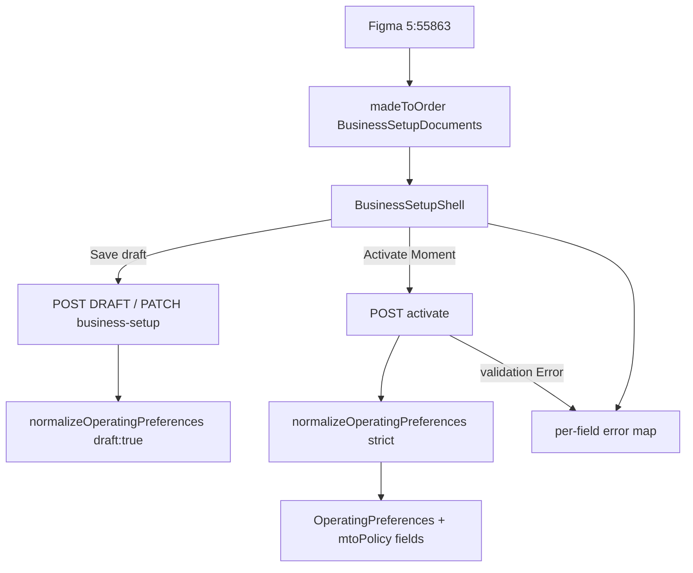

# Made-to-Order Setup Figma Redo (Backend + Draft + Errors)

> **For agentic workers:** REQUIRED SUB-SKILL: Use superpowers:subagent-driven-development (recommended) or superpowers:executing-plans to implement this plan task-by-task.

**Goal:** Make `MADE_TO_ORDER` setup match Figma `rknfN9EikSCdqmqXogR29o` node `5:55863`, persist every setup field through the backend draft/activate path, show per-field validation errors, and add Group-style Save draft on APK + iOS.

**Architecture:** Keep the shared [`BusinessSetupShell`](apk/app/src/main/java/com/example/momentra/ui/shell/business/setup/BusinessSetupShell.kt) / [`BusinessSetupShell.swift`](momentra/momentra/Shell/BusinessSetup/BusinessSetupShell.swift). Rewrite only the `madeToOrder` document. Extend the closed `OperatingPreferences` contract with an MTO policy block (same pattern as marketing extras). Wire shell Save draft / discard / prefill to existing `POST /v1/moments` (DRAFT), `PATCH .../business-setup`, `GET .../setup`, `POST .../discard-draft`, `POST .../activate`.

**Tech Stack:** Kotlin Compose, SwiftUI, TypeScript backend (`operating-catalog.ts`, moment setup service), existing `OperatingSetupPayloadBuilder`.

**Spec:** Figma `5:55863` (session `e709f5fd-8309-444b-ad2d-47871d34254f`). Related: [`docs/superpowers/plans/2026-11-21-business-setup-figma-v6-parity.md`](docs/superpowers/plans/2026-11-21-business-setup-figma-v6-parity.md) Task 5 (MTO only — STANDARD_PRODUCTION out of scope).

**Also save plan copy to:** `docs/superpowers/plans/2026-11-22-mto-setup-figma-backend-draft.md` when execution starts.

## Global Constraints

- SoT: Figma file `rknfN9EikSCdqmqXogR29o` node `5:55863` — not the old TzLvw quick-add set.
- Platforms: iOS + Android lockstep for every client task.
- Shared shell stays; no MTO-only screen file.
- Draft UX lands in `BusinessSetupShell` (all nine subtypes get Save draft; this plan’s document rewrite is MTO-only).
- Do not invent GST computation, print, or BOM explosion backends — MTO policy rows store preference strings only.
- Quote / confirm honesty: setup copy must not imply quotes/advances are revenue.
- Accent: orange `#EA580C` family already used in Figma frame; keep `BusinessSetupTheme` Made-to-order kit.

## Review Focus

1. Invalid GSTIN on activate → field border + message on `gstin`, not only a bottom banner.
2. Empty `businessName` / missing positive `monthlyBudget`+`monthlyTarget` → CTA blocked or activate fails with keyed errors; draft save still succeeds.
3. Save draft with partial form → resume via `getDomainSetupPrefill` restores all keys including MTO policy strings.
4. Discard draft from back when editing a DRAFT → moment gone; no orphan ACTIVE setup.
5. Channels multi-select persists; mode stays `MADE_TO_ORDER` after activate (frozen).

## Drift (app vs Figma)

| Area | App today | Figma `5:55863` |
|------|-----------|-----------------|
| Hero | Short “Set up job-order work” | “Forge & Form Setup” + “Setup in progress” + kind chip “Make to order” |
| Basics | `shopName`, `jobType`, `quoteStyle`, `gstin` | Business name, Company name, GSTIN, Currency, Start/End, Description, Business mode (read-only) |
| People | Generic roles | Owner card, roles Owner/Manager/Supervisor/Storekeeper/Operator, Invite & QR |
| §03 | Missing / wrong “Jobs & Network” modules | Quote validity, Spec template, Order approval, Job per confirmed order, Products & BOM |
| Plan | `monthlyJobs` only | Channels chips, Month, Monthly budget, Monthly target, target measure + honesty note |
| GST | Toggle + type + state | Yes/Not now, Regular/Composition/Unregistered/Not sure, state, prices include GST?, effective from |
| Activate | “Start this business” only | Summary cards + “Activate Moment”; **plus** Group-style Save draft (product requirement) |
| Backend | MTO-only keys stripped by normalize | Persist via aliases + new MTO policy fields |
| Errors | Banner only | Per-field highlight |

## File map

- Backend: [`operating-catalog.ts`](backend/typescript/src/modules/business/operating-catalog.ts), [`setup-preferences.ts`](backend/typescript/src/modules/moment/setup-preferences.ts), [`business-setup-draft.test.ts`](backend/typescript/tests/business-setup-draft.test.ts), [`operating-moments.test.ts`](backend/typescript/tests/operating-moments.test.ts)
- Android: [`BusinessSetupDocuments.kt`](apk/app/src/main/java/com/example/momentra/ui/shell/business/setup/BusinessSetupDocuments.kt), [`BusinessSetupShell.kt`](apk/app/src/main/java/com/example/momentra/ui/shell/business/setup/BusinessSetupShell.kt), [`BusinessSetupDocumentKit.kt`](apk/app/src/main/java/com/example/momentra/ui/shell/business/setup/BusinessSetupDocumentKit.kt), [`OperatingSetupPayloadBuilder.kt`](apk/app/src/main/java/com/example/momentra/ui/shell/business/setup/OperatingSetupPayloadBuilder.kt), [`MomentCreateViewModel.kt`](apk/app/src/main/java/com/example/momentra/ui/create/MomentCreateViewModel.kt)
- iOS: lockstep Swift mirrors under `momentra/momentra/Shell/BusinessSetup/` + `MomentCreateModel.swift`
- Reference draft UX: [`GroupExperienceSetupContent.kt`](apk/app/src/main/java/com/example/momentra/ui/shell/empty/group/GroupExperienceSetupContent.kt) Save draft / discard

## Canonical field → preference map (locked)

| UI key | Persists as | Notes |
|--------|-------------|-------|
| `businessName` | `identityName` (alias) | `defaultTitleKey` |
| `companyName` | `partyName` (alias) | Registered company |
| `gstin` | `gstin` | Strict validate on activate |
| `currency` | `currency` | Default INR |
| `startDate` / `endDate` | `startDate` / `endDate` | End may be empty = Still open |
| `description` | `description` | |
| `businessMode` | display-only | Always Made to order; not written |
| `roles` / `teamMembers` | `participants` via existing builder | Roles: Owner, Manager, Supervisor, Storekeeper, Operator |
| `quoteValidity` | `quoteValidity` **new** | e.g. `15 days` |
| `specificationTemplate` | `specificationTemplate` **new** | Free text / choice |
| `orderApproval` | `orderApproval` **new** | e.g. discount/value rule string |
| `jobOnConfirm` | `jobOnConfirm` **new** | `YES` default |
| `productsBomNote` | `productsBomNote` **new** | Optional; never required |
| `channels` | `channels` | Direct B2B, Dealers, OEM, Export, Job work |
| `planMonth` | `planMonth` **new** | Display month label |
| `monthlyBudget` / `monthlyTarget` | same | Separate amounts; stop dual-write when both present |
| `targetMetric` | `targetMetric` | Map “Invoiced value…” → `REVENUE` |
| `gstRegistered` / `gstType` / `gstState` | existing GST aliases | Plus `salePriceIncludesGst`, `gstEffectiveFrom` |

---

### Task 1: Backend MTO preference contract + draft round-trip

**Files:**
- Modify: `backend/typescript/src/modules/business/operating-catalog.ts` (`OperatingPreferences`, `normalizeOperatingPreferences`, `applyOperatingSetupAliases`)
- Test: `backend/typescript/tests/business-setup-draft.test.ts`, `operating-moments.test.ts`

**Interfaces:**
- Produces: `OperatingPreferences` gains string fields `quoteValidity`, `specificationTemplate`, `orderApproval`, `jobOnConfirm`, `productsBomNote`, `planMonth` (default `''`); `businessName`/`companyName` already alias; `normalizeMtoPreferences(subtype, prefs)` returns the six fields when subtype is `MADE_TO_ORDER`, else empty.
- Consumes: existing `{ draft: true }` lenient path

- [ ] **Step 1: Write failing tests** — draft PATCH with MTO keys keeps `quoteValidity`/`monthlyBudget`/`channels`; activate without budget fails; activate with invalid GSTIN fails with GSTIN message; activate with full payload persists new fields on re-read.
- [ ] **Step 2: Run** `npm test -- business-setup-draft.test.ts` (or project’s equivalent) — expect FAIL.
- [ ] **Step 3: Implement** extend interface + `normalizeMtoPreferences` + aliases (`businessName` already present); when both budget and target provided, do not overwrite either.
- [ ] **Step 4: Run tests — PASS**
- [ ] **Step 5: Commit** `feat(business): persist MTO setup policy fields through draft/activate`

---

### Task 2: Client payload builder + field-keyed validation

**Files:**
- Modify: `OperatingSetupPayloadBuilder.kt` / `.swift`
- Test: `OperatingSetupPayloadBuilderTest.kt` / `OperatingSetupPayloadBuilderTests.swift`

**Interfaces:**
- Produces: `validationError: String?` plus `fieldErrors: Map<String, String>` (or Swift `[String: String]`) with keys `businessName`/`identityName`, `companyName`/`partyName`, `monthlyBudget`, `monthlyTarget`, `gstin`, `channels` as applicable
- Consumes: Task 1 preference keys

- [ ] **Step 1: Failing tests** for MTO: missing name → `fieldErrors["businessName"]`; bad GSTIN → `gstin`; zero target → `monthlyTarget`; happy path includes MTO policy keys in preferences map.
- [ ] **Step 2: FAIL → implement mapping + fieldErrors → PASS**
- [ ] **Step 3: Commit** `feat(business): MTO setup payload field errors`

---

### Task 3: Rewrite `madeToOrder` document from Figma

**Files:**
- Modify: `BusinessSetupDocuments.kt` / `.swift` (`madeToOrder` only)
- Test: `BusinessSetupFieldModelTest` / `BusinessSetupFieldModelTests` (section order + keys + activateLabel)

**Locked copy / structure:**
- `heroTitle`: live moment title or “Forge & Form Setup” placeholder pattern — use dynamic title when editing; default eyebrow `Make to order`
- `activateLabel`: `Activate Moment`
- `defaultTitleKey`: `businessName`
- Sections in order: `01 Business Basics` → `02 People & Roles` → `03 MTO · Quotes & order approval` → `04 Plan · Monthly target` → `05 GST & Tax Details` → `Activate` (review)
- §03 rows as `choice` or `rowAction` prefs (not full nested masters): Quote validity, + Specification template, Order approval, Job per confirmed order, Products & BOM (optional)
- §04 channel chips + Month + budget + target + measure + honesty note (use existing `moduleList`/`reviewSummary` or a static helper text field if kit already supports; otherwise `rowAction` Why note is fine)
- Role chips: Owner, Manager, Supervisor, Storekeeper, Operator; invite CTA `+ Invite & QR · pick role`

- [ ] **Step 1: Failing tests** asserting section ids/titles and required keys listed above.
- [ ] **Step 2: Rewrite `madeToOrder` spec lockstep → PASS**
- [ ] **Step 3: Commit** `feat(business): MTO setup document Figma 5:55863 parity`

---

### Task 4: Per-field error highlighting in DocumentKit + Shell

**Files:**
- Modify: `BusinessSetupDocumentKit.kt` / `.swift`, `BusinessSetupShell.kt` / `.swift`
- Test: unit test that when `fieldErrors["gstin"]` is set, text field uses danger border / shows message (Compose semantics / Swift accessibility id)

**Interfaces:**
- Consumes: `fieldErrors` from Task 2 via shell state
- Produces: text/choice/date/toggle renderers accept optional `error: String?`

- [ ] **Step 1: Failing UI-model test** for error prop on text field
- [ ] **Step 2: Implement** danger border `#F87171` / theme danger + caption under field; clear error for a key when that value changes
- [ ] **Step 3: On activate failure**, map `OperatingSetupPayloadBuilder.fieldErrors` (and parse known backend messages into keys) into shell state
- [ ] **Step 4: PASS + Commit** `feat(business): setup field error highlighting`

---

### Task 5: Group-style draft UX in BusinessSetupShell (APK + iOS)

**Files:**
- Modify: `BusinessSetupShell.kt` / `.swift`
- Wire: existing `submitBusinessSetup(..., status = "DRAFT")`, `saveBusinessSetupDraft`, `getDomainSetupPrefill`, `discardMomentDraft` in ViewModel / `MomentCreateModel`

**Behavior (mirror Group):**
- Sticky footer: secondary **Save draft** + primary **Activate Moment**
- First Save draft → `status = DRAFT` create; subsequent → `PATCH business-setup`
- Editing existing draft: prefill on appear; back confirms discard when dirty (reuse Group discard pattern)
- Activate → `ACTIVE` (or patch then activate when `editingMomentStatus == DRAFT`)
- Draft save uses lenient validation (no fieldErrors blocking save); Activate runs full validation + highlights

- [ ] **Step 1: Failing tests / manual checklist** — Save draft enabled with empty budget; Activate disabled or errors when name empty
- [ ] **Step 2: Implement dual CTAs + prefill + discard lockstep**
- [ ] **Step 3: Commit** `feat(business): Group-style Save draft on business setup shell`

---

### Task 6: Smoke + cross-platform gate

**Files:** [`docs/qa/BUSINESS_V4_APPSTATE_SMOKE.md`](docs/qa/BUSINESS_V4_APPSTATE_SMOKE.md)

- [ ] **Step 1: Add MTO row** for `5:55863` — scroll all 6 sections, Save draft, kill app, resume, Activate, invalid GSTIN highlight
- [ ] **Step 2: Run** Android + iOS setup/payload tests; backend draft/MTO tests
- [ ] **Step 3: Commit** `test(business): MTO setup draft and Figma smoke gate`

## Out of scope

- STANDARD_PRODUCTION Figma `5:50728` rewrite
- MTO Quick Add 29-sheet fidelity ([`2026-11-11-mto-quickadds-figma-fidelity.md`](docs/superpowers/plans/2026-11-11-mto-quickadds-figma-fidelity.md))
- Real nested Products/BOM masters browsers beyond preference strings
- Changing Personal/Group draft APIs

## Self-review (coverage)

- Figma sections 01–05 + Activate → Tasks 3–5
- Missing backend fields → Task 1
- Error highlighting → Tasks 2 + 4
- Draft as Group → Task 5
- Type consistency: `businessName` / `quoteValidity` / `fieldErrors` names match across tasks