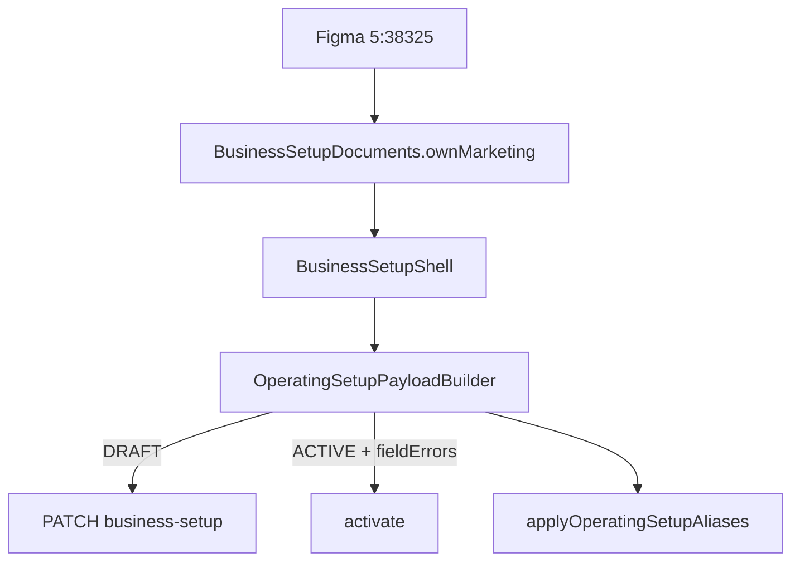

# Own Business Campaign Setup Figma + Draft Implementation Plan

> **For agentic workers:** REQUIRED SUB-SKILL: Use superpowers:subagent-driven-development (recommended) or superpowers:executing-plans to implement this plan task-by-task. Steps use checkbox (`- [ ]`) syntax for tracking.

**Goal:** Redo `OWN_BUSINESS_CAMPAIGN` Business setup to match Figma `5:38325` (MKT-OWN-SETUP-v6 · Harbor & Loom) on iOS and Android, with backend preference aliases, activate field errors on visible keys, and Group-parity Save draft | Schedule later via the shared shell.

**Architecture:** Keep shared `BusinessSetupShell` + `BusinessSetupDocumentKit`. Rewrite only `ownMarketing` in `BusinessSetupDocuments`. Extend `OperatingSetupPayloadBuilder` + `applyOperatingSetupAliases` so Figma keys coerce into closed marketing `OperatingPreferences`. Network / Counterparties masters sheets are **out of scope** — omit that section (five sections), same product choice as trading/retail.

**Tech Stack:** SwiftUI, Jetpack Compose, Node/TS `operating-catalog.ts`, Figma SoT `rknfN9EikSCdqmqXogR29o` node `5:38325`.

**Spec:** Figma [MKT-OWN-SETUP-v6 · Harbor & Loom](https://www.figma.com/design/rknfN9EikSCdqmqXogR29o/momentra?node-id=5-38325&m=dev); pattern from [docs/superpowers/plans/2026-11-22-trading-setup-figma-draft.md](docs/superpowers/plans/2026-11-22-trading-setup-figma-draft.md); smoke [docs/qa/BUSINESS_V4_APPSTATE_SMOKE.md](docs/qa/BUSINESS_V4_APPSTATE_SMOKE.md).

## Global Constraints

- Platforms: native iOS + Android lockstep; no web.
- Type code: `OWN_BUSINESS_CAMPAIGN` only (`CLIENT_CAMPAIGN` / `5:33148` is a follow-up).
- Hero: `Harbor & Loom Setup` / subtitle `Bring your business, people, and monthly plan together before you start.` / eyebrow `Own Business Campaign`.
- CTA: `Start this business`.
- Identity key: `campaignName` (label **Campaign name**); party via `brandName` (label **Promoted brand** / company profile — not a client).
- Five sections only: Basics → People & Roles → Channels & Monthly Plan → GST & Tax Details → Review.
- **Omit Network / Counterparties** (Figma UI §03 / frame “Catalogue, Stock & Network”) — masters sheets not required for setup; same product choice as trading/retail. Keep **Channels & Monthly Plan** (Figma UI §04 field block) — required.
- GST uses v7 panels: `gstTracking`, `gstRegistration`, `gstState`, `salePriceIncludesGst`, `gstEffectiveFrom`.
- Draft CTAs on shared `StickyActivateBar` (already wired); do not fork a marketing-only shell.
- Backend: marketing activate still requires `monthlyBudget` + `startDate` + identity + party; `requiresChannel` stays `false`.
- Rebuild `backend/dist` locally after catalog changes (dist is gitignored).

## Review Focus

- Activate with empty `monthlyBudget` → `fieldErrors["monthlyBudget"]` on the visible budget field.
- Activate with missing/invalid `startDate` → `fieldErrors["startDate"]`.
- Activate with empty party → `fieldErrors["brandName"]` (not `companyName` / `partyName`).
- Invalid GSTIN with `gstTracking == Yes` → `fieldErrors["gstin"]`; Save draft still succeeds.
- Draft half-filled → no fieldErrors; reopen prefills `campaignName`, `brandName`, channels, budget.

---

## File map

| Responsibility | iOS | Android | Backend |
|----------------|-----|---------|---------|
| Document | [`BusinessSetupDocuments.swift`](momentra/momentra/Shell/BusinessSetup/BusinessSetupDocuments.swift) `ownMarketing` | [`BusinessSetupDocuments.kt`](apk/app/src/main/java/com/example/momentra/ui/shell/business/setup/BusinessSetupDocuments.kt) `ownMarketing` | — |
| Aliases / fieldErrors | [`OperatingSetupPayloadBuilder.swift`](momentra/momentra/Shell/BusinessSetup/OperatingSetupPayloadBuilder.swift) | [`OperatingSetupPayloadBuilder.kt`](apk/app/src/main/java/com/example/momentra/ui/shell/business/setup/OperatingSetupPayloadBuilder.kt) | [`operating-catalog.ts`](backend/typescript/src/modules/business/operating-catalog.ts) |
| Shell draft (verify) | [`BusinessSetupShell.swift`](momentra/momentra/Shell/BusinessSetup/BusinessSetupShell.swift) | [`BusinessSetupShell.kt`](apk/app/src/main/java/com/example/momentra/ui/shell/business/setup/BusinessSetupShell.kt) | draft PATCH / activate |
| Tests | `BusinessSetupFieldModelTests.swift`, `OperatingSetupPayloadBuilderTests.swift` | `BusinessSetupFieldModelTest.kt`, `OperatingSetupPayloadBuilderTest.kt` | `business-setup-draft.test.ts` |
| Smoke | [`docs/qa/BUSINESS_V4_APPSTATE_SMOKE.md`](docs/qa/BUSINESS_V4_APPSTATE_SMOKE.md) | same | — |

## Canonical field map (Figma `5:38325`)

| Section | Keys | Notes |
|---------|------|-------|
| Basics | `campaignName`, `brandName`, `gstin`, `currency`, `startDate`, `endDate`, `campaignPurpose` (multi), `offerType` (Structure: One-time / Ongoing), `promotedProducts`, `location`, `description` | Drop short-form-only `offerType` old options; map Structure → `offerType` values `One-time`, `Ongoing`. `company` picker → seed `brandName` |
| People | `teamMembers`, `roles` | Roles: Owner, Admin, Campaign Lead, Finance, Approver. No `addPeople` |
| Channels | `channels`, `marketingBudget` (Own marketing budget), `planMonth`, `monthlyBudget`, `conversionGoal` (Primary target), `targetMetric` (Target unit), `supportingTarget` | Channels: Paid social, Search, Print, Influencer, Events, Store window |
| GST | `gstTracking`, `gstRegistration`, `gstState`, `salePriceIncludesGst`, `gstEffectiveFrom` | Hide registration/pricing when Not now |
| Review | campaignName, brandName, gstin, channels, monthlyBudget, conversionGoal, targetMetric | |
| Omitted | Network rowActions / masters | |

Aliases: `ownMarketingBudget` → `marketingBudget` (and into budget fallbacks if needed); `primaryTarget` → `conversionGoal`; `month` → `planMonth`; role `campaign lead` → existing `OPERATIONS_LEAD`.



---

### Task 1: Own marketing document Figma parity (iOS + Android)

**Files:**
- Modify: `BusinessSetupDocuments.swift` (`static let ownMarketing`)
- Modify: `BusinessSetupDocuments.kt` (`val ownMarketing`)
- Test: `BusinessSetupFieldModelTests.swift`, `BusinessSetupFieldModelTest.kt`

**Interfaces:**
- Consumes: `panelHeader`, `multiChoice(..., helper:)`, `date`, `choice` helpers
- Produces: `spec(for: "OWN_BUSINESS_CAMPAIGN")` with five sections; `defaultTitleKey == "campaignName"`; `activateLabel == "Start this business"`; no `network` / `modules`

- [ ] **Step 1: Write failing test** `ownMarketingMatchesFigma38325` (Swift + Kotlin)

Assert: `heroTitle == "Harbor & Loom Setup"`, `eyebrow` contains Own, `activateLabel == "Start this business"`, `defaultTitleKey == "campaignName"`, section titles Basics → People & Roles → Channels & Monthly Plan → GST & Tax Details → Review; `sections.allSatisfy { $0.id != "network" }`; keys include `brandName`, `endDate`, `campaignPurpose`, `offerType`, `promotedProducts`, `location`, `description`, `channels`, `marketingBudget`, `planMonth`, `monthlyBudget`, `conversionGoal`, `targetMetric`, `gstTracking`, `gstRegistration`, `salePriceIncludesGst`; channels `["Paid social", "Search", "Print", "Influencer", "Events", "Store window"]`; roles `["Owner", "Admin", "Campaign Lead", "Finance", "Approver"]`; `!keys.contains("modules")` and `!keys.contains("addPeople")`.

Update `ownMarketingMatchesMarketingPair` / any test that still expects Network section.

- [ ] **Step 2: Run tests — expect FAIL**

Android: `ANDROID_HOME=/home/santosh/Android/Sdk ./gradlew :app:testDebugUnitTest --tests '...BusinessSetupFieldModelTest.ownMarketingMatchesFigma38325'`

- [ ] **Step 3: Rewrite `ownMarketing`** to the canonical map (mirror trading five-section / restaurant GST panels). Basics subtitle: `Name the campaign and what it promotes.`

- [ ] **Step 4: Run tests — expect PASS**

- [ ] **Step 5: Commit**

```bash
git add momentra/momentra/Shell/BusinessSetup/BusinessSetupDocuments.swift \
  apk/app/src/main/java/com/example/momentra/ui/shell/business/setup/BusinessSetupDocuments.kt \
  momentra/momentraTests/BusinessSetupFieldModelTests.swift \
  apk/app/src/test/java/com/example/momentra/ui/shell/business/setup/BusinessSetupFieldModelTest.kt
git commit -m "$(cat <<'EOF'
feat(setup): align OWN_BUSINESS_CAMPAIGN document with Figma 5:38325

EOF
)"
```

---

### Task 2: Payload aliases + activate fieldErrors (clients)

**Files:**
- Modify: `OperatingSetupPayloadBuilder.swift` / `.kt`
- Test: `OperatingSetupPayloadBuilderTests.swift` / `OperatingSetupPayloadBuilderTest.kt`

**Interfaces:**
- Consumes: Task 1 keys
- Produces: party error key `brandName` for `OWN_BUSINESS_CAMPAIGN`; `primaryTarget`/`ownMarketingBudget` aliases; role `campaign lead`

- [ ] **Step 1: Write failing tests**

`ownMarketingFigmaAliasesRoundTrip`: prefs with `campaignName`, `brandName`, `channels`, `monthlyBudget`, `primaryTarget` / `conversionGoal`, `startDate` → `identityName`, `partyName`, `monthlyTarget` from conversion/primary; `activating: false` → empty fieldErrors.

`ownMarketingActivateMissingBudgetSetsFieldError`: activating with name+brand only (no budget/start) → `fieldErrors["monthlyBudget"]` and `fieldErrors["startDate"]`.

`ownMarketingActivateMissingBrandSetsFieldError`: activating with campaignName + budget + startDate but no brand → `fieldErrors["brandName"]`.

Fix `validationFieldErrors` so empty party uses `brandName` when subtype is `OWN_BUSINESS_CAMPAIGN` (and keep `clientName` for CLIENT when that doc is redone; until then CLIENT may still use `companyName` — only change Own in this task).

- [ ] **Step 2: Run — expect FAIL**

- [ ] **Step 3: Implement aliases + party error key + role `campaign lead` / `campaignlead`**

- [ ] **Step 4: Run — expect PASS**

- [ ] **Step 5: Commit**

```bash
git commit -m "$(cat <<'EOF'
feat(setup): own marketing Figma aliases and activate fieldErrors

EOF
)"
```

---

### Task 3: Backend aliases + draft/activate tests

**Files:**
- Modify: `backend/typescript/src/modules/business/operating-catalog.ts`
- Test: `backend/typescript/tests/business-setup-draft.test.ts`

**Interfaces:**
- Consumes: same Figma prefs
- Produces: `applyOperatingSetupAliases` maps `primaryTarget` → `conversionGoal` / `monthlyTarget` fallback; `ownMarketingBudget` → `marketingBudget`; draft normalize accepts half-filled Own; activate rejects missing budget with field key aligned to client when possible

- [ ] **Step 1: Write failing test** `maps own marketing Figma aliases and accepts an own-campaign draft`

Assert: `campaignName` → `identityName`, `brandName` → `partyName`, budget/target aliases; draft with `channels: ['Paid social']` succeeds; Existing Client→Own flip test still passes.

- [ ] **Step 2: Run** `node --import tsx --test tests/business-setup-draft.test.ts` — expect FAIL on new case if aliases missing

- [ ] **Step 3: Add aliases** in `applyOperatingSetupAliases`; role map if needed; keep `requiresChannel: false`

- [ ] **Step 4: Run draft tests — PASS**; `npx tsc -p tsconfig.json --outDir ../dist`

- [ ] **Step 5: Commit** src + tests (not gitignored dist)

```bash
git commit -m "$(cat <<'EOF'
feat(backend): own marketing setup Figma preference aliases

EOF
)"
```

---

### Task 4: Draft UX verify + smoke notes

**Files:**
- Verify: `BusinessSetupShell` / `StickyActivateBar` already pass `onSaveDraft` + `onScheduleLater`
- Modify: `docs/qa/BUSINESS_V4_APPSTATE_SMOKE.md` — Own Business (`5:38325`) checklist

- [x] **Step 1: Confirm** Own chip uses shared shell draft CTAs (no code unless a bypass exists) — `BusinessSetupShell` passes `onSaveDraft` / `onScheduleLater` into `StickyActivateBar` for all subtypes including `OWN_BUSINESS_CAMPAIGN`; no marketing-only bypass.

- [x] **Step 2: Add smoke subsection** — `docs/qa/BUSINESS_V4_APPSTATE_SMOKE.md` § Own Business Campaign (`5:38325`); global Network omit list includes Own.

  - Hero **Harbor & Loom Setup**; CTA **Start this business**
  - Five sections only (no Network)
  - Basics: campaign, brand, purpose, structure, dates, currency, GSTIN
  - Channels: Paid social… + own marketing budget + monthly budget + primary target
  - Save draft | Schedule later; reopen restores prefs
  - Activate missing budget/startDate/brand highlights those fields; bad GSTIN with tracking Yes highlights GSTIN

- [ ] **Step 3: Commit** (smoke + plan checkbox notes)

```bash
git commit -m "$(cat <<'EOF'
docs(qa): own marketing setup Figma smoke checklist

EOF
)"
```

---

## Self-review

1. **Spec coverage:** Figma Basics/People/Channels/GST/Review → Task 1; Network masters explicitly omitted; aliases/backend → Tasks 2–3; draft → Task 4.
2. **Steps:** One test / implement / verify / commit each.
3. **Types:** String prefs; identity `campaignName`; party `brandName`.
4. **Review Focus:** Each mode has a Task 2/3 test.
5. **Out of scope:** `CLIENT_CAMPAIGN` rewrite, Network masters CRUD, changing `requiresChannel` to true.
