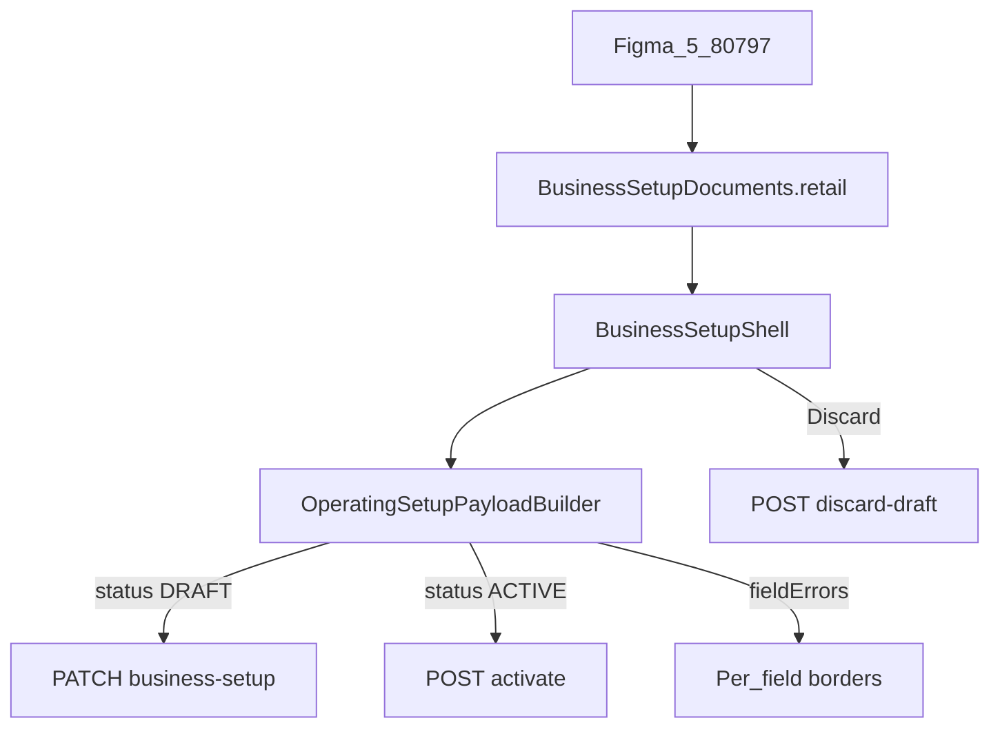

# Retail Store Setup (Figma + Drafts + Field Errors)

**Goal:** Make `RETAIL_STORE` setup match Figma `rknfN9EikSCdqmqXogR29o` node `5:80797` on Android and iOS, persist every editable field through existing business draft/activate APIs, highlight invalid fields, and support Group-style drafts — **without** Section 04 Catalogue/Stock/Network.

**Architecture:** Keep shared `BusinessSetupShell` + document specs. Rewrite only the `RETAIL_STORE` document to five sections. Map form keys through `OperatingSetupPayloadBuilder` / backend `applyOperatingSetupAliases` into closed `OperatingPreferences`. Android already has draft CTA + `fieldErrors` hooks; bring iOS to lockstep and finish Discard + retail field coverage on both.

**Tech stack:** Jetpack Compose (`apk/.../business/setup`), SwiftUI (`momentra/.../BusinessSetup`), Express `/v1` business draft/activate, Postgres prefs on the moment setup row.

**Spec:** Figma `5:80797`; contracts in [`backend/.../operating-catalog.ts`](backend/typescript/src/modules/business/operating-catalog.ts); draft APIs `PATCH /v1/moments/:id/business-setup` + `POST .../activate` + `POST .../discard-draft`.

## Locked decisions

- Scope: **`RETAIL_STORE` only** (not restaurant/service).
- **Remove Section 04** (Catalogue / Stock / Network / Create SKU rows). Renumber to **5 steps**: Basics → People → Channels & Plan → GST → Review.
- CTA copy: **Start this store**.
- Draft UX: same lifecycle as Group — **Save draft**, **Activate**, **Discard draft** (header when `editingMomentStatus == DRAFT`).
- No new moment types or POS sheets in this plan.

## Field map (Figma → prefs)

| UI key | Backend `OperatingPreferences` |
|--------|-------------------------------|
| `storeName` | `identityName` |
| `companyName` | `partyName` |
| `gstin` | `gstin` |
| `currency` | `currency` (default INR) |
| `startDate` / `endDate` | `startDate` / `endDate` |
| `description` | `description` |
| `location` | `location` |
| `channels` multi (Counter, Home, Online, B2B, Market) | `channels[]` |
| `planMonth` | display helper only — writes first day into `startDate` if empty |
| `monthlyBudget` | `monthlyBudget` |
| `monthlyTarget` | `monthlyTarget` |
| `targetMetric` | `targetMetric` (e.g. Revenue) |
| `gstTracking` Yes / Not now | `gstTracking` |
| `gstType` Regular / Composition / Unregistered / Not sure | `gstRegistration` |
| `gstState` | `gstState` (+ derived `gstStateCode`) |
| `salePriceIncludesGst` | `salePriceIncludesGst` |
| `gstEffectiveFrom` | `gstEffectiveFrom` |
| invite default role chips | invite section only (not activate-blocking) |

Drop from current retail spec: `locality`, `format`, `posStyle`, `skuFocus`, `modules` / network section.

## File map

- Specs: [`BusinessSetupDocuments.kt`](apk/app/src/main/java/com/example/momentra/ui/shell/business/setup/BusinessSetupDocuments.kt) / [`.swift`](momentra/momentra/Shell/BusinessSetup/BusinessSetupDocuments.swift)
- Shell + sticky bar: [`BusinessSetupShell.kt`](apk/app/src/main/java/com/example/momentra/ui/shell/business/setup/BusinessSetupShell.kt) / [`.swift`](momentra/momentra/Shell/BusinessSetup/BusinessSetupShell.swift); [`BusinessSetupDocumentKit`](apk/app/src/main/java/com/example/momentra/ui/shell/business/setup/BusinessSetupDocumentKit.kt)
- Payload + field errors: [`OperatingSetupPayloadBuilder.kt`](apk/app/src/main/java/com/example/momentra/ui/shell/business/setup/OperatingSetupPayloadBuilder.kt) / iOS twin
- VM: [`MomentCreateViewModel.kt`](apk/app/src/main/java/com/example/momentra/ui/create/MomentCreateViewModel.kt) / [`MomentCreateModel.swift`](momentra/momentra/Shell/MomentCreateModel.swift)
- Backend aliases + activate validation: [`operating-catalog.ts`](backend/typescript/src/modules/business/operating-catalog.ts); draft tests under `backend/typescript/tests/`

## Tasks

### Task 1 — Backend retail prefs round-trip + field-keyed errors

- Extend/assert `applyOperatingSetupAliases` so retail accepts Figma aliases (`storeName`, `companyName`, `location`, channel labels) into closed prefs.
- On activate (non-draft), keep strict channel + identity/party rules for `RETAIL_STORE`.
- When validation fails, return `AppError` details shaped as `{ fields: { <prefOrAliasKey>: message } }` so clients can highlight (message string remains for banner).
- Tests: draft PATCH with full retail field set persists; activate missing `channels` fails with `fields.channels`; activate with Counter + names succeeds.

### Task 2 — Rewrite `RETAIL_STORE` document (5 sections, no network)

- Replace `BusinessSetupDocuments.retail` on **both** platforms from Figma: hero **Harbor Mart Setup** / subtitle; kind chip Retail Store selected; step copy **5 steps · Retail setup**; sections 01–05 as above; `activateLabel = "Start this store"`; review summary keys match Figma (company, GSTIN, people, budget, target, measure, channels).
- GST visibility: hide registration/pricing fields when tracking is **Not now**.
- Unit tests: section ids/order, no `network` section, activate label, required channel multiChoice options.

### Task 3 — Payload builder aliases + client fieldErrors for retail

- Map new keys → prefs; stop mapping `format` → `partyName` for retail (use `companyName`).
- `validationFieldErrors` keys must match **UI keys** (`storeName`, `companyName`, `channels`, `gstin`, …) so borders land on the right rows.
- Soft status pill in Channels section: green when budget+target parse positive; rose warning when target present but budget empty (informational, not blocking activate unless backend requires amounts — retail amounts stay optional on activate).

### Task 4 — Draft UX lockstep (Group pattern) on Android + iOS

**Android (mostly present):** keep Save draft on sticky bar; add **Discard draft** in header when `draftMomentStatus == DRAFT` calling `discardMomentDraft`; after first draft create, stay on setup with `draftMomentId` (already). Ensure draft create uses stable idempotency key `business:RETAIL_STORE:{title}` like iOS business path.

**iOS (gap):** add Save draft + Discard to `BusinessSetupShell` / `StickyActivateBar`; wire `saveBusinessSetupDraft` / `submitBusinessSetup(status: "DRAFT")` / `discardMomentDraft`; surface `fieldErrors` on `FieldRow` / chips (port Android pattern).

Both: draft save is lenient (no field-error block); Activate runs strict validation + highlights.

### Task 5 — Visual parity gate for retail shell chrome

- Rose theme unchanged; Identity + Dates panels; channel chips; GST panels; Review cards; sticky **Start this store** + secondary **Save draft**.
- Confirm Section 04 rows/icons are absent.
- Smoke checklist update in [`docs/qa/BUSINESS_V4_APPSTATE_SMOKE.md`](docs/qa/BUSINESS_V4_APPSTATE_SMOKE.md) for retail: 5 sections, draft save/resume/discard, field error on empty channels activate.

## Out of scope

- Restaurant / Consumer Service documents
- Catalogue / Stock / Supplier / Location sheets during setup
- Active retail POS kits
- Changing other eight business subtypes

## Review focus

- Activate with empty channels → `channels` field highlighted + banner.
- Invalid GSTIN format when GST tracking Yes → `gstin` highlighted.
- Save draft with only store name → succeeds; resume prefill restores prefs.
- Discard draft leaves setup and removes DRAFT moment.
- Kind chip swap away from Retail reseeds without crashing (existing shell behavior).
