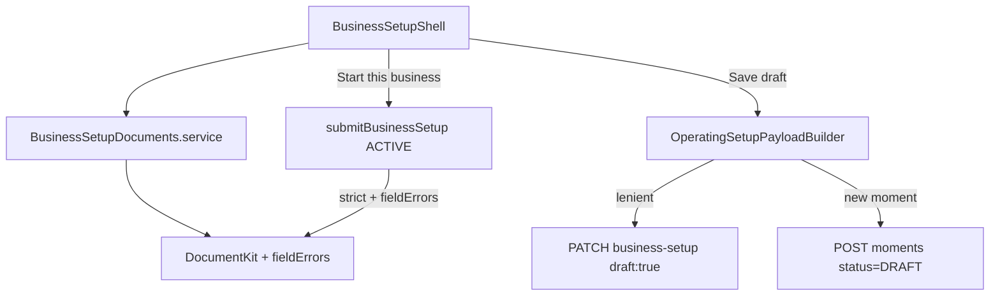

# Service Setup Figma Redo + Draft/Errors Implementation Plan

> **For agentic workers:** REQUIRED SUB-SKILL: Use superpowers:subagent-driven-development (recommended) or superpowers:executing-plans to implement this plan task-by-task. Steps use checkbox (`- [ ]`) syntax for tracking.

**Goal:** Make Consumer Service setup (`CONSUMER_SERVICE`) match Figma `SVC-SETUP-v6 · BrightCare` (`5:71162`), persist incomplete work via the existing business-setup draft API, resume drafts, and surface activate validation on the offending fields — lockstep Android + iOS.

**Architecture:** Keep the shared [`BusinessSetupShell`](apk/app/src/main/java/com/example/momentra/ui/shell/business/setup/BusinessSetupShell.kt) / [`BusinessSetupShell.swift`](momentra/momentra/Shell/BusinessSetup/BusinessSetupShell.swift). Rewrite only the `service` document to the Figma v7 six-section inventory; extend the field kit for helpers, panel headers, richer module rows, and error chrome; map UI keys through [`OperatingSetupPayloadBuilder`](apk/app/src/main/java/com/example/momentra/ui/shell/business/setup/OperatingSetupPayloadBuilder.kt) + backend [`applyOperatingSetupAliases`](backend/typescript/src/modules/business/operating-catalog.ts) into closed `OperatingPreferences`. Draft = create/patch with lenient normalize; Activate = strict validate + fieldErrors.

**Tech Stack:** Jetpack Compose (`apk/.../business/setup/`), SwiftUI (`momentra/.../BusinessSetup/`), existing `PATCH /v1/moments/:momentId/business-setup`, `POST /v1/moments` with `status=DRAFT`, `GET /v1/moments/:momentId/setup`, backend `normalizeOperatingPreferences({ draft: true|false })`.

**Spec:** Figma `rknfN9EikSCdqmqXogR29o` node `5:71162`; contract freeze in [`docs/superpowers/plans/2026-11-19-business-v4-contract-freeze.md`](docs/superpowers/plans/2026-11-19-business-v4-contract-freeze.md). After approval, also save this plan to `docs/superpowers/plans/2026-11-22-service-setup-figma-draft-errors.md`.

## Global Constraints

- SoT: Figma `rknfN9EikSCdqmqXogR29o` / `5:71162` — not the legacy TzLvw SVC operating screens.
- Scope: `CONSUMER_SERVICE` document + shared shell draft/error plumbing (shell changes apply to all subtypes; only service field inventory is rewritten here).
- Platforms: native Android + iOS lockstep; no web.
- Reuse existing draft APIs; do not invent a new draft endpoint.
- Closed preferences stay the activate contract; UI-only keys (`modules`, panel chrome) stay client-side.
- Palette: services teal/lime (`#042F2E` / `#0D9488` / `#84CC16`) via existing `BusinessSetupTheme` / `Services` tokens.
- CTA copy: primary `Start this business`; secondary draft `Save draft`.

## Review Focus

- Empty `serviceName` blocks activate and highlights that field (not only a bottom banner).
- Zero channels on activate: channels chip group highlights with copy `Select at least one channel.`
- Invalid GSTIN on activate (when tracking Yes): GSTIN field borders danger; draft save still succeeds.
- Resume DRAFT: reopen with `editingMomentId` restores saved prefs including multi-select channels.
- Chip swap Retail↔Service reseeds service fields without losing a typed title when keys overlap.

## Drift (confirmed)

| Area | App today | Figma `5:71162` |
|------|-----------|-----------------|
| Basics | `serviceName`, `serviceType`, `bookingStyle`, `gstin` | Identity: name, company, GSTIN, currency, start/end; Dates & more: description, location |
| People | Specialist / Front desk + Add Member | Owner card, roles Owner/Manager/Stylist/Front desk/Therapist, Invite & QR only |
| Channels | Walk-in/WhatsApp/Phone/Website + jobs/avg ticket | Studio/Home/Online/Corporate/Events + Month + monthly budget + charge target + measure |
| Network | 4 plain module names | Services catalogue / Rooms / Team & Staff / Clients / Team Tasks with subtitles |
| GST | Yes toggle + type + state | Track Yes/Not now, Regular/Composition/Unregistered/Not sure, state, prices include GST, effective from |
| Draft | API + VM exist; shell never calls | Save draft + Setup in progress + resume |
| Errors | Banner only | Per-field danger border + message |

## File map

- Specs: [`BusinessSetupDocuments.kt`](apk/app/src/main/java/com/example/momentra/ui/shell/business/setup/BusinessSetupDocuments.kt) / [`.swift`](momentra/momentra/Shell/BusinessSetup/BusinessSetupDocuments.swift) — rewrite `service`
- Kit: [`BusinessSetupDocumentKit.kt`](apk/app/src/main/java/com/example/momentra/ui/shell/business/setup/BusinessSetupDocumentKit.kt) / [`.swift`](momentra/momentra/Shell/BusinessSetup/BusinessSetupDocumentKit.swift) — helper, panelHeader, moduleRow subtitle, error chrome, Save draft in sticky bar
- Shell: [`BusinessSetupShell.kt`](apk/app/src/main/java/com/example/momentra/ui/shell/business/setup/BusinessSetupShell.kt) / [`.swift`](momentra/momentra/Shell/BusinessSetup/BusinessSetupShell.swift) — draft load/save, fieldErrors state, Setup in progress pill
- Payload: [`OperatingSetupPayloadBuilder.kt`](apk/app/src/main/java/com/example/momentra/ui/shell/business/setup/OperatingSetupPayloadBuilder.kt) / [`.swift`](momentra/momentra/Shell/BusinessSetup/OperatingSetupPayloadBuilder.swift) — aliases + `fieldErrors: Map<String,String>`
- Create models: [`MomentCreateViewModel.kt`](apk/app/src/main/java/com/example/momentra/ui/create/MomentCreateViewModel.kt) / [`MomentCreateModel.swift`](momentra/momentra/Shell/MomentCreateModel.swift) — surface draft save result; return fieldErrors from activate validation
- Backend: [`operating-catalog.ts`](backend/typescript/src/modules/business/operating-catalog.ts) — aliases `monthlyChargeTarget`→`monthlyTarget`, role labels Stylist/Therapist
- Tests: `BusinessSetupFieldModelTest(s)`, new `OperatingSetupPayloadBuilder*Test`, backend alias/normalize tests for service draft vs activate

## Locked Figma → preference keys (`CONSUMER_SERVICE`)

**01 Business Basics**
- `serviceName` (Business name) → `identityName`
- `companyName` → `partyName` (via existing alias)
- `gstin`, `currency`, `startDate`, `endDate`, `description`, `location`

**02 People & Roles**
- `roles` multiChoice: Owner, Manager, Stylist, Front desk, Therapist
- Invite section unchanged (no separate Add person)
- `teamMembers` / invite list display only

**03 Channels & Monthly Plan**
- `channels` multiChoice: Studio, Home, Online, Corporate, Events (at least one on activate)
- `planMonth` (Month) — UI + review; store as preference string
- `monthlyBudget`, `monthlyChargeTarget`→`monthlyTarget`, `targetMetric` (default Revenue)

**04 Services, Rooms & Clients**
- Module rows (UI-only seeds, not activate-blocking): Services catalogue; Rooms & infrastructure; Team & Staff; Clients; Team Tasks & Chat — each with Figma subtitle

**05 GST & Tax Details**
- `gstTracking` chips Yes / Not now (replace boolean-only toggle copy)
- `gstRegistration`: Regular, Composition, Unregistered, Not sure
- `gstState`, `salePriceIncludesGst` (Prices include GST / GST is added separately), `gstEffectiveFrom`
- Hide registration/pricing panels when `gstTracking` is Not now

**06 Review**
- Live summary: Company, GSTIN, People, budget, charge target, target measure, channels line, Ready status, CTA `Start this business`

---

### Task 1: Field kit — helper, panel, module subtitle, error chrome

**Files:** DocumentKit + Documents field model (kt/swift); tests `BusinessSetupFieldModelTest(s)`

**Interfaces:**
- Produces: optional `helper: String` on `BusinessSetupFieldSpec`; kind `PanelHeader(title)`; `ModuleList` entries become `ModuleRow(title, subtitle)`; kit APIs accept `error: String?` and render `SignalDanger` border + 11sp error text
- Sticky bar gains secondary `Save draft` (`enabled` when title non-empty, `savingDraft` flag)

- [ ] Write failing tests for helper rendering, panel header kind, module subtitle, and error border when `error != null`
- [ ] Implement kit + model; run tests PASS
- [ ] Commit `feat(setup): field kit helpers panels module subtitles and errors`

### Task 2: Rewrite `BusinessSetupDocuments.service` from Figma

**Files:** `BusinessSetupDocuments.kt` / `.swift` (`service` only)

**Interfaces:** Consumes Task 1 kinds; produces locked keys above; hero `BrightCare Setup` / subtitle `Bring your business, people, and monthly plan together before you start.`; eyebrow Services; activate `Start this business`; `defaultTitleKey = serviceName`; section titles numbered 01–06 with Figma subtitles

- [ ] Failing snapshot/unit test asserting section ids, field keys, channel options, role options
- [ ] Rewrite `service` spec lockstep; PASS; commit `feat(service): Figma 5:71162 setup document fields`

### Task 3: Payload builder — aliases + fieldErrors

**Files:** `OperatingSetupPayloadBuilder` kt/swift; backend `applyOperatingSetupAliases` / role aliases

**Interfaces:**
- `Result(preferences, masterSeeds, validationError, fieldErrors: Map<String,String>)`
- Map `monthlyChargeTarget` → `monthlyTarget`; `serviceName`/`companyName` already aliased
- Activate rules for service: require `identityName`, `partyName` (companyName or fallback), ≥1 channel; GSTIN format when tracking Yes and gstin non-empty
- Draft path (`activating=false`): no fieldErrors, empty allowed

- [ ] Failing tests: activate missing channels → `fieldErrors["channels"]`; bad GSTIN → `fieldErrors["gstin"]`; draft never errors
- [ ] Implement client + backend aliases/roles; PASS; commit `feat(service): setup validation fieldErrors and aliases`

### Task 4: Wire Save draft + resume (APK + iOS as one group)

**Files:** Shells, MomentCreateViewModel / MomentCreateModel, hosts that pass `editingMomentId`

**Behavior (locked):**
1. **Save draft** with no `editingMomentId`: `submitBusinessSetup(..., status="DRAFT")` → keep user on shell with returned moment id as editing DRAFT; show pill `Setup in progress`
2. **Save draft** with DRAFT id: `saveBusinessSetupDraft` / `patchBusinessSetupDraft` (lenient); toast or inline `Draft saved`
3. **Open existing DRAFT:** `GET .../setup` (or create-model load) → merge preferences into `values` before first paint
4. **Start this business:** existing activate path; on `validationError`, set `fieldErrors` and scroll/banner; do not clear values
5. Discard remains available from existing create-model API where hosts already expose it — no new discard UI in this plan

- [ ] Failing VM/shell tests: draft create then second save patches; activate with empty channels sets fieldErrors and does not clear form
- [ ] Implement shell + models lockstep; PASS; commit `feat(setup): wire business setup draft save and resume`

### Task 5: Smoke + parity gate

**Files:** [`docs/qa/BUSINESS_V4_APPSTATE_SMOKE.md`](docs/qa/BUSINESS_V4_APPSTATE_SMOKE.md); unit tests both platforms; backend catalog tests

- [ ] Update smoke checklist for service node `5:71162`: full field list, Save draft, resume, field highlight, GST hide on Not now
- [ ] Run Android + iOS setup unit tests and backend operating-catalog tests
- [ ] Commit `test(service): smoke and parity for setup draft errors`

## Out of scope

- Post-activate 22 SVC operating screens ([`2026-11-10-service-flow-22-screens.md`](docs/superpowers/plans/2026-11-10-service-flow-22-screens.md))
- Rewriting the other eight setup documents (only service inventory)
- New backend draft schema or Group-domain draft flows