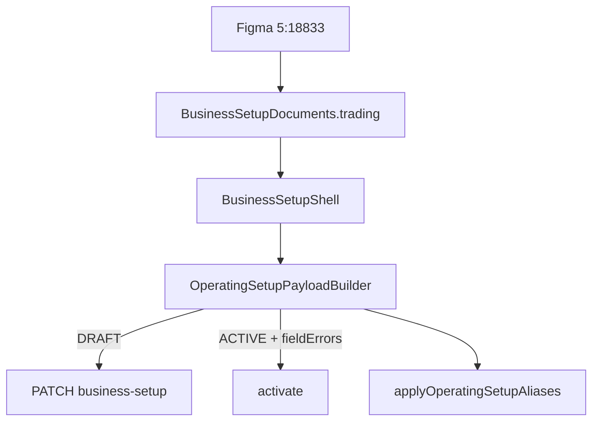

# Trading Setup Figma + Draft Implementation Plan

> **For agentic workers:** REQUIRED SUB-SKILL: Use superpowers:subagent-driven-development (recommended) or superpowers:executing-plans to implement this plan task-by-task. Steps use checkbox (`- [ ]`) syntax for tracking.

**Goal:** Redo `TRADING_WHOLESALE` Business setup to match Figma `5:18833` (TRD-SETUP-v6 · Northstar Trading) on iOS and Android, with backend preference aliases, activate field errors, and Group-parity Save draft | Schedule later (already on shared shell).

**Architecture:** Keep shared `BusinessSetupShell` + `BusinessSetupDocumentKit`. Rewrite only the `trading` document spec to the retail/restaurant Figma-v7 field shape. Extend `OperatingSetupPayloadBuilder` + `applyOperatingSetupAliases` so Figma keys coerce into closed `OperatingPreferences`. §04 Catalogue / Godowns / Suppliers rows are **display-only** `moduleListRows` (no masters sheets), same product choice as restaurant.

**Tech Stack:** SwiftUI (`momentra/.../BusinessSetup/`), Jetpack Compose (`apk/.../business/setup/`), Node/TS `operating-catalog.ts`, Figma SoT `rknfN9EikSCdqmqXogR29o` node `5:18833`.

**Spec:** Figma [TRD-SETUP-v6 · Northstar Trading](https://www.figma.com/design/rknfN9EikSCdqmqXogR29o/momentra?node-id=5-18833&m=dev); mirror pattern in [docs/superpowers/plans/2026-11-22-restaurant-setup-figma-draft.md](docs/superpowers/plans/2026-11-22-restaurant-setup-figma-draft.md); smoke [docs/qa/BUSINESS_V4_APPSTATE_SMOKE.md](docs/qa/BUSINESS_V4_APPSTATE_SMOKE.md).

## Global Constraints

- Platforms: native iOS + Android lockstep; no web.
- Type code: `TRADING_WHOLESALE` only in this plan (`DISTRIBUTION_DEALERSHIP` / `5:8637` is a follow-up).
- Activate CTA copy from Figma: `Start this business` (replace current `Start the business!`).
- Hero: `Northstar Trading Setup` / subtitle `Bring your business, people, and monthly plan together before you start.` / eyebrow `Trading`.
- Identity key stays `businessName` (label **Business name**); party via `companyName`.
- Plan fields use canonical `monthlyBudget`, `monthlyTarget`, `targetMetric` (not `targetSales` / `monthlyExpense` / `marketingBudget` as primary UI keys).
- GST uses retail panels: `gstTracking`, `gstRegistration`, `gstState`, `salePriceIncludesGst`, `gstEffectiveFrom` (drop UI-only `filingFrequency` / `industry` / `headquarters`).
- §04 masters sheets out of scope — static module rows only.
- Draft CTAs live on shared `StickyActivateBar` (already wired for all subtypes); do not fork a trading-only shell.
- Backend activate still dual-writes budget↔target for trading; `requiresChannel` stays `false` (channels encouraged in copy, not hard-required).
- Rebuild `backend/dist` after catalog changes.

## Review Focus

- Activate with empty `monthlyBudget` after aliases — field error must land on `monthlyBudget` key present in the new form.
- Activate with empty `monthlyTarget` — field error on `monthlyTarget` (Figma “Monthly sales target”).
- Missing `companyName` / party — field error on `companyName`.
- Invalid GSTIN with `gstTracking == Yes` — field error on `gstin`; Save draft still succeeds.
- Draft save with half-filled form — no fieldErrors; reopen prefills `businessName`, channels, budget/target.

---

## File map

| Responsibility | iOS | Android | Backend |
|----------------|-----|---------|---------|
| Document spec | [`BusinessSetupDocuments.swift`](momentra/momentra/Shell/BusinessSetup/BusinessSetupDocuments.swift) `trading` | [`BusinessSetupDocuments.kt`](apk/app/src/main/java/com/example/momentra/ui/shell/business/setup/BusinessSetupDocuments.kt) `trading` | — |
| Aliases / fieldErrors | [`OperatingSetupPayloadBuilder.swift`](momentra/momentra/Shell/BusinessSetup/OperatingSetupPayloadBuilder.swift) | [`OperatingSetupPayloadBuilder.kt`](apk/app/src/main/java/com/example/momentra/ui/shell/business/setup/OperatingSetupPayloadBuilder.kt) | [`operating-catalog.ts`](backend/typescript/src/modules/business/operating-catalog.ts) `applyOperatingSetupAliases` |
| Shell draft (verify only) | [`BusinessSetupShell.swift`](momentra/momentra/Shell/BusinessSetup/BusinessSetupShell.swift) | [`BusinessSetupShell.kt`](apk/app/src/main/java/com/example/momentra/ui/shell/business/setup/BusinessSetupShell.kt) | draft PATCH / activate |
| Sticky bar | [`BusinessSetupDocumentKit.swift`](momentra/momentra/Shell/BusinessSetup/BusinessSetupDocumentKit.swift) | [`BusinessSetupDocumentKit.kt`](apk/app/src/main/java/com/example/momentra/ui/shell/business/setup/BusinessSetupDocumentKit.kt) | — |
| Tests | `momentraTests/BusinessSetupFieldModelTests.swift`, `OperatingSetupPayloadBuilderTests.swift` | `apk/.../BusinessSetupFieldModelTest.kt`, `OperatingSetupPayloadBuilderTest.kt` | `backend/typescript/tests/business-setup-draft.test.ts` |
| Smoke | [`docs/qa/BUSINESS_V4_APPSTATE_SMOKE.md`](docs/qa/BUSINESS_V4_APPSTATE_SMOKE.md) | same | — |

## Canonical field map (Figma `5:18833`)

| Section | Keys | Notes |
|---------|------|-------|
| Basics | `outlet`-style panels: `businessName`, `companyName`, `gstin`, `currency`, `startDate`, `endDate`, `description`, `location` | Drop `industry`, `startedOn`, `headquarters`; alias `startedOn`→`startDate` if lingering |
| People | `teamMembers`, `roles` | Roles: Owner, Manager, Sales exec, Warehouse, Sales rep. No `addPeople` |
| Channels | `channels`, `planMonth`, `monthlyBudget`, `monthlyTarget`, `targetMetric` | Channels: Retail buyers, Wholesale, Modern trade, HoReCa, Online |
| Network §04 | `modules` moduleListRows | Catalogue & SKU; Godowns & branches; Suppliers & buyers; Team invite & QR — display only |
| GST | `gstTracking`, `gstRegistration`, `gstState`, `salePriceIncludesGst`, `gstEffectiveFrom` | Hide registration/pricing when tracking is Not now |
| Review | companyName, gstin, channels, monthlyBudget, monthlyTarget, targetMetric | |
| CTA | `Start this business` | |

Aliases to support: `monthlySalesTarget`→`monthlyTarget`; `targetSales`/`monthlyExpense`/`marketingBudget` remain fallbacks in builders; role labels `sales exec`, `sales rep`, `warehouse`.



---

### Task 1: Trading document Figma parity (iOS + Android)

**Files:**
- Modify: `momentra/momentra/Shell/BusinessSetup/BusinessSetupDocuments.swift` (`static let trading`)
- Modify: `apk/app/src/main/java/com/example/momentra/ui/shell/business/setup/BusinessSetupDocuments.kt` (`val trading`)
- Test: `momentra/momentraTests/BusinessSetupFieldModelTests.swift`
- Test: `apk/app/src/test/java/com/example/momentra/ui/shell/business/setup/BusinessSetupFieldModelTest.kt`

**Interfaces:**
- Consumes: existing `panelHeader`, `moduleListRows`, `multiChoice(..., helper:)`, `date`, `choice` helpers
- Produces: `BusinessSetupDocuments.spec(for: "TRADING_WHOLESALE")` with Figma sections/keys above; `defaultTitleKey == "businessName"`; `activateLabel == "Start this business"`

- [ ] **Step 1: Write the failing test** `tradingMatchesFigma18833` (Swift + Kotlin)

Assert: `heroTitle == "Northstar Trading Setup"`, `activateLabel == "Start this business"`, `defaultTitleKey == "businessName"`, section titles in order Basics → People & Roles → Channels & Monthly Plan → Catalogue, Warehouses & Network → GST & Tax Details → Review your setup; keys include `companyName`, `currency`, `startDate`, `endDate`, `description`, `location`, `channels`, `planMonth`, `monthlyBudget`, `monthlyTarget`, `targetMetric`, `gstTracking`, `gstRegistration`, `salePriceIncludesGst`; channels options `["Retail buyers", "Wholesale", "Modern trade", "HoReCa", "Online"]`; roles `["Owner", "Manager", "Sales exec", "Warehouse", "Sales rep"]`; modules count 4 with titles Catalogue & SKU, Godowns & branches, Suppliers & buyers, Team invite & QR.

- [ ] **Step 2: Run tests to verify they fail**

Run: Android `./gradlew :app:testDebugUnitTest --tests '...BusinessSetupFieldModelTest.tradingMatchesFigma18833'`; iOS `xcodebuild test` filtered to `BusinessSetupFieldModelTests/tradingMatchesFigma18833` (or project’s usual iOS unit command).

Expected: FAIL on heroTitle / activateLabel / missing keys.

- [ ] **Step 3: Rewrite `trading` specs** to the canonical field map (mirror `restaurant` / Android `retail` structure). §04 subtitle: `Modules your orders, dispatches and purchases will use after start.` (no “opens its own sheet”).

- [ ] **Step 4: Run tests to verify they pass**

Expected: PASS. Also keep `tradingActivateLabelIsStartTheBusiness` in sync (rename/update assertion to `Start this business`).

- [ ] **Step 5: Commit**

```bash
git add momentra/momentra/Shell/BusinessSetup/BusinessSetupDocuments.swift \
  apk/app/src/main/java/com/example/momentra/ui/shell/business/setup/BusinessSetupDocuments.kt \
  momentra/momentraTests/BusinessSetupFieldModelTests.swift \
  apk/app/src/test/java/com/example/momentra/ui/shell/business/setup/BusinessSetupFieldModelTest.kt
git commit -m "$(cat <<'EOF'
feat(setup): align TRADING_WHOLESALE document with Figma 5:18833

EOF
)"
```

---

### Task 2: Payload aliases + activate fieldErrors (clients)

**Files:**
- Modify: `OperatingSetupPayloadBuilder.swift` / `.kt`
- Test: `OperatingSetupPayloadBuilderTests.swift` / `OperatingSetupPayloadBuilderTest.kt`

**Interfaces:**
- Consumes: Task 1 keys (`monthlyBudget`, `monthlyTarget`, `businessName`, `companyName`, channels)
- Produces: `build(..., activating: true).fieldErrors` keyed to those UI keys; `monthlySalesTarget` aliases into `monthlyTarget`; role map includes `sales exec` / `sales rep`

- [ ] **Step 1: Write failing tests**

`tradingFigmaAliasesRoundTrip`: prefs with `businessName`, `companyName`, `channels: "Retail buyers|Wholesale"`, `monthlyBudget`, `monthlySalesTarget` → `identityName`, `monthlyTarget` coerced, no validationError when `activating: false`.

`tradingActivateMissingBudgetSetsFieldError`: activating with name+company only → `fieldErrors["monthlyBudget"]` and/or `monthlyTarget` set (after dual-write rules: if both missing, both errors; match existing `tradingOrMfg` branch).

`mapRole("Sales exec")` / `mapRole("Sales rep")` → `OPERATIONS_LEAD` or `TEAM_MEMBER` consistently with warehouse/salesman mapping already in file (Sales exec → `OPERATIONS_LEAD`, Sales rep → `TEAM_MEMBER` unless catalog already maps salesman differently — follow existing `salesman` → `TEAM_MEMBER`).

- [ ] **Step 2: Run tests — expect FAIL**

- [ ] **Step 3: Implement aliases + role entries** in both builders (`monthlySalesTarget` in target firstNonEmpty list; role aliases). Ensure `validationFieldErrors` for `tradingOrMfg` continues to set `monthlyBudget` / `monthlyTarget` keys that exist on the new form.

- [ ] **Step 4: Run tests — expect PASS**

- [ ] **Step 5: Commit**

```bash
git commit -m "$(cat <<'EOF'
feat(setup): trading Figma aliases and activate fieldErrors

EOF
)"
```

---

### Task 3: Backend aliases + draft/activate tests

**Files:**
- Modify: `backend/typescript/src/modules/business/operating-catalog.ts`
- Test: `backend/typescript/tests/business-setup-draft.test.ts`
- Rebuild: `backend/dist`

**Interfaces:**
- Consumes: same Figma prefs as clients
- Produces: `applyOperatingSetupAliases` sets `monthlyTarget` from `monthlySalesTarget`; `normalizeOperatingPreferences(..., { draft: true })` accepts half-filled trading; activate still requires budget+target after aliases

- [ ] **Step 1: Write failing test** `maps trading Figma aliases and accepts a trading draft`

Assert aliases: `businessName` → `identityName`, `companyName` → `partyName`, `monthlySalesTarget` → `monthlyTarget`; draft normalize with `channels: ['Retail buyers']`, budget/target strings succeeds; optional activate case still rejects missing budget with field key `monthlyBudget`.

- [ ] **Step 2: Run** `node --import tsx --test tests/business-setup-draft.test.ts` — expect FAIL

- [ ] **Step 3: Add `monthlySalesTarget` to target `firstNonEmpty` in `applyOperatingSetupAliases`**; add role aliases `sales exec` / `sales rep` if missing. Keep `requiresChannel: false` for `TRADING_WHOLESALE`.

- [ ] **Step 4: Run draft tests — PASS**; rebuild dist (`npx tsc -p tsconfig.json --outDir ../dist` from `backend/typescript`)

- [ ] **Step 5: Commit** src + dist if repo tracks dist

```bash
git commit -m "$(cat <<'EOF'
feat(backend): trading setup Figma preference aliases

EOF
)"
```

---

### Task 4: Draft UX verify + smoke notes

**Files:**
- Verify only: `BusinessSetupShell` / `StickyActivateBar` already expose Save draft | Schedule later for all subtypes (including trading)
- Modify: `docs/qa/BUSINESS_V4_APPSTATE_SMOKE.md` — add Trading (`5:18833`) checklist mirroring Restaurant block

**Interfaces:**
- Consumes: Tasks 1–3
- Produces: documented smoke path draft → resume → activate with field errors

- [ ] **Step 1: Confirm shell** still passes `onSaveDraft` + `onScheduleLater` for trading chip path (no code change unless a trading-specific entry point bypasses `BusinessSetupShell`)

- [ ] **Step 2: Add smoke subsection** under Setup smoke:

  - Hero **Northstar Trading Setup**; CTA **Start this business**
  - Basics/company/currency/dates; channels Retail buyers…; budget + sales target
  - §04 Catalogue/Godowns/Suppliers display-only
  - Save draft | Schedule later; reopen restores prefs
  - Activate missing budget/target highlights those fields; bad GSTIN with tracking Yes highlights GSTIN

- [ ] **Step 3: Commit** smoke doc

```bash
git commit -m "$(cat <<'EOF'
docs(qa): trading setup Figma smoke checklist

EOF
)"
```

---

## Self-review

1. **Spec coverage:** Figma sections 01–06 → Task 1; aliases/backend → Tasks 2–3; draft CTAs → Task 4 (shared shell); §04 interactive sheets explicitly out of scope.
2. **Steps:** Each step is one test, one implement, one verify, or one commit.
3. **Types:** Keys stay string prefs in `BusinessSetupDocuments` / `OperatingPreferences`; identity `businessName`.
4. **Review Focus:** Each failure mode has a test in Tasks 2–3.
5. **Proportion:** Plan locks decisions and assertions; implementers write bodies.
6. **Out of scope:** `DISTRIBUTION_DEALERSHIP` rewrite (`5:8637`), masters CRUD sheets, changing `requiresChannel` to true.
