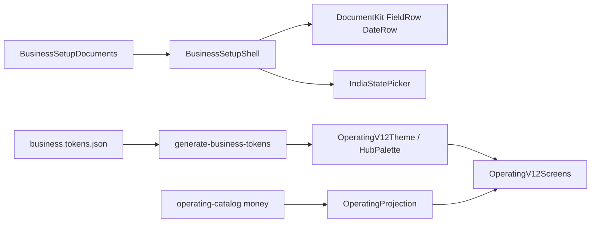

# Setup Fixes + Trading Hub Figma Parity

> **For agentic workers:** REQUIRED SUB-SKILL: Use superpowers:subagent-driven-development (recommended) or superpowers:executing-plans to implement this plan task-by-task. Steps use checkbox (`- [ ]`) syntax for tracking.

**Goal:** Make all 9 Business Setup flows usable (live ₹ grouping, readable calendar, metric chips, GST state search) and ship Trading populated Pulse/Moments/Life/Memory/Quick Add with emerald `#10B981` per-screen tokens and Indian-grouped money (max 2 decimals).

**Architecture:** Setup fixes land once in DocumentKit + Shell so every subtype inherits them. Money formatting is a shared client helper (`OperatingV12Money.amount` / iOS twin) plus backend `money()`/`trimNumber` capped at 2 decimals with `en-IN` grouping for display strings. Trading UI parity ports Android [`OperatingV12Screens.kt`](apk/app/src/main/java/com/example/momentra/ui/shell/business/shared/OperatingV12Screens.kt) + [`OperatingV12Kit.kt`](apk/app/src/main/java/com/example/momentra/ui/shell/business/shared/OperatingV12Kit.kt) into SwiftUI under `BusinessOperating/`, driven by regenerated tokens from [`design/tokens/business.tokens.json`](design/tokens/business.tokens.json) with a new `screens.{pulse,moments,life,memory,quickAdd}` layer under `color.domain.trading` (and stubs for other domains later).

**Tech Stack:** Kotlin Compose, SwiftUI, Node token generator (`tools/design-pipeline/generate-business-tokens.mjs`), backend TypeScript (`operating-catalog.ts`, `operating-board-metrics.ts`, `operating-widget-engine.ts`).

**Spec:** User request (Nov 23) + decisions: money = `grouped_everywhere` (`₹90,00,000`, `₹86,000.50`); parity = `port_android`; tokens = per-screen Trading blocks. Figma frames: `TRD-PULSE-v12` `5:15203`, `TRD-MOMENTS-v12` `5:15516`, `TRD-LIFE-v12` `5:15807`, `TRD-MEMORY-v12` `5:16107`, `TRD-QA-v12`. Also save a copy to [`docs/superpowers/plans/2026-11-24-setup-fixes-and-trading-hub-figma.md`](docs/superpowers/plans/2026-11-24-setup-fixes-and-trading-hub-figma.md) when execution starts.

## Global Constraints

- Android + iOS lockstep for setup; Trading V12 port is iOS-first against Android as SoT (Android already has screens; fix money + tokens on both).
- All 9 subtypes: `CLIENT_CAMPAIGN`, `OWN_BUSINESS_CAMPAIGN`, `TRADING_WHOLESALE`, `DISTRIBUTION_DEALERSHIP`, `RETAIL_STORE`, `RESTAURANT_FOOD`, `CONSUMER_SERVICE`, `STANDARD_PRODUCTION`, `MADE_TO_ORDER`.
- Money display: Indian grouping (`##,##,###.##`), max 2 fraction digits; strip commas on submit (existing `positiveAmount` already strips `,`).
- Trading accent must be emerald `#10B981` / soft `#34D399` (source JSON already correct; generated Swift/Kotlin still amber — regenerate).
- Do not rewrite non-Trading verticals' populated layouts in this plan (Distribution/Own/Client keep their hubs).
- Date-picker opacity fix is **picker-local** (solid `#101623`); do not make every Business glass sheet opaque.

## Review Focus

- Typing `9000000.5` in Amount fields → display `90,00,000.5` (or `.50` once complete); stored/submitted value still parses after comma strip.
- Date picker over a long setup form: calendar digits readable; underlying section cards do not bleed through.
- GST state search by `"27"` and `"maha"` both find Maharashtra; row shows name + code; preference stores **name** not code.
- Backend `money(940000)` no longer emits `940000.0000`; clients never show 4dp leftovers on Trading tiles.
- Trading Moments/Memory use `#151D2E` surface tokens while Pulse keeps `#111827` pulse surface — wrong token would reintroduce amber or flat wrong canvas.

## File map

| Area | Files |
|------|-------|
| Live amount + opaque calendar | [`BusinessSetupDocumentKit.kt`](apk/app/src/main/java/com/example/momentra/ui/shell/business/setup/BusinessSetupDocumentKit.kt), [`BusinessSetupDocumentKit.swift`](momentra/momentra/Shell/BusinessSetup/BusinessSetupDocumentKit.swift); move helpers from [`BusinessSetupWizardContent.kt`](apk/app/src/main/java/com/example/momentra/ui/shell/empty/business/BusinessSetupWizardContent.kt) `formatIndianAmount` / `plainAmount` |
| Target metric chips | [`BusinessSetupDocuments.kt`](apk/app/src/main/java/com/example/momentra/ui/shell/business/setup/BusinessSetupDocuments.kt) / [`.swift`](momentra/momentra/Shell/BusinessSetup/BusinessSetupDocuments.swift); alias maps in [`OperatingSetupPayloadBuilder`](apk/app/src/main/java/com/example/momentra/ui/shell/business/setup/OperatingSetupPayloadBuilder.kt) + [`operating-catalog.ts`](backend/typescript/src/modules/business/operating-catalog.ts) |
| GST state sheet | Shell wiring in [`BusinessSetupShell.kt`](apk/app/src/main/java/com/example/momentra/ui/shell/business/setup/BusinessSetupShell.kt) / [`.swift`](momentra/momentra/Shell/BusinessSetup/BusinessSetupShell.swift); reuse [`IndiaStateSheet`](apk/app/src/main/java/com/example/momentra/ui/shell/business/shared/IndiaStatePicker.kt); extract iOS `SetupStatePickerSheet` from stale [`BusinessSetupWizardView.swift`](momentra/momentra/Shell/BusinessEmpty/BusinessSetupWizardView.swift) into `BusinessSetup/` then delete stale wizard |
| Money 2dp + grouping | `OperatingV12Money` in Kit (Android) + new iOS twin; backend `money()` in catalog/widget-engine/manufacturing → `toFixed(2)` + display `toLocaleString('en-IN', { maximumFractionDigits: 2 })` where user-facing |
| Tokens | [`business.tokens.json`](design/tokens/business.tokens.json) + [`generate-business-tokens.mjs`](tools/design-pipeline/generate-business-tokens.mjs) → regenerate Swift/Kotlin |
| Trading hub | Android: theme reads generated tokens; iOS: new `OperatingV12Kit.swift` + `OperatingV12Screens.swift`, route Trading from [`OperatingMomentHubView`](momentra/momentra/Shell/BusinessOperating/OperatingMomentHubView.swift) |



---

### Task 1: Live Indian amount formatting in setup Amount fields

**Files:**
- Create: `apk/app/src/main/java/com/example/momentra/ui/shell/business/setup/BusinessSetupAmountFormatting.kt`
- Create: `momentra/momentra/Shell/BusinessSetup/BusinessSetupAmountFormatting.swift`
- Modify: DocumentKit `FieldRow` on both platforms — when `helper == "Amount"` (or `"Amount / count"` for marketing target), format on change
- Test: `apk/.../setup/BusinessSetupAmountFormattingTest.kt`, `momentra/momentraTests/BusinessSetupAmountFormattingTests.swift`

**Interfaces:**
- Produces: `plainAmount(raw: String) -> String`, `formatIndianAmount(raw: String) -> String` (same algorithm as existing wizard helpers: strip non-digits except one `.`, Indian group integer part, keep at most 2 fraction digits — change `.take(3)` / frac cap from 2 chars after dot including `.` so max 2 decimals)

- [ ] **Step 1: Write failing tests**

```kotlin
@Test fun formatsIndianGroupingWhileTyping() {
  assertEquals("90,00,000", formatIndianAmount("9000000"))
  assertEquals("86,000.5", formatIndianAmount("86000.5"))
  assertEquals("86,000.50", formatIndianAmount("86000.50"))
  assertEquals("86,000.50", formatIndianAmount("86000.509")) // clamp to 2dp
}
```

Mirror on iOS with `#expect`.

- [ ] **Step 2: Run tests — expect FAIL** (symbols missing / wrong clamp)

- [ ] **Step 3: Implement helpers + wire FieldRow** so Amount fields call `formatIndianAmount` in `onValueChange` / binding setter; keep non-Amount fields unchanged

- [ ] **Step 4: Run tests — expect PASS**

- [ ] **Step 5: Commit** `fix(setup): live Indian amount grouping on Amount fields`

---

### Task 2: Opaque date picker sheet

**Files:**
- Modify: Android `DateRow` in DocumentKit — `DatePickerDefaults.colors(containerColor = Color(0xFF101623))` (not `Transparent`); ensure sheet content column has solid `Color(0xFF101623)` behind picker
- Modify: iOS `DateRow` sheet — replace clear/`BusinessGlassSheetPanel` glass for this sheet with solid `Color(hex: "#101623")` background; keep cancel/OK toolbar
- Test: manual smoke (no unit test for opacity); add a one-line comment + optional Compose screenshot note in smoke checklist

- [ ] **Step 1: Implement solid calendar backing on Android + iOS**

- [ ] **Step 2: Smoke** — open `planMonth` / `startDate` on Trading setup; calendar digits readable over section cards

- [ ] **Step 3: Commit** `fix(setup): solid date picker background`

---

### Task 3: Target-metric choice chips for all 9 setups

**Files:**
- Modify: `BusinessSetupDocuments` both platforms — change every `text("targetMetric", …)` to `choice("targetMetric", …, options)`
- Modify: payload + catalog aliases for new labels
- Test: extend `BusinessSetupFieldModelTest` / iOS twin; `OperatingSetupPayloadBuilderTest`; backend preference normalize test

**Exact chip sets (store label as written; map on submit):**

| Subtype | Options |
|---------|---------|
| `CLIENT_CAMPAIGN` | Leads, Reach, Clicks, Sales, Client billing, Custom |
| `OWN_BUSINESS_CAMPAIGN` | Leads, Reach, Clicks, Attributed sales, Engagements, Custom |
| `TRADING_WHOLESALE` / `DISTRIBUTION_DEALERSHIP` / `RETAIL_STORE` / `RESTAURANT_FOOD` | Revenue, Orders, Count |
| `CONSUMER_SERVICE` | Revenue, Appointments, Count |
| `STANDARD_PRODUCTION` / `MADE_TO_ORDER` | Invoiced value (or accepted job units), Production output, Delivery count, Orders |

**Alias map (payload + `operating-catalog.ts` normalize):**
- Client billing → `CLIENT_BILLING`
- Attributed sales / Sales → `REVENUE`
- Engagements / Clicks → `ENGAGEMENT`
- Appointments → `ORDERS` (or add `APPOINTMENTS` only if catalog already accepts it — prefer map to `CUSTOM_COUNT` if orders-only set; **decision:** map Appointments → `CUSTOM_COUNT` and keep catalog `targetMetrics` as-is for service, **or** extend service `targetMetrics` to include a dedicated code — prefer extend normalize: `appointments` → treat as custom count label stored as `CUSTOM_COUNT` while UI shows Appointments)
- Count / Custom → `CUSTOM_COUNT`
- Existing manufacturing / marketing maps stay

- [ ] **Step 1: Failing tests** asserting each of 9 specs has `Kind.Choice` for `targetMetric` with exact option lists; payload maps `"Client billing"` → `CLIENT_BILLING`, `"Count"` → `CUSTOM_COUNT`, `"Appointments"` → `CUSTOM_COUNT`

- [ ] **Step 2: Run — FAIL**

- [ ] **Step 3: Update documents + mappers + backend normalize block (~L824)**

- [ ] **Step 4: Run — PASS**

- [ ] **Step 5: Commit** `feat(setup): target metric chips for all 9 verticals`

---

### Task 4: GST state searchable sheet

**Files:**
- Modify: Shell field dispatch — when `field.key == "gstState"` (helper `"State"`), render picker row opening sheet instead of `FieldRow`
- Android: reuse `IndiaStateSheet(selected, theme: OperatingSheetTheme derived from BusinessSetupTheme, …)`; store `state.name` on pick; show `"\(name) · \(code)"` in row
- iOS: move `SetupStatePickerSheet` into `momentra/.../BusinessSetup/SetupStatePickerSheet.swift` themed with `BusinessSetupTheme`; delete or gut stale [`BusinessSetupWizardView.swift`](momentra/momentra/Shell/BusinessEmpty/BusinessSetupWizardView.swift) if it still compiles via filesystem sync and references broken APIs
- Test: extend India state catalog tests if needed; field-model unchanged

- [ ] **Step 1: Wire Android gstState → IndiaStateSheet**

- [ ] **Step 2: Extract + wire iOS SetupStatePickerSheet; remove stale wizard file if it breaks the target**

- [ ] **Step 3: Smoke** — search `27` and `maha`; selecting Maharashtra writes name; code visible on row

- [ ] **Step 4: Commit** `feat(setup): searchable GST state picker with GSTIN codes`

---

### Task 5: Populated money — Indian grouping, max 2 decimals

**Files:**
- Modify: Android `OperatingV12Money.amount` / add `grouped(amount, currency)` using `NumberFormat` `Locale("en","IN")` max 2 fraction digits + ₹ prefix for INR; route tile/row amount displays that need full grouping through `grouped` (per user `grouped_everywhere`); keep `compact` only if a call site still needs L/k — default Trading amount paths to `grouped`
- Create: iOS `OperatingV12Money` with `grouped` + `compact`; use in hub / V12 port
- Modify: backend `money()` in [`operating-catalog.ts`](backend/typescript/src/modules/business/operating-catalog.ts) L1559, [`operating-widget-engine.ts`](backend/typescript/src/modules/business/operating-widget-engine.ts) L80, manufacturing local `money` → `toFixed(2)`; board metrics already use `en-IN` — keep
- Test: Android unit for `OperatingV12Money`; backend assert `money(940000) === '940000.00'` or grouped display helper; iOS XCTest

**Pinned examples:** `940000` → `₹9,40,000` or `₹9,40,000.00`; `86000.5` → `₹86,000.50`; never `…0000` 4dp.

- [ ] **Step 1: Failing money tests (Android + backend + iOS)**

- [ ] **Step 2: Implement helpers + switch call sites on Trading screens / hub metrics**

- [ ] **Step 3: Run tests — PASS**

- [ ] **Step 4: Commit** `fix(money): Indian grouping with 2 decimal max on populated surfaces`

---

### Task 6: Per-screen Trading design tokens + regenerate emerald

**Files:**
- Modify: [`design/tokens/business.tokens.json`](design/tokens/business.tokens.json) — under `color.domain.trading` add:

```json
"screens": {
  "pulse": { "canvas": "#090D16", "surface": "#111827", "heroStart": "#6EE7B7", "heroEnd": "#10B981" },
  "moments": { "canvas": "#090D16", "surface": "#151D2E", "heroStart": "#34D399", "heroEnd": "#10B981" },
  "life": { "canvas": "#090D16", "surface": "#151D2E", "heroStart": "#34D399", "heroEnd": "#10B981" },
  "memory": { "canvas": "#090D16", "surface": "#151D2E", "heroStart": "#10B981", "heroEnd": "#059669" },
  "quickAdd": { "canvas": "#090D16", "surface": "#151D2E", "sheetSurface": "#101623", "heroStart": "#10B981", "heroEnd": "#059669" }
}
```

Keep domain-level `accent`/`accentSoft` as `#10B981`/`#34D399`.
- Modify: [`generate-business-tokens.mjs`](tools/design-pipeline/generate-business-tokens.mjs) to emit nested screen colors as `tradingPulseSurface`, `tradingMomentsSurface`, etc. (flatten `screens.<tab>.<token>` → `trading` + Pascal(tab) + Pascal(token))
- Run: `cd tools/design-pipeline && npm run business-tokens`
- Modify: `OperatingV12Theme.trading()` and iOS `HubPalette` / new kit to read generated tokens (no hardcoded amber)
- Test: `business-tokens:check`; Android/iOS token assertion tests if present (`BusinessTokensObsidianTest` / theme tests)

- [ ] **Step 1: Extend JSON + generator; add failing check that tradingAccent is `#10B981` and `tradingPulseSurface` exists**

- [ ] **Step 2: Regenerate; wire themes**

- [ ] **Step 3: Commit** `feat(tokens): Trading per-screen emerald palettes`

---

### Task 7: Port Trading V12 screens to iOS + align Android money/tokens

**Files:**
- Create: `momentra/momentra/Shell/BusinessOperating/OperatingV12Kit.swift` (chrome, money, theme, tiles, rows, heroes — mirror Kit.kt)
- Create: `momentra/momentra/Shell/BusinessOperating/OperatingV12Screens.swift` (Pulse/Moments/Life/Memory — mirror Screens.kt)
- Modify: `OperatingMomentHubView` — when `isTradingWholesale`, render V12 screens for pulse/moments/life/memory instead of generic widget/board fallback; Quick Add keeps existing typed flow but palette from `tradingQuickAdd*` tokens
- Modify: Android `OperatingV12Theme.trading()` surfaces from generated per-screen tokens where the active tab is known (or keep kit defaults that match Pulse/Moments sampled values already in `OperatingV12.pulseSurface` / `surface`)
- Test: compile iOS target if available; Android unit tests for theme accent; smoke checklist against Figma frames

**Section contract (from Android, do not invent):**
- Pulse: Attention, Target & Budget, Payment Readiness, Finance, Activity, GST (if on)
- Moments: Open Commitments, Orders & Commitments, Stock & Products, People & Network
- Life: Current Business, Buyers & Channels, Money Moving, People & Activity
- Memory: Monthly / Money / Fulfilment / People & Patterns + story CTA

- [ ] **Step 1: Add iOS Kit + Screens skeleton compiling against `OperatingProjectionPayload`**

- [ ] **Step 2: Port Pulse then Moments then Life then Memory (one commit each if large)**

- [ ] **Step 3: Route Trading hub tabs to V12; verify emerald hero + grouped money**

- [ ] **Step 4: Commit** `feat(ios): Trading V12 populated hub port`

---

### Task 8: Smoke + regression

- [ ] **Step 1: Android** `cd apk && ./gradlew :app:testDebugUnitTest --tests '*.BusinessSetup*' --tests '*OperatingV12*' --tests '*IndiaState*' --tests '*BusinessTokens*' -q`

- [ ] **Step 2: Backend** `cd backend/typescript && npm test -- --test-name-pattern='operating|setup|money'` (or full `npm test` if pattern sparse)

- [ ] **Step 3: Manual checklist**
  - Setup Trading: Amount live commas; calendar opaque; metric chips; GST state search
  - Trading Pulse/Moments/Life/Memory: emerald chrome; amounts like `₹9,40,000` / `₹86,000.50`; layout matches Android/Figma sections
  - Confirm other verticals still open setup without crash

- [ ] **Step 4: Final commit** if smoke fixes needed

---

## Self-review notes

- Spec items 1–5 each map to Tasks 1–2, 3, 4, 5, 6–7.
- Appointments→`CUSTOM_COUNT` keeps catalog `targetMetrics` valid without schema migration; UI label remains Appointments.
- Figma compact `₹9.4L` vs user `grouped_everywhere`: **user decision wins** — show full Indian grouping on populated amounts.
- Non-Trading populated parity deferred by design.